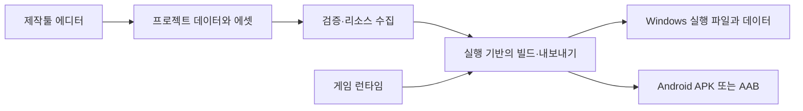
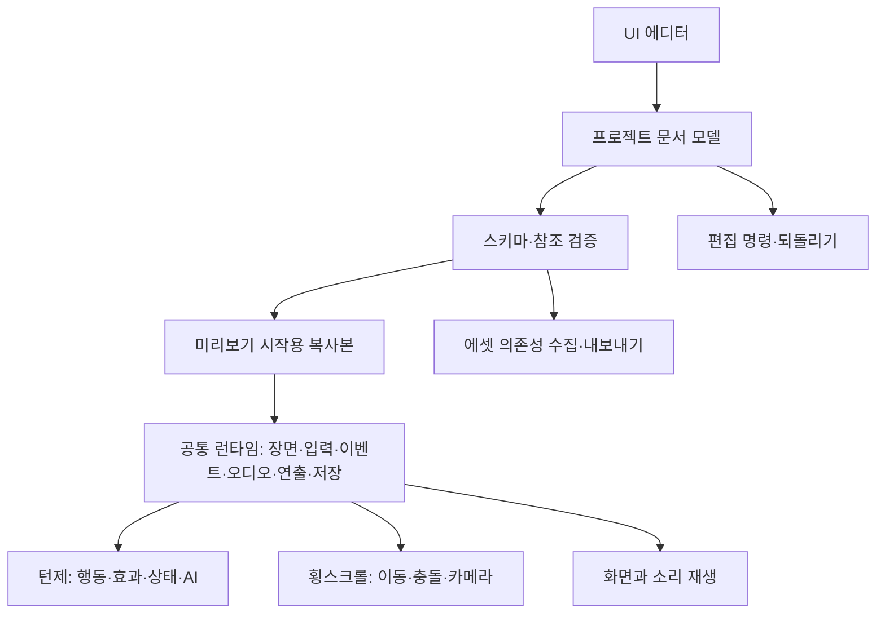

# 게임 제작툴 기초 설계 — RPG Maker 기반 기능과 Unity·Godot의 장점 통합

> **2026-10-27 최신 사용자 확정:** Godot을 실행 기반으로 감싼 툴이 아니라 자체 엔진을 만든다. **C++ 엔진 + Qt 제작 UI + Python 게임 확장 스크립트**를 채택했다. 아래 Godot/Unity/웹 기반 비교·추천은 과거 후보 기록이다. 기능/사용성 조사로 참고하되 새 제품의 구현 기준은 [NARU_NEXT_STEPS.md](NARU_NEXT_STEPS.md)를 우선한다. 개발 기준 폴더는 game_tool, 저장소는 Aristia0930/Naru_Studio다.

상태: 2026-10-26 사용자 방향 반영 설계 초안. 기능 구현 완료나 실행 엔진 최종 채택을 뜻하지 않는다.

## 1. 사용자에게 확인된 목표

**RPG Maker에 있던 제작 기능을 기준으로 삼고, Unity·Godot의 더 나은 기능·작업 방식을 조합하여 UI로 사용하기 편한 새 제작툴을 만든다.** RPG Maker에 없는 기능도 Unity·Godot에 있고 UI로 편하게 제공할 수 있다면 추가 후보에 포함한다. 단순히 RPG Maker와 닮은 화면을 만드는 작업이 아니다.

- 턴제 RPG와 2D 횡스크롤을 모두 지원한다.
- 데이터베이스, 맵·장면, 이벤트, 전투, 음악·효과음, 애니메이션, UI, 저장·불러오기, 게임 내보내기를 함께 설계한다.
- 사용자는 명령 선택, 속성 입력, 드래그 앤 드롭, 미리보기로 콘텐츠를 만든다. 초보자에게 스크립트 입력을 필수로 요구하지 않는다.
- 기존 툴의 코드를 합치거나 UI를 복제하는 방식이 아니라 기능·작업 흐름을 비교해 독립적으로 구현한다.
- 구현 순서는 단계로 나누지만 미구현 기능을 자동으로 최종 제외하지 않는다. 기존 07 문서의 장비·자동 조우 등 제외 목록도 최종 결정으로 사용하지 않는다.
- 게임 「이면기록」의 카드 RPG 설정과 제작툴의 지원 범위를 구분한다. 점프·중력·액션 전투·타일맵·장비 등 개별 규칙과 첫 구현 분량은 아직 확정하지 않았다.

## 2. 무엇이 실행 파일을 만드는가

제작툴 자체와 제작툴로 만든 게임은 서로 다른 실행 결과물이다.



에디터에서 배경·캐릭터·대사·전투·음악을 설정하면 텍스트 데이터와 에셋 참조로 저장된다. 내보내기는 이것을 읽을 런타임과 사용 에셋을 함께 묶는다. `.exe` 하나에 모두 넣을 수도 있고 실행 파일 옆 데이터 폴더를 둘 수도 있다. 최종 배포 형태는 실행 기반과 설정에 따라 다르다.

- Godot 기반이면 프로젝트를 Godot이 실행할 데이터로 변환하고 Godot export를 사용한다. 설치한 에디터만으로 Android 배포 준비가 모두 끝나는 것은 아니며 export templates·SDK·서명 설정이 별도로 필요하다.
- Unity 기반이면 커스텀 에디터와 런타임 데이터를 Unity 빌드로 묶는다. 현재 PC에 Unity가 설치되어 있어도 이 전용툴 프로젝트나 게임 빌드는 아직 없다.
- 웹 기반이면 자체 런타임과 데이터·에셋을 웹으로 만들고 데스크톱·Android용 컨테이너로 패키징한다. 렌더링·물리·애니메이션·빌드 통합 비용을 따로 비교해야 한다.
- 제작툴 자체를 독립 `.exe`로 제공할지, Godot/Unity 안에서 여는 확장 툴로 제공할지도 별도 선택이다.

## 3. 기능 비교와 UI 개선안

다음은 요구사항 후보 목록이다. '기준'은 기능 비교의 출발점이며 세 제품의 구현이 서로 같다는 뜻이 아니다. 이번 직접 검증 범위는 아래 조사 기록에 명시했다.

| 기능 영역 | RPG Maker에서 기준으로 볼 것 | Unity·Godot에서 더할 후보 | 우리 UI 제안 |
|---|---|---|---|
| 프로젝트 | 게임 설정·리소스 관리·테스트 | 장면별 실행, 빌드 프로필 | 새 프로젝트 마법사, 시작 장면, 오류 목록, 실행/중지 |
| 데이터베이스 | 캐릭터·직업·스킬·아이템·장비·적·적 편성·상태·속성 | 공유 데이터 리소스, 타입 있는 속성 | 종류 → 목록 → 상세, 검색·복제·일괄 편집·참조 선택 |
| 맵·장면 | 맵, 레이어, 이벤트 배치, 이동 경로 | 중첩 씬, 자유 배치, 카메라, 충돌체 | 2D 캔버스, 장면 트리, 배치 도구, 격자 켜기/끄기 |
| 재사용 | 공통 이벤트·공통 데이터 | 프리팹/씬 인스턴스·변형 | 캐릭터·대화창·상자를 묶음으로 저장, 원본과 개별 변경 표시 |
| 이벤트 | 조건·분기·반복·변수·스위치·공통 이벤트·대사·선택지 | 오브젝트 이벤트 연결, 타입 검증 | 명령 목록과 입력 폼, 조건 카드, 실행 위치 표시, 중단점 후보 |
| 스토리 | 그림·대화·선택지·화면 전환 | 연출 트랙·보간·동시 재생 | 초반에는 명령 목록, 복잡한 연출은 같은 데이터의 타임라인 뷰 |
| 음악·효과음 | BGM·환경음·효과음·결과 음악 | 오디오 버스·크로스페이드·위치 기반 음향 | 파일 드롭, 미리듣기, 음량·반복·페이드·버스·대기 설정 |
| 애니메이션 | 전투 연출·그림 이동·화면 효과 | 속성 키프레임·스프라이트·상태 전환·이벤트 마커 | 대상 선택 → 재생/편집, 타임라인, 걷기→공격 연결 도식 |
| 카메라·횡스크롤 | 화면 스크롤·이동 이벤트 | 추적·이동 제한·줌·충돌·물리 | 카메라 사각형과 제한 영역을 직접 드래그, 이동 프리셋 |
| 턴제 전투 | 행동 순서·스킬·효과·상태·AI·전투 이벤트 | 데이터 분리·로직 테스트·시각적 디버깅 | 편성 편집, 1턴 실행, 난수 시드·입력 기록, 피해 계산 확인 |
| 게임 UI | 메뉴·상점·아이템·상태·저장 화면 | 앵커·레이아웃·테마·화면 크기 미리보기 | 화면 프리셋, 여백·정렬·기준점, PC/모바일 미리보기 |
| 저장·불러오기 | 진행 상태·변수·소지품·위치 저장 | 버전 있는 데이터·이동 가능한 리소스 참조 | 저장할 상태 목록, 호환성 경고, 테스트 슬롯 |
| 검증·내보내기 | 플레이 테스트·배포 | 에셋 의존성·빌드 프로필·콘솔 | 누락 파일에서 문제 위치로 이동, 내보내기 프리셋·로그 |
| 확장 | 플러그인 명령 | 등록형 컴포넌트·에디터 확장 | 확장 기능이 제공하는 입력 폼, 명령·속성 목록 자동 갱신 |

추가 후보의 채택 기준은 (1) 만들 게임이나 지원 장르에 도움이 되는가, (2) UI로 예측 가능하게 설정할 수 있는가, (3) 미리보기·저장·내보내기에서 같은 결과를 유지할 수 있는가, (4) 구현과 유지보수가 감당 가능한가이다. Rigidbody/컴포넌트 같은 엔진 내부 이름을 초보자의 기본 화면에 그대로 노출할 필요는 없다.

## 4. 기본 화면

```text
상단: 프로젝트 · 저장 · 되돌리기 · 실행/중지 · 게임 내보내기
왼쪽: 장면/맵 · 데이터 · 이벤트 · 에셋 · 애니메이션 · 게임 UI
중앙: 현재 작업에 맞는 목록/2D 배치/이벤트 명령/타임라인
오른쪽: 선택한 대상의 속성 · 참조 파일 · 조건 · 도움말
하단: 미리보기 · 실행 기록 · 오류 · 에셋 사용처
```

모든 기능을 첫 화면에 동시에 늘어놓지 않는다. 데이터 작업은 RPG Maker처럼 목록 중심, 장면 작업은 캔버스 중심으로 전환한다. 같은 선택 대상과 되돌리기 기록을 유지한다. 저장 안 된 편집과 게임 실행 중 상태는 눈에 띄게 구분한다.

예: 배경 이미지 드롭 → 장면에 배치 → 오른쪽에서 크기·정렬 수정 → 이벤트에 `음악 재생`, `대사 표시`, `이미지 이동` 추가 → 현재 장면 재생 → 문제 명령을 로그에서 선택.

## 5. 공통 구조와 장르 기능



공통 부분은 두 장르에서 같은 대사·음악·아이템 정의를 쓴다. 턴제의 턴 시간과 횡스크롤의 물리 시간은 각각 관리한다. 물리 업데이트는 고정 간격, 화면 연출은 표시 시간, 대사 대기는 사용자 입력/완료 이벤트를 사용한다.

이벤트 실행 상태는 `running / waiting / completed / failed / cancelled`를 구분한다. 명령은 타입·입력 폼·실행 함수를 등록한다. 대사 완료, 애니메이션 완료, 오디오 완료를 기다릴 수 있어야 하며 중지 시 대기 작업과 연결을 정리한다. 끝없는 즉시 반복이 편집기를 멈추지 않도록 프레임별 명령 예산을 둔다.

턴제 규칙은 화면 객체에 직접 접근하지 않고 입력과 상태를 받아 결과 이벤트를 만든다. 이것은 MV가 이미 완전히 분리했다는 관측이 아니라 우리 설계에서 개선할 부분이다. MV BattleManager에는 로그 창과 화면 갱신 접근이 남아 있다.

## 6. 음악·애니메이션 제작과 재생

첫 기본형은 외부에서 만든 이미지·음원·스프라이트·애니메이션을 가져와 재생·조절하는 기능이다. 직접 그림을 그리거나 음악을 작곡하는 기능은 별도 후보다.

| 에디터에서 설정 | 저장할 내용 | 런타임 책임 |
|---|---|---|
| BGM 선택·미리듣기·반복·페이드 | 에셋 ID, 버스, 음량, 반복 구간/재생 방식 | 로딩, 재생 위치, 일시정지·정지·페이드 |
| 효과음 삽입 | 에셋 ID, 발생 시점, 음량, 중복 정책 | 재생 인스턴스·완료 알림 |
| 그림/카메라 이동 | 대상 ID, 시작·끝 값, 시간, 보간 방식 | 프레임 시간으로 속성 갱신 |
| 프레임 애니메이션 | 프레임 묶음, 속도, 반복, 이벤트 마커 | 표시 프레임·상태 전환·완료 알림 |
| 동시 연출 | 트랙, 시작 시각, 대기·취소 정책 | 여러 작업의 시작·완료를 조정 |

후보 명령: `audio.play`, `audio.fade`, `audio.stop`, `image.show`, `image.tween`, `animation.play`, `camera.move`, `parallel`, `wait`, `dialogue.say`, `choice.show`, `scene.change`.

예: `BGM 시작 → CG 표시 → 대사 → 실 애니메이션과 효과음 동시 시작 → 애니메이션 완료 대기 → 다음 대사`. 기존 인연의 실 장면에 적용할 수 있지만 실 애니메이션 원본은 아직 미제작이며 색·제작 방식 등 미정 사항을 이번 설계로 확정하지 않는다. 승인 대본과 에셋을 자동으로 수정하지 않는다.

스켈레톤 애니메이션, 파티클, 영상, 복잡한 오디오 믹서는 후보로 남긴다. 지원 파일 형식·모바일 성능·동기화는 선택한 실행 기반에서 개별 검증한다. 이번 10개 Godot 검증에 음원 재생이나 시각적 애니메이션 검증은 포함되지 않았다.

## 7. 저장 형식과 데이터 경계

프로젝트에는 `formatVersion`, 안정적인 ID, 엔진과 구분되는 의미 있는 필드명을 둔다. 표시 이름·폴더 위치 변경이 ID 변경으로 이어지지 않게 한다.

```text
project.json                 이름·형식 버전·시작 장면·활성 기능
assets/manifest.json         에셋 ID → 프로젝트 내 파일·종류·가져오기 설정
data/characters/*.json       공통 캐릭터 정의
data/skills/*.json           스킬·효과 정의
scenes/*.json                배치 객체·부모 ID·속성·재사용 묶음 참조
events/*.json                명령·분기·트리거
animations/*.json            트랙·키프레임·마커
ui/*.json                    화면·레이아웃·테마
export/*.json                대상·해상도·빌드 프로필
```

위 폴더와 JSON은 자체 포맷 제안이며 Godot `.tscn/.tres`나 Unity 프로젝트와 그대로 호환된다는 뜻이 아니다. Godot을 기반으로 선택하면 네이티브 리소스와 자체 데이터 중 어느 쪽을 원본으로 삼을지 작은 왕복 저장 실험으로 정한다. 변환한 산출물과 편집 원본을 양쪽에서 동시에 수정하지 않는다.

정의 데이터(캐릭터 기본값), 편집 상태(선택·확대 배율), 실행 상태(현재 체력·위치·진행 플래그), 세이브 파일을 분리한다. 세이브에는 프로젝트/형식 버전·정의 ID·변경된 실행 값·이벤트 재개 지점을 기록한다. 현재 음성·전환 도중을 복원할지, 안전한 명령 경계에서만 저장할지도 정해야 한다.

처음부터 필요한 검증: 중복 ID·누락 참조·순환 장면 참조·알 수 없는 명령·잘못된 타입·존재하지 않는 에셋. 저장은 임시 파일 후 교체로 중간 손상을 줄이고, 경로 이동과 삭제 시 사용처를 보여준다.

## 8. 실행 기반 비교 — 추천과 확정 구분

| 후보 | 유리한 점 | 추가로 만들거나 검증할 점 | 현재 판단 |
|---|---|---|---|
| Godot 안의 확장 툴 또는 Godot으로 만든 전용 앱 | 2D·오디오·애니메이션·UI·물리·export 재사용, 공개 소스로 구조 확인 가능 | 초보자용 화면, 데이터베이스·이벤트·턴제, 에디터 확장/독립 앱 선택 | **우선 시제품 후보로 추천**, 최종 채택 전 |
| 설치된 Unity 6000.6.5f1의 커스텀 툴 | 인스펙터·프리팹·애니메이션·Android/WebGL 모듈 | 전용 화면, 프로젝트 준비·시작 시간·배포 워크플로 실측 | 비교 후보 유지 |
| 웹 에디터 + 자체 런타임 | 자유로운 목록·폼 UI, 브라우저 접근 | 2D 물리·애니메이션·오디오·에셋·내보내기 통합 | 이전 제안 유지, 자동 채택하지 않음 |

추천 근거는 필요한 2D 기반을 이미 갖췄고 이번 작은 실행 검증이 통과해 다음 실험 비용이 낮다는 것이다. 이것만으로 전체 에디터 UX·Android 빌드·성능이 우수하다고 확정할 수는 없다. RPG Maker 기반이라는 말은 기능과 제작 흐름의 기준을 뜻하며 실행 엔진 선택과는 독립적이다.

## 9. 첫 구현과 검증 순서 제안

1. **편집→저장→재로드→실행의 최소 연결:** 프로젝트 열기, 장면/데이터 목록, 이미지 배치, 속성 편집, 되돌리기, 이벤트 목록, 대사·BGM·그림 이동의 미리보기. 임시 연구용 데이터로 검증하고 승인 대본을 덮어쓰지 않는다.
2. **횡스크롤 연결:** 같은 프로젝트에서 캐릭터 이동·벽 충돌·카메라 추적·구역 이벤트. 점프·중력 규칙은 별도 채택한다.
3. **턴제 연결:** 같은 캐릭터/스킬 정의로 편성·행동·피해·상태·결과 이벤트를 검증한다. 규칙은 연구용 임시값이며 게임 기획 확정으로 기록하지 않는다.
4. **초기 배포 점검:** 작은 Windows 게임과 Android 테스트 패키지로 경로·에셋·해상도·입력·오디오를 일찍 확인한다. Android 검증을 모든 기능 구현 뒤까지 미루지 않는다.
5. 이후 기능표의 나머지를 우선순위별로 확대한다. 맵·장비·상점·전투 옵션·타임라인 등의 후보와 완료 상태를 계속 관리한다.

최소 연결의 통과 기준은 재실행 후 데이터가 유지되고, 편집→되돌리기가 동작하며, 미리보기를 중지하면 음원·애니메이션·이벤트 작업이 남지 않고, 누락 에셋 오류가 원래 편집 위치로 연결되는 것이다. 이 기능들은 아직 구현 전이다.

## 10. 이번 조사 결과와 남은 확인

- Godot 4.7.2 Windows 배포본 다운로드와 공식 제공 SHA-256 대조 완료. 핵심 소스는 동일 커밋의 일부 파일만 수집했다.
- Godot headless 검증 10개 통과, 종료 코드 0, 최종 stderr 비어 있음. 씬 저장/재로드, 소유권, 두 인스턴스 독립, 시그널 연결·해제, 리소스 저장/재로드, 수평 이동·벽 충돌, 카메라 부착을 확인했다. 카메라 화면 추적이나 시각적 렌더링까지 검증한 것은 아니다.
- REA로 MV 코어 4개 파일 재분석. 파싱 실패 0, AST 15,191개. 나머지 183개 인벤토리 파일과 동적 호출 관계는 미검증이다.
- Ghidra 12.1.4로 Godot 콘솔 래퍼 3개 함수의 의사 코드를 얻고 실행·종료 처리 흐름을 확인했다. Godot 에디터 본체 전체를 디컴파일한 것은 아니다.
- 설치된 Unity 버전·모듈과 공식 6.6 문서로 인스펙터·프리팹·공유 데이터 기능을 비교했다. Unity GUI 사용성 실측·프로젝트 실행·빌드는 아직 하지 않았다.
- 남은 것: 전용 에디터 UI 시제품, 실제 음악·애니메이션 재생과 중지, 입력·카메라 시각 검증, Android export, 기반 엔진 비교 후 최종 선택.

근거 문서: [Godot](analysis/godot/README.md), [RPG Maker 재조사](analysis/rpgmaker/08_REA_재조사.md), [Unity](analysis/unity/README.md), [소스 관측 기록](analysis/foundation/source-observations.json).
