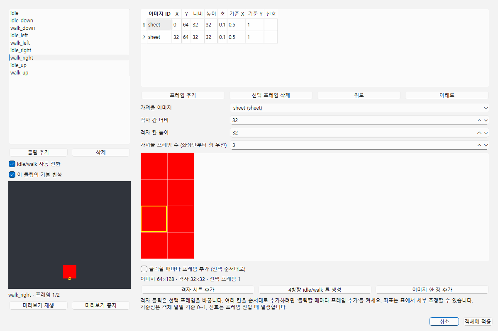
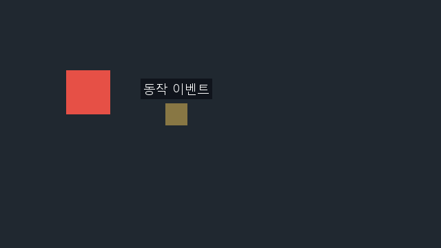

# 캐릭터 애니메이션

객체 인스펙터의 **애니메이션 편집...**에서 idle·walk·attack 등 이름 있는 클립과 프레임을 만듭니다. 도트·일러스트에 같은 규칙을 쓰며 충돌/조사 사각형은 기존 객체 크기를 유지합니다. 현재 클립 묶음은 객체별로 저장하며 독립된 공용 애니메이션 에셋 라이브러리와 DB 복합값/스킬 참조는 후속입니다.

## 1. 프레임과 클립 편집

먼저 에셋 목록에 PNG/JPG/BMP 이미지를 추가하고 객체를 선택합니다. **애니메이션 편집... → 클립 추가**에서 영문·숫자·밑줄·하이픈 이름을 지정합니다. 객체당 최대 256클립, 클립당 1~4096프레임입니다.



| 입력/조작 | 기본값·규칙 |
|---|---|
| 프레임 이미지 ID | 등록한 이미지 에셋 ID. 다른 종류·누락 파일·이미지 밖 자르기 영역은 적용을 막음 |
| X/Y/너비/높이 | 원본 이미지의 픽셀 영역. X/Y는 0 이상, 너비/높이 1~16384 |
| 초 | 기본 0.1, 0.01~60. 프레임별 표시 시간 |
| 기준 X/Y | 기본 0.5/1. 0~1 비율. 객체 발밑 중앙에 기준점을 맞춤 |
| 신호 | 최대 64바이트의 이름. 해당 프레임 진입 때 한 번 발생 |
| 기본 반복 | 자동 idle/walk와 편집기 미리보기의 반복 여부. 명시적 play/이벤트는 별도 반복 옵션 사용 |
| idle/walk 자동 전환 | 기본 켬. 멈추면 idle, 실제로 이동하면 walk. 벽에 막혀 제자리면 idle |
| 격자 시트 추가 | 이미지·칸 너비/높이·프레임 수 지정. 좌상단부터 행 우선으로 현재 클립에 추가 |
| 이미지 격자 클릭 | 가져올 이미지와 격자 칸 너비/높이를 정하면 원본에 격자가 표시됨. 표에서 프레임을 선택하고 칸을 클릭하면 그 프레임의 이미지 ID·X/Y·너비/높이를 변경. **클릭할 때마다 프레임 추가**를 켜면 클릭 순서대로 새 프레임 추가. 마지막 불완전 칸은 선택 불가 |
| 4방향 틀 | 이미지가 아래·왼쪽·오른쪽·위 순서 4행이어야 함. idle은 각 행 첫 칸, walk는 행별 지정 수(열 수까지)로 8클립 생성. 같은 이름이 있으면 거부 |
| 이미지 한 장 추가 | 선택 이미지 전체를 한 프레임으로 추가. 이미지를 바꾸어 반복하면 낱장 프레임 구성 |
| 아틀라스 | 프레임 표에서 각각의 이미지 ID와 사각형을 직접 지정. 외부 아틀라스 메타데이터 파일 자동 해석은 미지원 |
| 프레임 위로/아래로·삭제 | 프레임을 신호·시간·기준점과 함께 이동/삭제 |

이미지 위 노란 테두리는 표에서 선택한 프레임 영역입니다. 격자 크기 변경은 안내선만 즉시 바꾸며 기존 프레임 좌표는 유지합니다. 큰 이미지는 이미지 영역을 스크롤해 선택합니다. 클립을 바꾸면 표의 편집값을 해당 클립의 작업 사본에 보존합니다. **객체에 적용**은 모든 클립과 이미지 영역을 검사한 뒤 객체에 반영하고 한 번 Undo로 되돌립니다. 취소는 객체를 바꾸지 않습니다. 프로젝트 저장은 Ctrl+S로 별도 수행합니다. 사용 중인 프레임 이미지 삭제는 막고, 에셋 ID 변경/Undo는 프레임 참조도 갱신합니다.

표시 배율·회전·투명도·필터·뒤집기·순서는 기존 객체 이미지 설정을 함께 사용합니다. 너비/높이를 0으로 두면 각 프레임의 자른 크기를 사용합니다. 애니메이션 기준점은 객체 발밑 중앙에 기존 이미지 오프셋을 더한 위치입니다. 기준점을 맞추면 크기가 다른 프레임도 발 위치를 유지합니다. 장면 캔버스는 idle 첫 프레임, 편집기 미리보기와 실제 게임은 엔진 고정 틱 재생입니다.

## 2. 자동 동작과 한 번 재생

이동/방향은 게임 기본 조작·이벤트 이동·Python obj.move 모두에서 갱신합니다. idle_down, walk_right처럼 현재 방향 접미사 클립을 먼저 찾고 없으면 idle/walk를 찾습니다. 8방향 전용 자동 선택은 현재 미지원입니다. 평소 클립이 없으면 기본 이미지/색으로 표시합니다.

**객체 애니메이션** 이벤트의 대상은 이 객체/플레이어/장면 객체입니다. 동작 이름 기본 attack, 한 번 재생, 이동 잠금 끔, 완료 대기 켬입니다. 반복+완료 대기는 거부합니다. 중지 옵션은 명시적 재생을 종료하고 잠금을 해제합니다. 실제 게임에서만 재생하며 F6는 로그만 남깁니다. [이벤트 입력·오류·중지](EVENTS.md#객체-애니메이션-object_animation).

명시적 재생은 자동 동작보다 우선합니다. 같은 객체의 새 재생이 이전 동작을 대체하며 이전 동작을 기다리던 이벤트는 다음 틱에 진행합니다. 한 번 재생이 끝나면 잠금을 해제하고 idle로 복귀한 뒤 다음 이동 틱에서 walk를 선택합니다. 이동 잠금은 기본 조작·obj.move를 막고 기존 이동 경로는 잠시 기다립니다. 위치 직접 대입은 순간 배치이므로 잠금을 우회합니다.

F8은 명시적 동작·이동 경로·대기 이벤트·신호를 정리합니다. 자동 idle/walk와 전역 훅은 계속 동작하며 조건이 맞는 반복 이벤트는 다시 시작할 수 있습니다. 장면 이동/게임 종료는 이전 객체의 재생·신호를 버리고 장면 정의에서 새로 시작합니다. 숨긴 객체도 재생 시간은 진행됩니다. 실행 사본은 원본 클립을 바꾸지 않습니다.

## 3. Python 연결

게임 프로젝트의 scripts/animation_controls.py에 아래처럼 작성하고 **전역 스크립트**에 등록하면 Ctrl+R에서 호출됩니다. F5/F6에서는 ctx.scene이 None입니다. time.sleep으로 게임을 멈추지 않습니다.

```python
def on_game_start(ctx):
    ctx.input.bind("attack", ["X"])


def on_update(ctx):
    if ctx.scene is None:
        return
    hero = ctx.scene.object("hero")
    if hero is not None and ctx.input.pressed("attack"):
        hero.play("attack", lock=True)
    for signal in ctx.scene.animation_signals():
        if signal["signal"] == "hit":
            ctx.log("공격 프레임: " + signal["object"])
```

play는 양의 정수 재생 번호를 돌려주며 없는 클립은 ValueError입니다. hero.is_animating()은 명시적 동작 진행 여부, hero.stop_animation()은 중지 후 None입니다. animation_signals는 object/clip/signal/frame(0부터) 사전의 목록을 소비합니다. 전역 한 곳에서 읽어 각 기능에 전달하세요. 같은 프레임에 머무는 동안 중복 신호를 내지 않고, 반복하면 회차마다 다시 발생합니다. 첫 프레임 신호는 play 때, 이후는 틱 끝에서 발생하여 다음 on_update에서 읽습니다. 최대 256개로 넘치면 오래된 신호부터 버리고 경고를 남깁니다. [API 전체 계약](../SCRIPT_API.md#캐릭터-애니메이션-순서-12).

## 4. 실행 예제와 수동 확인



```powershell
python tools/create_animation_example.py build/manual-animation
& .\build\windows-msvc\bin\NaruStudio.exe build/manual-animation
```

기존 폴더는 덮어쓰지 않습니다. 이번 확인용으로 준비된 `build/manual-animation-check-b`를 열면 B 반복 동작을 바로 시험할 수 있습니다. 이전에 만든 사본에는 새 스크립트가 자동 반영되지 않습니다. 제공된 예제는 자체 생성한 색상 프레임이며 에셋은 assets/sheet.png와 pose.png, 완성 연결 코드는 scripts/animation_controls.py입니다.

1. hero 선택 → 애니메이션 편집. idle/walk 4방향과 attack/cast/victory/atlas 클립을 선택해 재생합니다. 프레임 시간·영역·신호를 바꾸어 미리보기하고 취소 시 원본 유지, 적용 후 Undo/Redo·저장/재열기를 확인합니다.
2. Ctrl+R → 방향키로 이동하면 빨강/초록/파랑 프레임이 바뀌고, 멈추면 빨간 idle로 돌아와야 합니다. 그림 배율과 충돌 크기가 분리되어야 합니다.
3. X 공격 중 이동이 잠기고 초록 프레임의 hit 로그가 한 회에 한 번 나와야 합니다. 종료 후 이동이 복구되고 idle/walk로 돌아와야 합니다. C는 키가 큰 낱장 pose, V는 중지입니다.
4. 표지판 앞에서 결정 키로 조사하면 플레이어 attack이 끝난 뒤 대사가 나와야 합니다. 같은 이벤트를 F6으로 시험하면 실제 재생 없이 다음 명령으로 진행합니다.
5. 게임 창에서 B를 누르면 빨강/노랑 프레임이 반복되고 방향키 이동이 잠깁니다. V를 누르면 반복이 끝나고 이동이 다시 됩니다. 제작툴 로그에 V 중지 결과가 표시됩니다. 다시 B를 누른 뒤 F8을 눌러도 반복과 잠금이 해제되는지 확인합니다. 또 B를 누른 뒤 C를 누르면 노란 시전으로 교체되고 종료 후 이동이 복구됩니다. F8 자체에 V 로그가 나오는 것은 아닙니다. 이 예제에는 다른 장면이 없으므로 장면 재진입과 신호 폐기는 별도 두 장면 프로젝트에서 확인합니다.
6. 잘못된 프레임 시간·중복 클립·이미지 범위·누락 에셋 입력을 적용하면 차단되어야 합니다. 사용 중 이미지 제거 차단·ID 변경/Undo·저장/재열기를 확인합니다.

사용자 수동 결과는 아직 미확인입니다. 본/Spine·외부 아틀라스 파일·스킬 전투 판정·이펙트·공용 클립 라이브러리는 이번 기능에 포함되지 않습니다. 그림 재촬영은 NARU_ANIMATION_SCREENSHOT을 그림의 절대 경로로 지정하고 naru_asset_editor_tests.exe를 실행합니다.
