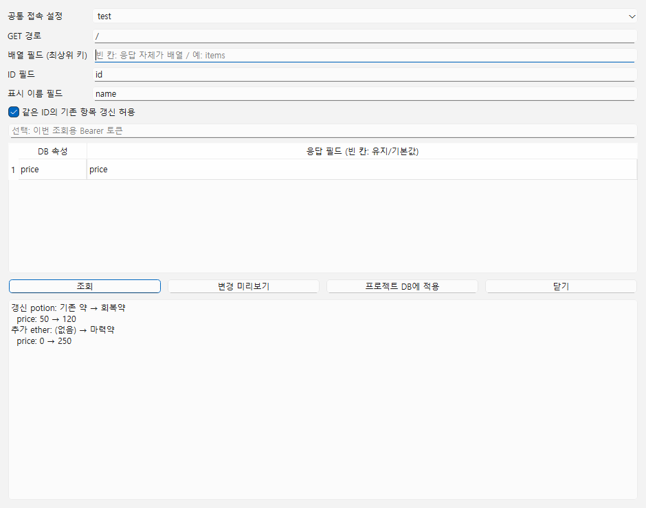
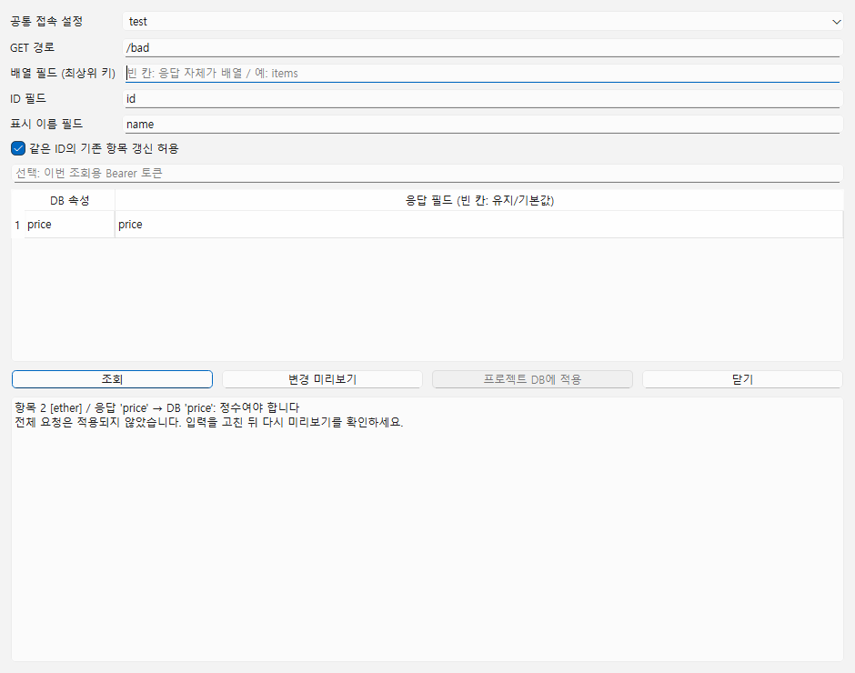

# API 데이터 가져오기

제작툴의 **데이터베이스 → 데이터 종류 선택 → API에서 가져오기...**에서 HTTPS JSON 응답을 해당 종류의 항목으로 가져옵니다. 외부 DB 직접 연결은 제공하지 않습니다. Windows 전송이며 로컬 검증 서버만 HTTP를 허용합니다.

[나중에 수행할 수동 테스트 모음](MANUAL_TESTS.md)에 준비부터 정상/오류/취소까지 결과 기록표를 제공합니다. 오류 그림 재촬영은 `NARU_IMPORT_ERROR_SCREENSHOT`에 그림의 절대 경로를 지정하고 편집기 검사 실행 파일을 실행합니다.

## 입력과 실행

먼저 DB 종류와 속성을 정의하고 **게임 → 네트워크 접속 설정...**에서 서버를 등록합니다. [서버 등록](NETWORK_EVENTS.md#1-서버-등록)을 참고하세요.

| 입력 | 기본값과 규칙 |
|---|---|
| 공통 접속 설정 | 등록한 서버 중 첫 항목. 주소·공통 헤더·제한 시간을 재사용 |
| GET 경로 | `/`. 쿼리 문자열을 포함할 수 있음 |
| 이번 조회용 Bearer 토큰 | 선택. 화면에서는 가리고 해당 창에서만 사용. 프로젝트·로그에 저장하지 않음 |
| 배열 필드 | 빈 칸이면 응답 자체가 배열. `items`이면 최상위 `items` 배열 사용 |
| ID / 표시 이름 필드 | `id` / `name`. 모두 문자열. ID는 영문·숫자·밑줄·하이픈으로 구성한 유효한 DB ID, 이름은 공백만 사용할 수 없음 |
| 같은 ID 갱신 허용 | 기본 꺼짐. 켜면 해당 항목의 이름과 연결한 속성만 갱신 |
| DB 속성 → 응답 필드 | 기본은 속성 키와 같은 최상위 응답 필드. 빈 칸이면 기존 값 유지, 새 항목은 DB 기본값 사용 |

1. **조회**를 누릅니다. 창은 응답을 기다리는 동안 계속 동작하며 프로젝트는 변경되지 않습니다. 다시 조회할 때 이전 응답은 버립니다.
2. **변경 미리보기**를 누릅니다. 추가/갱신할 ID와 이름·속성의 변경 전후 값을 확인합니다.
3. 형식·범위·선택지·참조 오류, 필드 누락, 응답 내 중복 ID, 허용하지 않은 기존 ID 충돌이 있으면 전체 적용을 막습니다. 같은 응답의 항목끼리 참조할 수 있습니다. 선택한 종류의 기존 참조 오류도 먼저 고쳐야 합니다.
   오류에는 1부터 시작하는 응답 항목 번호·ID·응답 필드와 DB 속성, 구체적인 이유를 표시합니다. 예: `항목 2 [ether] / 응답 'price' → DB 'price': 정수여야 합니다`. DB 참조 검사는 `종류/항목.속성` 위치를 표시합니다. 오류가 난 항목만 건너뛰지 않고 전체 적용을 차단합니다.
4. **프로젝트 DB에 적용**을 누릅니다. 한 번의 Undo로 전체를 취소하고 Redo로 복원합니다. 저장 전까지 디스크에는 반영되지 않습니다.

미리보기 후 입력을 바꾸면 다시 미리보기를 해야 합니다. 조회 경로·서버·토큰을 바꾸면 다시 조회해야 합니다. 조회 후 DB가 변경되면 다시 미리보기를 확인해야 합니다. 닫기는 진행 중 요청과 미적용 결과를 폐기합니다. 늦은 응답으로 DB가 바뀌지 않습니다.

최대 응답 1 MiB, 배열 1~10000항목입니다. 중첩 경로·자동 페이지 조회·자동 동기화·삭제·서버 쓰기는 지원하지 않습니다. 정수는 JSON 숫자의 정확도를 위해 ±9007199254740991 범위만 허용합니다. 이미지/소리 필드는 파일 URL이 아니라 이미 등록된 올바른 종류의 에셋 ID입니다.

## 실행 예제와 수동 확인

저장소 루트에서 `python docs/examples/api-import/server.py`를 실행합니다. 서버 기본 주소는 `http://127.0.0.1:8766`입니다. Python 표준 라이브러리만 사용하며 Ctrl+C로 종료합니다.

1. 테스트 프로젝트에서 빈 DB 종류 `goods`를 만들고 정수 속성 `price`(기본값 0)를 추가합니다. 공통 접속 설정에 위 서버를 등록합니다.
2. 가져오기 창에서 기본 입력으로 조회·미리보기합니다. `potion` 회복약 120, `ether` 마력약 250 추가를 확인한 뒤 적용합니다.
3. Ctrl+Z로 두 항목이 사라지고 Ctrl+Y로 복원되는지 확인합니다. 저장 → 프로젝트 닫기 → 다시 열기 후 두 항목의 이름과 가격을 확인합니다.
4. 다시 같은 응답을 가져오면 기본 상태에서 충돌로 적용이 막혀야 합니다. 갱신 허용을 켜고 미리보기하면 갱신으로 표시됩니다.
5. 경로 `/bad`(잘못된 가격), `/duplicate`(중복 ID), `/missing`(HTTP 실패)를 각각 조회합니다. 오류로 적용이 막히고 기존 DB는 유지되어야 합니다.
6. `/slow`를 조회한 직후 창을 닫습니다. 3초 뒤에도 DB가 바뀌지 않아야 합니다.

이 과정은 제작툴 편집입니다. F5/F6에서 가져오기를 실행하는 API는 없습니다. 게임 실행 중 API 응답을 변수에 연결하려면 [API 이벤트](NETWORK_EVENTS.md)를 사용합니다. 가져온 DB 항목은 저장 후 게임을 새로 시작하면 기존 [Python DB 읽기](PYTHON_COOKBOOK.md)와 데이터→변수 이벤트에서 읽을 수 있습니다. 이미 실행 중인 게임의 DB는 자동 변경되지 않습니다.

그림 재촬영: `NARU_IMPORT_SCREENSHOT` 환경변수에 이 문서 그림의 절대 경로를 설정하고 `build/windows-msvc/bin/naru_asset_editor_tests.exe`를 실행합니다. 실제 로컬 HTTP 응답의 미리보기 창을 촬영합니다.
