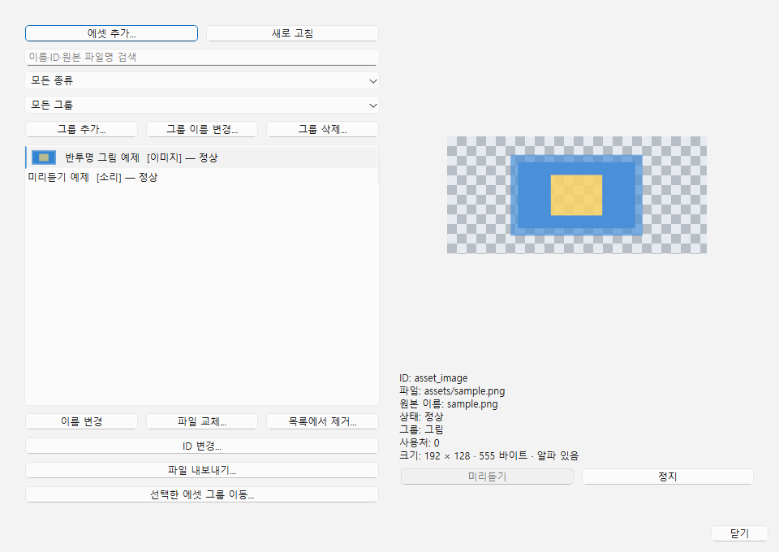
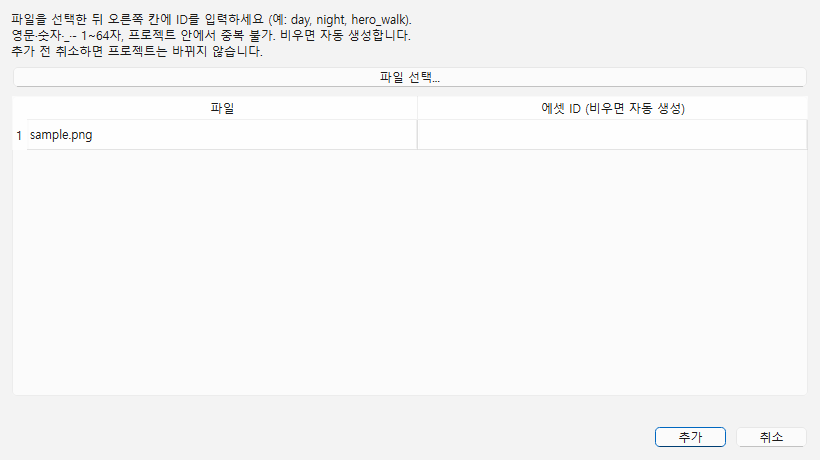

# 에셋 가져오기·목록

순서 10의 첫 단계입니다. 이미지·WAV 소리·글꼴을 프로젝트 안에 복사하고 목록에서 관리합니다. **객체 그림·장면 배경 지정**은 [이미지 안내](IMAGES.md)에서 사용할 수 있습니다. 게임 BGM/효과음·DB 이미지/소리 속성 연결은 다음 단계입니다.



## 1. 가져오기

에셋 목록은 크기 조절 가능한 별도 팝업입니다. 왼쪽은 검색·목록, 오른쪽은 미리보기·상세 정보이며 가운데 경계로 폭을 조절합니다. 목록을 열어도 장면 편집 영역의 폭은 줄지 않습니다. 목록을 열어 둔 채 제작툴의 저장·Undo를 사용할 수 있습니다. 닫기·Esc·X로 닫고 메뉴로 다시 엽니다.



1. 프로젝트를 열고 **에셋 → 에셋 목록...**을 누릅니다.
2. **에셋 추가...**를 눌러 별도 추가 창을 엽니다. **파일 선택...**에서 파일을 하나 또는 여러 개 고릅니다. 표 오른쪽 **에셋 ID** 칸을 더블클릭해 `day`, `night`, `hero_idle` 같은 ID를 입력한 뒤 **추가**를 누릅니다. ID를 비워 두면 자동 생성합니다. 파일 선택만으로는 복사하지 않으며, 추가 창에서 **취소**하면 프로젝트는 바뀌지 않습니다.
3. 목록에 등록된 항목을 선택해 그림·정보를 확인합니다. 소리는 **미리듣기**로 확인합니다.
4. **Ctrl+S**로 프로젝트를 저장합니다. 에셋 가져오기·이름 변경·파일 교체·목록에서 제거는 **편집 → 실행 취소/다시 실행** 또는 **Ctrl+Z / Ctrl+Y**로 되돌립니다. 검색 칸에 커서가 있으면 해당 칸의 글자 편집 단축키가 우선할 수 있으므로 편집 메뉴를 사용하세요.

| 종류 | 현재 지원 | 확인 방법 |
|---|---|---|
| 이미지 | PNG, JPG/JPEG, BMP | 목록 썸네일·선택 미리보기, 원본 픽셀 크기·바이트 수·알파 여부. 체크무늬는 투명 영역 |
| 소리 | WAV (SDL3가 읽을 수 있는 형식) | 미리듣기·정지. MP3/OGG는 아직 지원하지 않음 |
| 글꼴 | TTF, OTF | 선택한 글꼴로 예문 표시. 글꼴에 없는 문자는 다른 글꼴로 대체될 수 있음 |

파일 하나는 최대 **64 MiB**, 이미지는 최대 **32 × 1024 × 1024 픽셀**입니다. 빈 파일·읽기 실패·손상 파일·지원하지 않는 형식은 이유를 알려 주고 등록하지 않습니다. 여러 파일 중 실패한 파일이 있으면 성공한 파일만 등록하고 실패 목록을 보여 줍니다. 파일 선택 창에서 취소하면 아무것도 바뀌지 않습니다.

가져오기는 **원본 바이트를 그대로 복사**합니다. PNG의 반투명 알파도 보존합니다. 배경 제거·크기 변환·압축 옵션은 아직 없습니다. 같은 파일명을 여러 번 가져와도 별도 ID와 복사 경로를 만들어 기존 파일을 덮어쓰지 않습니다. 표시 이름은 같을 수 있으며 상세 정보의 ID로 구분합니다.

### ID 직접 지정·변경

- **추가할 때 지정:** 파일별 ID 칸을 더블클릭해서 입력합니다. ID는 **영문 대소문자·숫자·밑줄 `_`·하이픈 `-`만 1~64자**, 대소문자를 구분합니다. 앞뒤 공백은 제거하며 한글·공백·경로 기호는 허용하지 않습니다. 비우면 `asset_...` 형태로 자동 생성합니다.
- **중복 검사:** 프로젝트에 이미 있는 ID와 이번에 고른 파일끼리의 중복을 검사합니다. 잘못된 행과 이유가 표시되고 **추가**가 비활성화됩니다. ID 오류가 하나라도 있으면 파일 복사를 시작하지 않습니다. 같은 ID로 추가해 기존 파일을 덮어쓰는 기능이 아닙니다. 기존 내용을 바꾸려면 **파일 교체...**를 쓰세요.
- **추가 후 변경:** 목록에서 에셋 선택 → **ID 변경...** → 새 ID 입력 → 확인. 취소·잘못된 ID·중복 ID는 원본과 연결을 유지합니다. **이름 변경**은 표시 이름만, **ID 변경**은 스크립트에서 사용할 식별자를 바꿉니다.
- **연결 유지:** ID 변경은 모든 장면의 객체 이미지·장면 배경 참조를 함께 갱신합니다. 에셋 표시 이름·그룹·파일 경로·해시는 유지합니다. Undo/Redo는 ID와 연결을 함께 복원하며 Ctrl+S 후 재열어도 유지됩니다.
- **Python 코드:** 코드 안에 직접 적은 문자열은 자동 수정하지 않습니다. `day`를 `sky_day`로 변경했다면 `ctx.scene.background_image = "day"`와 비교식의 `"day"` 등도 직접 수정하세요. 조건식·동적으로 만든 문자열까지 자동 변경할 수 없으므로 변경 창에서도 안내합니다. 실행 중인 게임은 시작 때의 사본을 쓰므로 다시 실행합니다. 전용 ID 변경 Python API는 추가하지 않았습니다.

예: 낮·밤 그림을 추가하면서 ID를 `day`·`night`로 정하면 `ctx.scene.background_image = "night"`로 바로 선택할 수 있습니다. 파일명·표시 이름이 `night`여도 ID가 다르면 이 코드는 동작하지 않습니다. 실제 ID는 목록 상세에서 확인하세요. 여러 파일을 다시 선택하면 추가 후보 표와 입력한 ID는 새 파일 목록으로 초기화됩니다.

## 2. 목록·이름·파일 교체

- **검색:** 표시 이름·ID·원본 파일명에서 검색합니다. 종류 목록으로 이미지/소리/글꼴만 볼 수 있습니다.
- **이름 변경:** 표시 이름만 바뀝니다. ID와 파일 경로는 유지합니다. 빈 이름은 허용하지 않습니다.
- **ID 변경...:** 식별자를 변경하고 객체·배경 참조를 함께 갱신합니다. Python 코드의 ID 문자열은 직접 고칩니다. 위 ID 규칙과 실행 취소·저장을 지원합니다.
- **파일 교체...:** 선택한 에셋을 새 원본으로 갱신합니다. 같은 종류의 파일만 허용하며 **ID와 표시 이름을 유지**합니다. 예: PNG → 다른 PNG/JPG는 가능, 이미지 → WAV는 거부합니다. 잘못된 파일·취소는 기존 에셋을 유지합니다.
- **파일 내보내기...:** 현재 선택한 에셋 한 개를 프로젝트 밖의 폴더로 복사합니다. 원본 파일명을 기본으로 제안하며 바이트·알파를 그대로 보존합니다. 형식 변환은 하지 않습니다. 같은 이름의 파일이 있으면 저장 창에서 덮어쓰기를 확인합니다. 취소·읽기/쓰기 실패 시 프로젝트와 기존 대상 파일을 보존하며, 누락·변경된 원본은 파일 교체로 복구한 뒤 내보냅니다. 프로젝트 내부 파일 덮어쓰기는 막습니다. 내보내기는 프로젝트 변경이 아니므로 저장·Undo 대상이 아닙니다.
- **목록에서 제거:** 확인 후 목록에서 해제합니다. 실행 취소할 수 있고 복사 파일은 지우지 않습니다. 객체 이미지·장면 배경 사용처는 상세에 표시하며 사용 중인 에셋은 연결을 먼저 해제해야 제거할 수 있습니다. DB·이벤트의 일반 참조 검사는 아직 없습니다.
- **새로 고침:** 프로젝트 내부 복사 파일의 누락·변경을 다시 검사합니다. 외부 원본의 위치를 자동 추적하는 기능은 없습니다. 원본을 고쳤으면 파일 교체에서 직접 선택합니다.

미리듣기는 한 번에 하나를 재생합니다. **정지**, 항목 선택/검색/새로 고침, 목록 변경, 목록 창 닫기, 추가 창 열기, 제작툴 종료 시 멈춥니다. 오디오 출력 장치를 열지 못하면 목록 창에 실패 이유가 표시됩니다. 이 미리듣기는 게임 실행과 독립적이며 F8 이벤트 중지와 연결되지 않습니다.

### 그룹으로 분류하기

그룹은 에셋 목록 안의 분류이며 실제 파일 폴더와는 별개입니다. 에셋 한 개는 그룹 하나에 속하거나 **미분류**로 남습니다. 빈 그룹도 저장됩니다. 하위 그룹은 현재 지원하지 않습니다.

1. **그룹 추가...**에서 `캐릭터`, `배경`, `효과음` 같은 이름을 만듭니다. 빈 이름·중복 이름은 거부하며 앞뒤 공백은 제거합니다.
2. 종류 아래 그룹 목록에서 **모든 그룹 / 미분류 / 그룹: 이름**을 고릅니다. 이름 검색·종류 필터와 함께 적용됩니다.
3. 목록에서 에셋을 선택하고 **선택한 에셋 그룹 이동...**으로 대상 그룹을 고릅니다. Ctrl/Shift로 여러 항목을 골라 한 번에 이동할 수 있습니다. 미분류로도 옮길 수 있습니다.
4. 특정 그룹을 선택하고 **에셋 추가...**를 사용하면 새 에셋은 그 그룹에 들어갑니다. 모든 그룹·미분류에서 추가하면 미분류로 들어갑니다.
5. 특정 그룹을 고른 뒤 **그룹 이름 변경...**을 누르면 소속 에셋도 새 이름을 따릅니다. **그룹 삭제...**는 확인 후 그룹만 지우고 소속 에셋을 미분류로 옮깁니다. 에셋·파일은 지우지 않습니다.
6. 그룹 추가·이름 변경·삭제·에셋 이동은 제작툴 **편집 → 실행 취소/다시 실행**으로 되돌립니다. **Ctrl+S**로 저장한 뒤 재열어도 유지됩니다. 파일 교체·이름 변경·내보내기는 소속 그룹을 바꾸지 않습니다.

예: `캐릭터`와 `효과음` 그룹 생성 → 모든 그룹에서 그림을 선택해 캐릭터로 이동 → WAV를 효과음으로 이동 → 그룹 목록에서 각각 확인합니다. 그룹은 게임 실행 순서·충돌·이벤트 동작에 영향을 주지 않습니다.

## 3. 누락·변경 복구와 저장 위치

| 상태 | 뜻 | 조치 |
|---|---|---|
| 정상 | 복사 파일의 SHA-256이 가져온 값과 일치 | 선택해 미리보기/미리듣기 |
| 파일 없음 | 목록은 있지만 프로젝트 안의 파일이 없음 | 같은 항목에서 파일 교체 |
| 파일 변경됨 | 프로젝트 안의 복사 파일을 외부에서 수정함 | 내용을 확인하고 파일 교체. 확인 전 미리보기/미리듣기는 막음 |
| 읽기 오류 | 접근 실패·빈 파일·크기 제한 초과 | 파일 권한/크기 확인 후 파일 교체 |

`정상`은 저장한 바이트와 일치한다는 뜻이며 파일의 출처나 사용 권한을 보증하지 않습니다. 디코딩 오류는 선택 미리보기에서 별도로 알립니다. 파일이 없어도 프로젝트는 열리므로 목록에서 복구할 수 있습니다. 프로젝트 밖으로 벗어나는 경로나 잘못된 목록 구조는 프로젝트 열기/저장에서 거부합니다.

`project.json`의 `assetGroups`는 그룹 이름 목록, `assets` 각 항목의 `group`은 소속 이름(빈 문자열은 미분류)입니다. 이전 프로젝트의 누락 필드는 빈 목록·미분류로 읽습니다. 중복·빈 그룹 이름과 없는 그룹 참조는 열기/저장에서 거부합니다. `assets`에는 `id`, `name`, `kind` (`image`/`audio`/`font`), `path`, `sourceName`, `sha256`도 기록합니다. `path`는 `assets/<고유 문자열>.<확장자>` 같은 **프로젝트 기준 상대 경로**, `sourceName`은 원본 파일명뿐입니다. 외부 원본의 개인 절대 경로는 저장하지 않습니다.

가져오기/파일 교체는 복사 파일을 먼저 안전하게 기록하고 목록을 바꿉니다. 목록은 Ctrl+S 때 저장합니다. 파일 교체는 새 복사본을 만들므로 저장 전 종료하거나 Undo해도 이전 저장본의 파일이 유지됩니다. **취소·목록에서 제거·파일 교체 뒤 사용하지 않는 복사 파일이 남을 수 있습니다. 자동 정리 기능은 아직 없습니다.** 다른 PC로 옮길 때는 프로젝트 폴더 전체를 복사하세요. 현재 목록이 쓰는 파일을 수동으로 삭제하면 안 됩니다.

## 4. 직접 확인하는 예제

**팝업 변경 후 확인:** 아래 표의 ‘가져오기’는 **에셋 추가... → 파일 선택... → 추가** 순서입니다. 파일 선택 취소와 파일을 고른 뒤 추가 창 취소 모두 목록·복사 파일을 바꾸지 않아야 합니다. 목록 창 크기·가운데 경계를 조절하고 닫았다 다시 열어 보세요. 장면 편집 영역 폭이 줄지 않아야 합니다. 아래 ‘패널 숨김’은 목록 창 닫기로 확인합니다.

**사용자 확인:** 2026-11-07 에셋 UI·그룹이 잘 동작한다는 보고를 받고 10②로 진행했습니다. 글꼴·긴 WAV 등 개별 항목 전부의 수동 통과로 확대하지 않습니다. 아래 절차는 에셋 회귀 확인용이며 새 이미지 단계는 [별도 수동 확인](IMAGES.md#5-직접-확인)을 사용합니다.

준비: `docs/examples/assets` 폴더 전체를 작업용 위치(예: `build/manual-assets`)로 복사합니다. `dev check`로 빌드·자동 검사 후 제작툴을 열고, **파일 → 프로젝트 닫기 → 프로젝트 열기...**에서 사본을 고릅니다. 저장소 원본 예제와 기존 choices/common-events 테스트 변경은 건드리지 않습니다. 사본 밖에 `asset-test-source` 폴더도 만들고 `sample.png`와 `tone.wav`를 복사해 원본 선택용으로 사용합니다.

| 번호 | 클릭·조작 순서 | 예상 결과 |
|---|---|---|
| 1. 이미지·목록 | 에셋 → 에셋 목록... → 반투명 그림 예제 선택. 검색에 `sample` 입력 → 지우기 → 종류를 소리/이미지/모든 종류로 바꾸기 | 체크무늬 위 투명·반투명 그림, `192 × 128`, 알파 있음. 검색/종류에 맞는 항목만 표시되고 되돌리면 두 항목 표시 |
| 2. 실제 소리 | 미리듣기 예제 → 미리듣기. 소리가 끝난 뒤 다시 미리듣기 | 실제 스피커/이어폰에서 약 0.5초 소리가 매번 들림. 출력 장치 오류라면 패널 메시지와 장치 상태 기록. 자동 검사의 더미 장치 통과와 구분 |
| 3. 추가·취소·같은 이름 | 에셋 추가... → 취소. 다시 에셋 추가... → 파일 선택... → 외부 `asset-test-source/sample.png` → 추가를 두 번 반복. 각 ID 기록 → 편집 → 실행 취소/다시 실행 | 취소는 목록 변화 없음. 같은 이름도 서로 다른 ID/복사 경로로 추가, 기존 두 에셋 유지. 마지막 추가만 취소/복원 |
| 4. 이름·저장·재열기 | 새로 가져온 이미지의 ID 기록 → 이름 변경 → `걷기 준비 그림` → Ctrl+S → 프로젝트 닫기/재열기 | 표시 이름과 ID·그림이 유지됨. 이름 검색으로 찾을 수 있음 |
| 5. 파일 교체·Undo | 같은 이미지의 ID/파일 경로 기록 → 파일 교체... → 외부 sample.png 선택 → 편집 → 실행 취소 → 다시 실행 | ID·표시 이름 유지, 복사 경로만 새로 생성. Undo 시 이전 경로로 복원, Redo 시 새 경로. Ctrl+S 후 재열어도 유지 |
| 6. 목록에서 제거 | 새로 가져온 항목 선택 → 목록에서 제거 → 확인 → 편집 → 실행 취소 | 목록에서만 사라지고 사본 안의 복사 파일은 남음. Undo하면 같은 ID로 복원 |
| 7. 실패 시 보존 | 메모장에서 내용이 `invalid`인 파일을 외부 폴더의 `broken.png`로 저장(파일 형식 모든 파일). 가져오기에서 선택. 정상 이미지의 파일 교체에서는 tone.wav 선택 | 손상 이미지/다른 종류는 오류 이유 표시. 실패한 항목이 추가되거나 기존 이미지·ID가 바뀌지 않음. 정상 파일은 계속 사용할 수 있음 |
| 8. 누락·복구·이동 | 사본의 원래 `assets/sample.png`만 외부 폴더로 이동 → 새로 고침 → 반투명 그림 예제에서 파일 교체...로 옮긴 파일 선택 → Ctrl+S → 닫기. 사본 폴더 전체를 다른 위치로 이동 후 열기 | 누락 시 파일 없음, 복구 후 정상·ID 유지. 폴더 이동 후에도 이미지와 WAV 미리듣기 정상 |
| 9. 내보내기 | 이미지 선택 → 파일 내보내기... → 취소. 다시 열어 사본 밖에 저장 → 저장한 PNG 열기 → 같은 경로 내보내기의 덮어쓰기 취소/확인 | 취소는 변화 없음. 저장한 그림과 알파가 같고 프로젝트 ID·내용은 유지. 프로젝트 안을 고르면 오류 |
| 10. 그룹 | 캐릭터·효과음 그룹 추가 → 모든 그룹에서 이미지·WAV 각각 그룹 이동 → 그룹·검색·종류 필터 확인 → 그룹 이름 변경 → 그룹 삭제 → Undo/Redo → Ctrl+S → 재열기 | 빈·중복 이름 거부. 여러 선택도 이동 가능. 그룹 삭제 후 에셋은 미분류, Undo 시 소속까지 복원. 빈 그룹·소속·이름 저장 유지 |
| 11. ID 지정 | 사본 밖 sample.png 선택 → ID에 `hero_idle` 입력 → 추가. 같은 ID로 추가 시도 → `hero_run`으로 수정. 두 파일 후보에 같은 ID도 입력 | 입력한 ID 유지. 기존/후보 간 중복·잘못된 문자는 행 오류와 추가 버튼 비활성화. 비워 두면 자동 ID |
| 12. ID 변경 | 연결된 이미지 선택 → ID 변경... → 새 ID → Undo/Redo → Ctrl+S → 재열기 | 객체·배경 연결까지 갱신/복원. 파일·표시 이름·그룹 유지. 취소·중복은 변화 없음. Python 코드는 원래 문자열이므로 직접 수정 후 게임 재실행 |

추가 확인: 사용할 정상 TTF/OTF가 있으면 가져오기 후 글꼴 예문을 확인합니다. 몇 초 이상인 WAV가 있으면 재생 도중 **정지**, 다른 항목 선택, 패널 숨김으로 즉시 중지되는지도 확인합니다. 짧은 예제만으로 중지 조작을 확인하지 못했거나 글꼴을 준비하지 못했다면 해당 항목을 미확인으로 기록합니다. 외부 파일의 출처/사용 조건은 유지하고 설치 글꼴이나 개인 파일을 저장소에 추가하지 않습니다.

결과 보고 예: `에셋 1~8 통과 / 글꼴 미확인 / 긴 WAV 중지 통과`. 실패하면 번호·직전 조작·화면 메시지·실제 결과를 기록합니다. 다음 세션에서 이 결과와 남은 항목을 먼저 확인하며, 수동 통과 보고 전에 완료로 표시하지 않습니다.

## 5. 이벤트·Python·게임 실행과의 관계

ID 지정부터 배경·객체 이미지 변경, 전역 키 입력·다른 공개 기능까지 연결하는 완성 코드는 [Python 전체 가이드](PYTHON_COOKBOOK.md)에 있습니다. 예: `day/night` 에셋 추가 → python_guide.py의 GUIDE_* 설정 → 이벤트 스크립트 호출 또는 전역 훅 등록 → Ctrl+R 확인 순서입니다.

에셋 추가만으로 객체 그림이나 게임 소리가 자동으로 바뀌지는 않습니다. [객체 이미지·장면 배경](IMAGES.md)을 지정하면 캔버스와 Ctrl+R 실제 게임에 표시됩니다. Python `obj.image`·`ctx.scene.background_image`도 실제 게임에서 사용할 수 있습니다. F5/F6에서는 `ctx.scene`이 None입니다. 전용 이미지 이벤트 명령·게임 소리·`ctx.assets` 관리 API는 아직 없습니다.

이후 게임 소리 → DB 참조 단계에서도 이벤트 명령과 Python 호출·인자·반환·대기/중지 규칙 및 연결 예제를 함께 제공합니다. 외부 서버·DB·API 호출은 순서 10의 다섯 번째 계획 항목이며 현재 미구현입니다.

## 그림 다시 찍기

```powershell
.\build\windows-msvc\bin\NaruStudio.exe docs/examples/assets --assets --smoke-test 1200 --screenshot docs/guide/images/27-assets.png
```

검증용 PNG/WAV는 외부 자료를 복사하지 않고 `tools/generate_asset_example.py`로 만든 원본 예제입니다. 재생성은 기존 예제를 덮어쓰지 않는 새 폴더에 `python tools/generate_asset_example.py build/new-asset-example`로 수행합니다.

추가 창 촬영은 위 명령의 `--assets`를 `--asset-import-dialog`로 바꾸고 저장 경로를 `docs/guide/images/28-asset-import.png`로 지정합니다.
