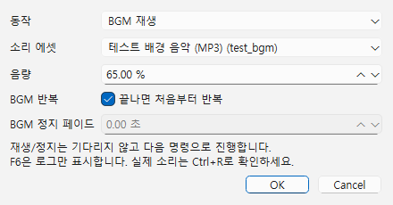
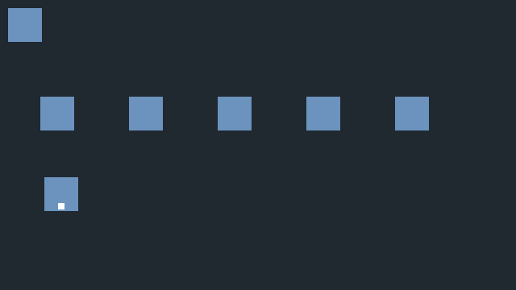

# BGM·효과음 재생

WAV와 MP3 소리 에셋을 게임에서 재생합니다. 제작툴 미리듣기와 게임은 같은 디코더를 사용합니다. BGM은 한 곡, 효과음은 최대 16개를 동시에 재생합니다.

**지금 테스트하려면 [단계별 테스트 안내](AUDIO_TEST.md)를 먼저 보세요.** 프로젝트 열기, 화면의 객체 위치, 조사하는 키, 번호별 기대 결과와 결과 전달 양식을 제공합니다. 이 문서는 자기 게임에 기능을 연결하는 가이드입니다.

## 1. 에셋 준비

**에셋 → 에셋 목록 → 에셋 추가... → 파일 선택**에서 WAV/MP3를 고릅니다. ID 칸에 `test_bgm` 또는 `test_se`처럼 입력하고 **추가**합니다. 파일은 프로젝트 내부로 복사하며 원본은 변경하지 않습니다. 목록에서 **미리듣기 / 정지**로 확인합니다. 선택 변경·목록 닫기에도 미리듣기가 멈춥니다.

압축 파일은 최대 64 MiB, float PCM 디코딩 결과는 파일당 128 MiB입니다. MP3는 모노/스테레오, WAV는 SDL이 읽을 수 있는 RIFF WAVE(최대 8채널)를 지원합니다. 게임의 동시 PCM 보유량은 새 파일 준비를 포함해 256 MiB 이내입니다. 압축 파일 크기가 작아도 긴 곡은 디코딩 한도를 넘을 수 있습니다. 현재 전체 파일을 동기 디코딩하므로 큰 파일을 처음 재생할 때 잠시 멈출 수 있습니다. 스트리밍·비동기 로딩·피치·위치 음향·구간 루프는 아직 없습니다.

## 2. 이벤트로 연결

객체 더블클릭 → **이벤트 → 명령 추가 → 소리 재생/정지**를 선택합니다. 공통 이벤트에도 같은 명령을 넣습니다.

### 시작하면 자동으로 BGM 틀기

1. 자기 프로젝트에 소리 파일을 추가하고 에셋 ID를 정합니다. 예제와 같은 코드를 쓰려면 BGM은 `test_bgm`, 효과음은 `test_se`로 지정합니다. 표시 이름이나 파일명이 같아도 ID가 다르면 따로 선택해야 합니다.
2. BGM을 시작할 장면에 객체를 하나 추가하고 이름을 ‘처음 BGM 재생’으로 정합니다. 객체를 더블클릭해 이벤트를 엽니다.
3. 시작 조건을 **자동 실행**, **끝나면 다시 실행**을 끔으로 설정합니다. 소리 명령 자체의 BGM 반복과 이벤트 반복은 다릅니다.
4. **명령 추가 → 소리 재생/정지 → 동작 BGM 재생 → 소리 에셋 선택 → 음량 35% → 끝나면 처음부터 반복 켬 → 확인**으로 추가합니다.
5. Ctrl+S → Ctrl+R. 장면에 들어오면 음악이 시작합니다. F6은 로그만 출력합니다. 장면에 다시 들어오면 같은 자동 실행 이벤트가 곡을 처음부터 시작하므로, 장면 전환에도 곡의 재생 위치를 이어가려면 시작 장면에만 이 이벤트를 두거나 아래 전역 on_game_start 방식 중 하나를 사용합니다.

### 조사하면 효과음 내기

1. 상자나 버튼 등 조사할 객체의 이벤트 시작 조건을 **조사**로 정합니다.
2. **명령 추가 → 소리 재생/정지 → 동작 효과음 재생 → 효과음 에셋 test_se → 음량 70% → 확인**으로 추가합니다.
3. Ctrl+S → Ctrl+R → 그 객체를 바라보고 결정 키를 누릅니다. 효과음은 한 번 나고 뒤의 대사/변수/로그 명령으로 즉시 넘어갑니다.

### 정지와 대기 연결

다른 조사 객체에 **BGM 정지·페이드 2초**를 추가하면 2초 동안 음량이 줄어듭니다. 그 다음에 대사를 배치하면 페이드 중 바로 대사가 시작합니다. **정지가 끝난 뒤** 대사를 띄우려면 ‘BGM 정지(2초) → 대기(2초) → 대사 표시’ 순서로 추가합니다. 효과음 전체 정지는 별도의 **효과음 모두 정지** 동작을 사용합니다.

### 입력값과 기본값

| 동작 | 입력·기본값 | 동작 |
|---|---|---|
| BGM 재생 | 소리 에셋 ID 필수, 음량 100%, 반복 켬 | 기존 BGM 대신 새 곡을 처음부터 재생. 같은 ID도 다시 시작 |
| BGM 정지 | 페이드 0초(즉시), 0~60초 | 지정 시간 동안 음량을 낮추고 정지. 이미 정지 상태면 변화 없음 |
| 효과음 재생 | 소리 에셋 ID 필수, 음량 100% | 한 번 재생. 앞 효과음과 겹칠 수 있음 |
| 효과음 모두 정지 | 입력 없음 | 진행 중인 모든 효과음을 즉시 정지 |

동작을 바꾸면 필요 없는 칸은 비활성화됩니다. 예를 들어 효과음 재생은 BGM 반복·페이드 칸을 사용하지 않습니다. 취소하면 기존 명령을 유지하며, 적용한 이벤트 편집은 Ctrl+Z/Ctrl+Y와 Ctrl+S로 실행 취소·저장합니다.

음량은 0~100%이며 0%도 무음으로 재생 시간을 진행합니다. 재생·정지·페이드 명령은 **즉시 다음 명령으로 진행**합니다. 음악 끝이나 페이드 완료를 기다리는 옵션은 없습니다. ‘2초 페이드 정지 → 대기 2초 → 다음 명령’처럼 이벤트의 대기 명령을 조합합니다.

장면 이동·대사·선택지 중에도 소리는 유지됩니다. 장면마다 음악을 바꾸려면 새 장면 자동 실행 이벤트에서 BGM을 재생합니다. 자동 실행은 반복을 끄세요. 반복 자동 실행/전역 on_update에서 매 틱 재생하면 곡이 계속 처음부터 시작합니다. 게임 종료 시 BGM·효과음은 모두 해제합니다. 게임을 다시 시작하면 소리도 새 세션에서 시작합니다.

**F6은 소리를 내지 않고 동작/ID 안내 로그만 남깁니다.** F8은 이벤트 테스트를 중지합니다. 실제 게임 이벤트가 끝나거나 취소되더라도 이미 재생한 소리는 유지되므로 정지 명령을 별도로 사용합니다. 게임의 소리 종료는 플레이어 창을 닫는 것으로 확인합니다. 제작툴 에셋 미리듣기와 게임 재생은 별도 세션입니다.

없는 ID·잘못된 에셋 종류·누락/손상 파일·장치 오류·효과음 16개 초과는 해당 게임 이벤트를 실패시키고 뒤 명령을 실행하지 않습니다. 로그에서 오류 명령으로 이동할 수 있습니다. 새 곡 준비에 실패하면 이전 BGM은 유지됩니다. 에셋 ID 변경은 객체/공통 이벤트의 중첩 분기까지 갱신하고 Undo·저장에 반영합니다. 사용 중인 소리의 목록 제거를 차단합니다. **Python 문자열의 ID는 직접 수정**합니다.



JSON 명령 형식은 `{"type":"audio","action":"play_bgm","asset":"test_bgm","volume":35,"loop":true}`입니다. `action`은 `play_bgm`, `stop_bgm`, `play_se`, `stop_se` 중 하나입니다. 정지는 `{"type":"audio","action":"stop_bgm","fadeSeconds":2}`입니다. 편집기로 작성하면 저장 시 나머지 기본값도 함께 기록합니다.

## 3. Python으로 연결

프로젝트 `scripts/audio_demo.py`에 저장합니다. 객체 이벤트에 **스크립트 호출**, 파일 `audio_demo.py`, 함수 `run`, 결과 변수 빈 칸을 지정합니다. 이벤트 함수만 사용하면 전역 등록은 필요 없습니다.

```python
def run(ctx):
    if ctx.audio is None:
        ctx.log("소리는 Ctrl+R 게임 실행에서 확인하세요.")
        return
    ctx.audio.play_bgm("test_bgm", volume=35, loop=True)
    ctx.audio.play_se("test_se", volume=70)
    ctx.log("Python BGM·효과음 호출 완료")


def fade(ctx):
    if ctx.audio is not None:
        ctx.audio.stop_bgm(fade_seconds=2)


def stop_effects(ctx):
    if ctx.audio is not None:
        ctx.audio.stop_se()
```

`ctx.audio.play_bgm(asset_id, volume=100, loop=True)`, `ctx.audio.play_se(asset_id, volume=100)`, `ctx.audio.stop_bgm(fade_seconds=0)`, `ctx.audio.stop_se()`는 모두 `None`을 반환하며 대기하지 않습니다. `asset_id`는 경로가 아닌 등록한 소리 ID 문자열입니다. volume/시간은 유한한 숫자, loop는 bool입니다. 잘못된 인자 타입은 TypeError, 없는 ID·잘못된 종류·범위/NaN/무한대는 ValueError, 파일·장치·동시 재생 한도 실패는 RuntimeError입니다. 스크립트 파일·행·traceback을 로그에 보존합니다.

위 완성 코드와 [예제 파일](../examples/audio/scripts/audio_demo.py)의 함수 이름은 같습니다. **스크립트 → 새 스크립트...**로 `audio_demo.py`를 만들고 내용을 붙여 넣어 저장하거나 예제 파일을 자기 프로젝트의 scripts/로 복사합니다. 외부에서 복사했다면 프로젝트를 다시 열어 스크립트 목록을 갱신합니다. 이벤트의 스크립트 호출 설정은 다음과 같습니다.

| 원하는 동작 | 파일 | 함수 | 함수가 받는 값 / 반환 | 결과 변수 |
|---|---|---|---|---|
| BGM·효과음 재생 | audio_demo.py | run | 엔진이 ctx를 전달 / None | 비움 |
| BGM 2초 페이드 정지 | audio_demo.py | fade | ctx / None | 비움 |
| 효과음 전체 정지 | audio_demo.py | stop_effects | ctx / None | 비움 |

함수 입력 칸에는 `run(ctx)` 대신 **run**처럼 함수 이름만 씁니다. 이벤트 함수는 전역 등록 없이 호출합니다. 실행할 때 읽는 이벤트 파일은 저장한 최신 파일이므로 코드를 바꿨다면 저장 후 게임을 다시 실행해 확인합니다.

F5/F6에서는 `ctx.audio`가 `None`이므로 위처럼 보호합니다. 실제 게임에서는 on_game_start(첫 장면 전에도 가능), on_scene_enter/on_scene_exit/on_update 훅과 이벤트 함수에서 사용합니다. 전역으로 실행하려면 아래 함수를 같은 파일에 넣고 **스크립트 → 전역 스크립트...**에 한 번 등록합니다. `run`은 전역 훅으로 자동 호출되지 않습니다.

```python
def on_game_start(ctx):
    ctx.audio.play_bgm("test_bgm", volume=35, loop=True)
```

전역 시작 훅과 장면 자동 실행의 BGM 재생을 동시에 넣으면 뒤에 실행된 쪽이 음악을 다시 시작합니다. 게임 시작에 한 번 틀 목적이면 **한 가지 방식만** 선택합니다. 전역 on_update에 재생을 넣으면 매 틱 처음부터 다시 시작하므로 사용하지 않습니다. 게임 중 효과음은 객체의 스크립트 호출 run에 연결하거나 필요한 훅/함수에서 play_se만 호출합니다.

## 4. 실행 예제와 직접 확인

게임 화면에서 객체를 구별하기 어려우면 **F9**로 전체 이름·ID를 켭니다. 게임용 이름표를 저장하려면 [객체별 이름표 설정](NAMEPLATES.md)을 사용합니다.

아래는 빠른 확인 요약입니다. 처음 실행하거나 효과음 겹침·정지/ID·파일 복구까지 시험하려면 [1~8번 상세 테스트](AUDIO_TEST.md)를 따릅니다.

저장소의 [audio 예제](../examples/audio/README.md)는 직접 생성한 짧은 WAV로 동작합니다. `dev.cmd` 빌드 후 제작툴에서 `docs/examples/audio`를 열고 Ctrl+R을 누릅니다. 주인공은 아래, 조사할 객체는 위쪽에 있습니다. 왼쪽부터 BGM 다시 재생 / 효과음 / BGM 2초 페이드 / 효과음 모두 정지 / Python 호출입니다. 가까이 이동해 위쪽을 보고 결정 키(기본 Enter/Space/Z)로 조사합니다.

지정한 MP3를 복사한 로컬 테스트 프로젝트는 **build/manual-audio**입니다. 테스트 음악은 `assets/user_bgm.mp3`, 에셋 ID는 `test_bgm`입니다. 원본 경로는 프로젝트에 저장하지 않습니다. 이 폴더의 개인 음원은 저장소 예제에 포함하지 않습니다. 다른 PC에서는 새 폴더에 다음처럼 생성합니다.

```powershell
python tools/generate_audio_example.py build/my-audio-test --bgm "내 음악.mp3"
```

| 번호 | 클릭·조작 | 기대 결과 |
|---|---|---|
| 1 | build/manual-audio 열기 → 에셋 목록 → 테스트 BGM → 미리듣기 → 정지 | 지정한 MP3가 들림. 정지/선택 변경/목록 닫기로 중지 |
| 2 | Ctrl+R → 음악을 듣고 BGM 다시 재생 객체 조사 | 시작부터 지정한 곡이 35%로 재생. 재조사 시 처음부터 시작 |
| 3 | 효과음 객체 조사. 겹침은 효과음 → 대기 0.1초 → 효과음을 같은 이벤트에 배치 | BGM 유지·짧은 효과음 한 번. 두 재생은 0.1초 차이로 겹침 |
| 4 | BGM 페이드 정지 객체 조사 → BGM 재생 객체 조사 | 약 2초 동안 작아져 정지. 이후 다시 재생 가능 |
| 5 | Python 호출 객체 조사 → 게임 종료. 효과음 전체 정지는 긴 소리를 효과음으로 재생해 별도 확인 | Python으로 음악/효과음 재생. 긴 효과음은 정지 객체로 중지. 플레이어 창을 닫으면 모두 종료 |
| 6 | 같은 이벤트 F6, 스크립트 F5 → F8 | 게임 소리 재생 없이 안내 로그. F5 보호 코드가 오류 없이 종료 |
| 7 | 사본에서 소리 ID 변경 → Undo/Redo → 저장/재열기 | 이벤트 참조 유지/복원. 사용 중 목록 제거 차단. Python ID는 직접 갱신 |
| 8 | 사본의 BGM 파일 임시 이동 후 Ctrl+R → 파일 복구 | 오류 명령/ID 로그, 다음 명령 실행 안 함. 복구·재실행하면 정상 |

자동 검사는 SDL 더미 소리 장치를 사용하므로 실제 스피커 출력 확인과 구분합니다. 자연 반복은 저장소 WAV 예제에서 2초 이상 들어 확인할 수 있습니다. 사용자 MP3 전체 곡의 반복 경계/끝부분 청취는 별도로 확인합니다.



## 그림 다시 찍기

```powershell
.\build\windows-msvc\bin\NaruStudio.exe --command-dialog audio --screenshot docs/guide/images/33-audio-command.png
.\build\windows-msvc\bin\NaruPlayer.exe docs/examples/audio --frames 2 --screenshot docs/guide/images/34-audio-game.png
```
