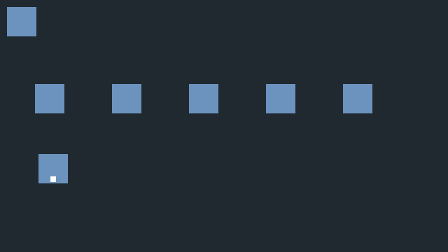

# BGM·효과음 직접 테스트

이 문서는 **준비된 예제로 무엇을 누르고 어떤 결과를 확인하는지** 설명합니다. 자기 게임에 추가하는 방법은 [소리 기능 가이드](AUDIO.md)를 보세요. 이미지·에셋 ID의 이전 사용자 확인은 완료됐으며, 아래는 새 소리 기능의 별도 확인입니다.

## 준비: 테스트 프로젝트 열기

1. 저장소 폴더에서 `dev.cmd`를 실행합니다. 빌드 후 Naru Studio가 열립니다. 이미 최신 빌드를 했다면 `build/windows-msvc/bin/NaruStudio.exe`를 실행해도 됩니다.
2. 다른 프로젝트가 열렸다면 **파일 → 프로젝트 닫기**로 시작 화면으로 돌아갑니다. 저장 확인이 나오면 현재 작업에 맞게 저장합니다.
3. **프로젝트 열기...**에서 저장소 안의 **`build/manual-audio` 폴더**를 선택합니다. 지정한 `The_Holding_Cell_BGM_01.mp3`를 복사한 프로젝트입니다. `game/audio`의 원본 파일을 열거나 옮기지 않습니다.
4. 원본 테스트 폴더를 보존하려면 탐색기에서 `manual-audio` 폴더 전체를 복사해 **`build/manual-audio-check`**라는 새 폴더를 만들고 그 사본을 엽니다. 이미 그 이름이 있으면 다른 새 이름을 사용합니다. 아래 7·8번은 반드시 이 사본에서 진행합니다.
5. Windows의 출력 장치와 음량을 확인합니다. 에셋 미리듣기를 끝낸 뒤 게임을 실행해야 두 소리가 겹치지 않습니다.

`build/manual-audio`가 없는 다른 PC에서는 `docs/examples/audio`를 열 수 있습니다. 이 예제는 **직접 만든 짧은 WAV 테스트 톤**이며 지정한 MP3와 음색이 다릅니다. 개인 MP3로 새 사본을 만드는 명령은 [소리 가이드 4장](AUDIO.md#4-실행-예제와-직접-확인)에 있습니다.

## 화면에서 객체 찾기

기본 소리 예제는 게임용 이름표를 켜 두지 않았습니다. **게임 창에서 F9**를 누르면 전체 객체 이름·ID를 볼 수 있고, 다시 누르면 꺼집니다. 제작툴 창의 F9는 데이터베이스를 여는 키입니다. 아래 배치와 이름을 함께 확인하세요. 객체별 게임용 이름표 설정은 [이름표 가이드](NAMEPLATES.md)에 있습니다.

| 위치 | 객체 이름 / ID | 하는 일 |
|---|---|---|
| 왼쪽 맨 위의 작은 사각형 | 처음 BGM 재생 / `startup` | 장면 시작 시 자동으로 음악 재생. 조사할 필요 없음 |
| 아래쪽 사각형 | 주인공 / `hero` | 방향키로 움직이는 객체. 바라보는 방향에 흰 점 표시 |
| 가운데 가로줄의 왼쪽 첫 번째 | BGM 다시 재생 / `music` | 음악을 처음부터 다시 재생 |
| 두 번째 | 효과음 (겹침 가능) / `effect` | 짧은 효과음 재생 |
| 세 번째 | BGM 2초 페이드 정지 / `fade` | 음악을 2초 동안 줄이고 정지 |
| 네 번째 | 효과음 모두 정지 / `silence` | 현재 효과음 전체 정지 |
| 다섯 번째 | Python 소리 호출 / `script` | Python으로 BGM·효과음 재생 |



**조사하는 방법:** 주인공을 목표 사각형 바로 아래로 이동 → 위 방향키를 눌러 목표를 바라보기 → 키에서 손을 떼고 **Z 또는 Enter 또는 Space**를 한 번 누릅니다. 마우스 클릭으로 조사하는 기능은 아직 없습니다. 방향키를 계속 누르면 지나칠 수 있으므로 짧게 눌러 맞춥니다. 다른 객체로 이동할 때는 먼저 아래로 내려와 가로로 이동한 뒤 다시 위로 접근합니다.

반응이 없으면 게임 창에 초점이 있는지, 주인공 앞 16px 안에 목표가 있는지, 위를 바라보는지 확인합니다. 결정 키는 **떼었다 다시 눌러야** 재조사합니다. 기본 예제는 조사 때 대사창 없이 소리를 내고 제작툴 로그에 실행 결과를 남깁니다.

## 1. MP3 가져오기 상태와 미리듣기

1. 제작툴 **에셋 → 에셋 목록...**을 엽니다.
2. **테스트 BGM**을 선택합니다. 상세 ID가 `test_bgm`, 파일이 `assets/user_bgm.mp3`, 원본 이름이 `The_Holding_Cell_BGM_01.mp3`, 상태가 **정상**인지 봅니다.
3. **미리듣기**를 누릅니다. 지정한 음악이 들리는지 확인합니다.
4. **정지**를 누르면 즉시 멈춰야 합니다. 다시 재생 후 **효과음** 항목을 선택하거나 목록을 닫아도 멈춰야 합니다.

**통과:** 지정한 MP3가 들리고 정지·선택 변경·창 닫기 모두 중지됩니다. 이후 게임 실행 전에 목록을 닫습니다. 저장소 WAV 예제는 파일명이 `assets/demo_bgm.wav`인 것이 정상입니다.

## 2. 게임 BGM·반복·음량

1. 제작툴에서 **Ctrl+R**을 누릅니다. 별도의 게임 창이 열리고 지정한 음악이 자동 재생돼야 합니다. 이 예제의 시작 음량은 **35%**입니다.
2. 첫 번째 객체 **BGM 다시 재생**을 조사합니다. 음악이 처음부터 다시 시작해야 합니다. 조금 기다렸다 재조사해 다시 시작하는지도 봅니다.
3. 음악의 반복을 빨리 확인하려면 `docs/examples/audio`를 별도로 열어 실행하고 **2초보다 오래** 듣습니다. 짧은 저음 톤이 반복돼야 합니다. 지정한 MP3의 실제 곡 끝 반복은 그 곡이 끝날 때까지 기다려 별도로 확인할 수 있습니다.
4. 음량 입력도 확인하려면 게임을 닫고 제작툴의 **BGM 다시 재생** 객체 → 이벤트 → 소리 명령 더블클릭 → **음량 0%** → 확인 → Ctrl+S → Ctrl+R로 실행합니다. 처음에는 자동 BGM 35%가 들리지만, **첫 번째 객체를 조사한 뒤**에는 무음이어야 합니다. 같은 명령을 35%로 복원해 저장합니다.

**통과:** 자동 시작·조사 시 재시작·반복·음량 적용이 맞습니다. 무음 상태도 재생은 진행 중이며 정지는 별도 동작입니다.

## 3. 효과음과 겹쳐 재생

1. 게임에서 두 번째 객체 **효과음 (겹침 가능)**을 조사합니다. BGM을 유지하면서 짧고 높은 효과음이 한 번 들려야 합니다.
2. 겹침을 분명히 확인하려면 게임을 닫습니다. 제작툴에서 같은 객체의 이벤트를 열고 기존 **효과음 재생(test_se)** 뒤에 **대기 0.1초 → 효과음 재생(test_se)**를 추가해 저장합니다. 원래 효과음은 0.35초이므로 두 번째 재생이 첫 소리가 끝나기 전에 시작합니다.
3. Ctrl+R → 같은 객체를 한 번 조사합니다. 짧은 효과음이 0.1초 차이로 시작하며 겹치는지 확인합니다.

**통과:** BGM이 끊기지 않고 효과음 두 개가 시간 차이로 겹쳐 들립니다. 원래 0.35초 효과음을 천천히 재조사하는 것만으로는 겹침을 확인했다고 기록하지 않습니다.

## 4. BGM 페이드와 효과음 정지

1. 게임에서 세 번째 객체 **BGM 2초 페이드 정지**를 조사합니다. BGM이 갑자기 끊기지 않고 약 2초에 걸쳐 작아진 뒤 멈춰야 합니다.
2. 첫 번째 객체를 다시 조사하면 음악을 다시 재생할 수 있어야 합니다.
3. 효과음 정지는 짧은 소리가 자연 종료된 상태에서 누르면 차이를 듣기 어렵습니다. 게임을 닫고 **효과음** 객체의 재생 에셋을 `test_se`에서 **테스트 BGM(test_bgm)**으로 바꿉니다. 동작은 **효과음 재생**으로 유지합니다. 이렇게 하면 같은 MP3를 길게 한 번 재생하는 효과음으로 시험합니다. 저장소 WAV 예제의 BGM도 짧으므로 그 예제로 이 항목을 시험할 때는 먼저 충분히 긴 WAV/MP3를 추가하고 해당 에셋을 선택하세요.
4. 혼동을 피하려고 게임에서 먼저 세 번째 객체로 BGM을 끈 다음, 두 번째 객체로 긴 효과음을 시작합니다. 음악이 들리는 동안 네 번째 객체 **효과음 모두 정지**를 조사합니다.

**통과:** 페이드 BGM은 점차 줄고, 긴 효과음은 정지 객체 조사 즉시 멈춥니다. **효과음 모두 정지**는 BGM을 끄는 명령이 아닙니다. 마친 뒤 효과음 객체를 `test_se`로 복원합니다. 3번에서 추가한 두 번째 효과음도 함께 복원하거나 제거합니다.

## 5. Python 호출과 종료

1. 게임의 다섯 번째 객체 **Python 소리 호출**을 조사합니다. BGM이 다시 시작되고 짧은 효과음이 함께 나야 합니다.
2. 제작툴 로그에서 **Python BGM·효과음 호출 완료**를 확인합니다. 게임 창을 닫으면 소리가 멈춰야 합니다.
3. 제작툴에서 같은 객체의 이벤트를 열어 **스크립트 호출** 파일 `audio_demo.py`, 함수 `run`, 결과 변수 빈 칸을 확인합니다. 파일은 프로젝트의 `scripts/audio_demo.py`에 있습니다. 전역 스크립트 등록은 필요 없습니다.

**통과:** Python으로도 재생되고 로그가 남으며 게임 종료 후 소리가 남지 않습니다.

## 6. F5·F6과 게임 실행 구분

1. 실제 게임 창과 에셋 목록을 모두 닫습니다.
2. 제작툴에서 **BGM 다시 재생** 객체의 이벤트를 열고 **▶ 테스트 실행(F6)**을 누릅니다. 소리 없이 `소리 테스트: play_bgm ...` 안내 로그가 나와야 합니다.
3. **Python 소리 호출** 객체도 F6으로 실행합니다. `소리는 Ctrl+R 게임 실행에서 확인하세요.` 안내만 나와야 합니다.
4. 스크립트 목록에서 `audio_demo.py`를 더블클릭한 뒤 F5로 실행해도 같은 안내가 나오고 오류가 없어야 합니다. 예제 `run(ctx)`가 `ctx.audio is None`을 확인하기 때문입니다.
5. F8로 이벤트 테스트를 중지합니다. 즉시 끝나는 소리 명령만 있는 경우에는 이미 완료된 것이 정상입니다.

**통과:** 실제 재생은 Ctrl+R에서 확인하고, F5/F6은 안내만 출력합니다. F8을 게임 BGM 정지 명령처럼 사용하지 않습니다.

## 7. ID 변경·Undo·저장·제거 보호

이 항목부터는 준비 단계에서 만든 **프로젝트 사본**에서 진행합니다.

1. 게임을 닫고 에셋 목록에서 테스트 BGM → **ID 변경...** → `test_bgm_check`를 입력합니다.
2. **처음 BGM 재생**, **BGM 다시 재생** 객체의 소리 명령을 열어 새 ID 연결이 유지되는지 확인합니다.
3. 편집 메뉴의 **실행 취소**로 `test_bgm`, **다시 실행**으로 `test_bgm_check`가 되는지 확인합니다. 에셋 검색 칸에 초점이 있으면 Ctrl+Z는 글자 편집에 쓰일 수 있어 메뉴 사용이 확실합니다.
4. Ctrl+S → 프로젝트 닫기 → 같은 사본 재열기 → Ctrl+R. 자동 BGM과 첫 번째 객체 재생이 정상이어야 합니다.
5. 에셋 목록에서 이 소리를 **목록에서 제거...**하려고 하면 사용처가 표시되고 제거가 차단돼야 합니다.
6. ID를 `test_bgm`으로 복원해 저장합니다. **Python 코드에 직접 적은 ID 문자열은 자동 변경되지 않습니다.** 새 ID로 Python 객체까지 시험하려면 `audio_demo.py`의 `"test_bgm"`도 직접 바꿔 저장하고 게임을 재시작합니다. 또는 ID를 복원한 뒤 Python을 확인합니다.

**통과:** 이벤트 참조·Undo/Redo·저장/재열기·사용 중 제거 차단이 맞습니다. Python 문자열 자동 변경을 기대하지 않습니다.

## 8. 파일 누락 오류와 복구

1. 사본의 ID가 `test_bgm`으로 복원돼 있는지 확인하고 게임을 닫습니다.
2. 탐색기에서 **사본 안의** `assets/user_bgm.mp3`를 `user_bgm.mp3.bak`으로 임시 이름 변경합니다. 원본 게임 폴더의 MP3는 건드리지 않습니다. WAV 예제면 `demo_bgm.wav`에 같은 방식으로 적용합니다.
3. 제작툴에서 Ctrl+R. BGM이 들리지 않고 로그에 `test_bgm`과 파일 누락/크기 오류가 표시돼야 합니다. 소리 실패는 해당 이벤트를 중지하며 게임 창 자체는 계속 열려 있을 수 있습니다.
4. 제작툴의 이벤트 오류 로그를 더블클릭하면 **처음 BGM 재생** 객체의 소리 명령으로 이동하는지 봅니다.
5. 게임을 닫고 파일 이름을 원래대로 돌립니다. 에셋 목록이 열려 있으면 **새로 고침** 후 게임을 재실행합니다. 음악이 정상으로 돌아와야 합니다.

**통과:** 누락이 로그로 드러나고 오류 위치를 찾을 수 있으며 복구 후 다시 재생됩니다. 이전 정상 BGM 유지 동작은 새 BGM 교체에 실패했을 때 적용되며, 시작부터 파일이 없는 경우에는 유지할 이전 곡이 없습니다.

## 결과 전달

아래처럼 번호별 결과를 보내면 됩니다. 아직 확인하지 않은 항목은 ‘미확인’으로 둡니다. 자동 검사 통과는 스피커에서 직접 들은 결과를 대신하지 않습니다.

```text
사용한 프로젝트: build/manual-audio-check (지정 MP3)
1 미리듣기/정지:
2 BGM 시작/재시작/반복/음량:
3 효과음/겹침:
4 페이드/효과음 정지:
5 Python/게임 종료:
6 F5/F6/F8:
7 ID/Undo/저장/제거 보호:
8 파일 누락/오류 이동/복구:
문제가 있다면: 누른 객체·순서 / 기대 결과 / 실제 결과 / 로그 내용
```

현재 제품 자동 검사는 **21/21 통과**이며, 2026-11-08 사용자가 소리·이름표 개선까지 완료를 확인하고 커밋·푸시를 요청했습니다. 위 양식은 다른 PC의 재확인이나 회귀 확인에도 사용합니다. 다음 개발 순서는 10④ DB 이미지·소리 속성입니다.
