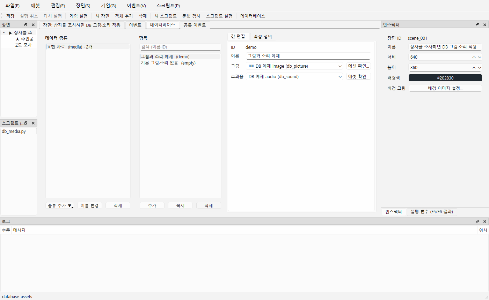
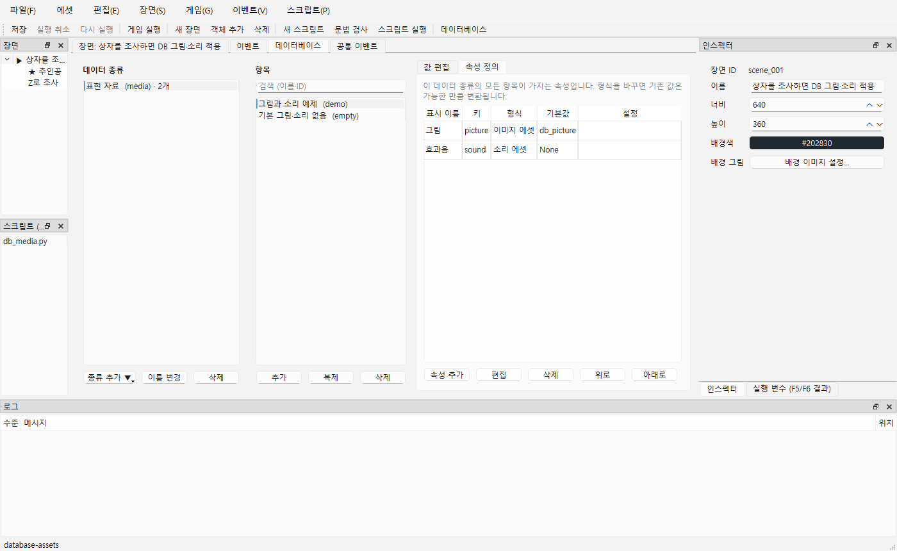

# DB의 이미지·소리 연결

DB 속성에 **이미지 에셋** 또는 **소리 에셋** 형식을 지정하면 프로젝트 에셋 ID를 고를 수 있습니다. DB에 그림·음원 파일을 복사하거나 자동으로 재생하는 기능은 아닙니다. 장면·이벤트·Python에서 DB 값을 읽어 표시·재생에 연결합니다.



## 1. 속성과 값 만들기

1. **에셋 → 에셋 목록**에서 PNG/JPG/BMP 또는 WAV/MP3 파일을 추가합니다.
2. 제작툴 **F9 → 데이터베이스**에서 종류를 선택하고 **속성 정의 → 추가**를 누릅니다. 표시 이름, 영문 키, 형식 **이미지 에셋** 또는 **소리 에셋**을 지정합니다.
3. **기본값**에서 에셋을 고르거나 **(없음)**을 선택하고 확인합니다. 이미지에는 이미지만, 소리에는 소리만 나옵니다. 새 속성의 기본값은 없음입니다.
4. 항목을 고르고 **값 편집**에서 항목별 에셋을 선택합니다. 값을 따로 저장하지 않은 항목은 속성 기본값을 사용합니다. 항목에서 **(없음)**을 직접 선택하면 기본값을 덮어쓰는 빈 값이 됩니다.
5. **에셋 확인...**은 별도 큰 창에서 썸네일·파일 상태·사용처를 보여 줍니다. 소리는 **미리듣기 / 정지**로 확인합니다. 선택 변경·확인 창 종료 시 미리듣기가 중지됩니다. 이 확인 창에서는 에셋을 수정하지 않습니다. 없음·누락 ID·종류 오류일 때 확인 버튼은 비활성화됩니다.

값 변경은 즉시 편집 데이터에 반영됩니다. Ctrl+Z / Ctrl+Y, Ctrl+S, 다시 열기를 지원합니다. 속성 정의 창의 취소는 변경을 적용하지 않습니다. 실제 에셋 관리는 **에셋 → 에셋 목록**에서 합니다.



## 2. ID 변경·누락·형식 변경

- 저장 형식은 `data/<종류키>.json`의 `type: "image"` / `"audio"`, 값은 에셋 ID 문자열 또는 JSON `null`입니다. 이전 6형식 프로젝트는 그대로 열립니다.
- 에셋 목록의 **ID 변경...**은 DB 기본값·명시적 항목 값과 기존 객체·배경·소리 명령 참조를 한 번의 Undo로 함께 변경합니다. 일반 문자열 속성과 Python 코드의 문자열은 자동 수정하지 않습니다.
- DB 기본값만 사용 중이어도 에셋 목록에서 제거할 수 없습니다. 해당 기본값과 항목별 연결을 모두 해제한 뒤 제거합니다. 파일 교체는 ID를 유지하므로 DB를 다시 연결할 필요가 없습니다.
- 누락 ID·다른 종류·잘못된 값은 DB 아래 **확인이 필요한 곳**에 종류/항목/속성 위치와 함께 표시됩니다. 저장·열기를 막지 않으므로 외부에서 깨진 데이터를 복구할 수 있습니다. 새 값·기본값을 UI로 선택할 때는 현재 목록의 올바른 종류만 허용합니다.
- 누락 값은 선택 목록에 경고와 원래 ID를 남깁니다. 올바른 에셋이나 없음을 선택해 고칩니다. 파일 자체의 누락·해시 변화는 **에셋 확인...**에서 확인합니다. ID가 유효해도 실제 파일이 없으면 그림 적용·재생 시 오류 또는 기존 대체 표시 규칙을 따릅니다.
- 속성 형식 변경은 기존 변환 규칙을 사용합니다. 변환 불가능한 값은 확인 후 기본값으로 초기화합니다. 문법상 유효한 ID라도 새 에셋 종류와 다를 수 있으므로 변경 후 DB 경고를 확인하세요. 게임 실행 중 DB는 읽기 전용입니다.

## 3. Python·이벤트 연결

실행 예제는 [database-assets](../examples/database-assets/README.md)에 있습니다. `scripts/db_media.py`의 `run(ctx)`를 객체 이벤트 **스크립트 호출**에 연결합니다. 전역 스크립트 등록은 필요 없으며 인자는 `ctx`, 반환은 `None`입니다.

```python
def run(ctx):
    media = ctx.db.get("media", "demo")
    if media is None:
        ctx.log("media/demo 항목이 없습니다.")
        return
    ctx.log(str(media))
    if ctx.scene is None or ctx.audio is None:
        return
    ctx.scene.object("display").image = media["picture"] or ""
    if media["sound"] is not None:
        ctx.audio.play_se(media["sound"], volume=60)
```

이미지·소리 속성은 `ctx.db.get` 결과에서 **str 또는 None**으로 읽습니다. 반환 사전을 바꿔도 DB 원본은 바뀌지 않습니다. 누락 ID도 문자열로 읽으며 읽기 자체가 파일 존재를 검사하지 않습니다. 없는 종류는 `KeyError`, 없는 항목은 `None`입니다. 파일/종류 오류는 실제 이미지 적용·소리 재생 단계에서 기존 API 규칙대로 보고되고 스크립트 파일·행·traceback이 보존됩니다.

F5/F6에서도 DB를 읽을 수 있지만 `ctx.scene`·`ctx.audio`는 `None`입니다. 위 예제는 로그만 남깁니다. Ctrl+R 게임에서 객체를 조사하면 그림과 효과음이 적용됩니다. 소리는 즉시 다음 명령으로 진행하고 이벤트 종료 후에도 재생되며, 게임 종료 때 정리합니다. 이 단계에 별도 DB 재생 명령이나 새 자동 훅은 없습니다.

**데이터 → 변수** 명령은 종류 `media`, 항목 `demo`, 속성 `sound`, 변수 `selected_sound`처럼 지정하면 ID 문자열을 변수에 넣습니다. F6에서도 같은 DB 읽기를 수행합니다. 빈 속성은 빈 값으로 읽습니다. 소리 명령의 에셋 칸이 변수를 자동 해석하지 않으므로 변수의 ID를 재생하려면 후속 스크립트에서 `ctx.audio.play_se(ctx.variables["selected_sound"])`로 호출합니다. 입력·오류·중지 규칙은 [이벤트 설명](EVENTS.md), [Python API](../SCRIPT_API.md)를 따릅니다.

## 4. 수동 확인

저장소 예제를 보존하려면 `python tools/generate_database_asset_example.py build/manual-db-assets`로 새 사본을 만들고 그 폴더를 엽니다. 이미 있는 폴더는 생성기가 덮어쓰지 않습니다.

1. 제작툴 **F9 → 표현 자료 → 그림과 소리 예제 → 값 편집**: 그림 `db_picture`, 효과음 `db_sound`를 확인합니다. **기본 그림·소리 없음** 항목은 같은 기본 그림과 효과음 없음이 표시되어야 합니다.
2. 그림·효과음의 **에셋 확인...**: 그림 썸네일과 소리 미리듣기·정지를 확인합니다. 그림 선택 칸에는 소리가 없어야 합니다.
3. **속성 정의 → 그림 편집**에서 기본값을 없음으로 바꾸고 **취소**합니다. 원래 그림이 유지되어야 합니다. 항목의 그림을 없음으로 바꾸고 Ctrl+Z / Ctrl+Y 후 저장·재열기로 선택이 유지되는지 확인합니다. 다시 그림을 선택합니다.
4. **에셋 → 에셋 목록 → db_sound → ID 변경... → db_sound_new**: DB 효과음도 새 ID가 되고 Ctrl+Z / Ctrl+Y로 함께 복원·재적용되어야 합니다. 저장·재열기 후 새 ID를 확인합니다. 사용 중인 `db_picture`·`db_sound_new`의 **목록에서 제거...**는 사용처를 보여 주며 차단되어야 합니다.
5. **Ctrl+R**: 주인공을 상자 왼쪽까지 오른쪽으로 이동한 뒤 오른쪽을 바라보고 **Z**로 조사합니다. 상자에 예제 그림이 나타나고 짧은 효과음이 들려야 합니다. DB에서 소리를 없음으로 바꾸고 게임을 다시 시작하면 소리가 없어야 합니다. **F6**으로 같은 이벤트를 실행하면 DB 로그만 남고 소리가 없어야 합니다.
6. 사본을 닫고 `data/media.json`의 그림 기본값을 `missing_picture`로 바꾼 뒤 다시 엽니다. DB 아래 경고에 `media.picture (기본값)`과 해당 ID가 나오고 선택 칸에도 원래 ID가 남아야 합니다. 실제 이미지 에셋을 골라 복구·저장합니다.

결과는 1~6번 각각 통과/실패와 증상을 알려 주세요. 자동 더미 오디오 검사는 실제 스피커 청취 결과와 별개입니다. 사용자 확인 후 다음 단계로 진행합니다.

그림 재촬영:

```powershell
& .\build\windows-msvc\bin\NaruStudio.exe docs/examples/database-assets --database media/demo --smoke-test 1200 --screenshot docs/guide/images/40-db-assets.png
& .\build\windows-msvc\bin\NaruStudio.exe docs/examples/database-assets --database media/demo --fields-tab --smoke-test 1200 --screenshot docs/guide/images/41-db-asset-fields.png
```
