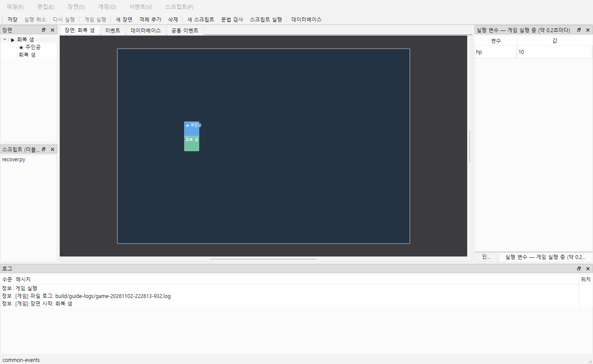

# 게임 실행 중 값과 오류 확인

## 게임의 현재 변수·스위치

1. 프로젝트를 열고 **Ctrl+R**(시작 장면) 또는 **Ctrl+Shift+R**(현재 장면)을 누릅니다. 먼저 편집 내용을 저장합니다.
2. 제작툴 오른쪽의 **실행 변수** 패널을 봅니다. 닫았다면 **게임 → 실행 변수 보기**로 다시 엽니다.
3. 게임에서 이벤트를 실행하면 이름과 현재 값이 약 0.2초마다 갱신됩니다. 프로젝트에 정의하지 않고 Python에서 만든 변수도 포함합니다.



읽기 전용입니다. 처음 값이나 실행 중 값을 여기서 수정하지 않습니다. 게임을 다시 시작하면 새 게임의 처음 값으로 시작합니다. 게임 종료 후에는 **종료 시 마지막 수신 값**을 남깁니다. 강제 종료·비정상 종료에서는 마지막 변경이 도착하지 않을 수 있습니다. 짧게 바뀌었다 되돌아오는 값의 모든 변화를 기록하는 기능은 아니므로 그런 경우 이벤트의 **로그**나 Python `ctx.log(...)`를 함께 사용하세요.

**F5 스크립트 실행과 F6 이벤트 테스트**도 기존처럼 같은 패널에 결과를 표시합니다. 별도 게임이 실행 중이면 게임 값 표시를 우선합니다. 게임이 종료된 뒤 F5/F6을 실행하면 제목이 **F5/F6 결과**로 바뀝니다. F6은 게임의 현재 변수를 가져오지 않고 프로젝트의 처음 값으로 실행하며 실행 조건을 무시합니다. 이벤트의 실제 대기·선택·이동·중지 차이는 [이벤트 명령](EVENTS.md)을 보세요.

## 오류에서 명령으로 이동

아래 **로그** 패널의 **명령 실패** 줄을 더블클릭하면 장면·객체와 이벤트 탭을 열고 실패한 명령을 선택합니다. 조건·선택지 안의 중첩 명령도 가능합니다. 공통 이벤트 안의 오류는 해당 공통 이벤트를 엽니다. 바깥 호출에도 오류가 표시될 수 있으므로 가장 안쪽의 **명령 실패**를 먼저 확인하세요. 마우스를 오류 메시지 위에 올리면 객체 → 공통 이벤트의 호출 경로를 볼 수 있습니다.

Python 오류 줄은 기존처럼 파일과 행으로 이동하고 traceback을 툴팁에 보존합니다. 그 다음의 **명령 실패** 줄은 Python을 호출한 이벤트 명령을 엽니다. 게임 실행 중 이벤트를 편집했거나 삭제했다면 옛 게임 로그의 위치 이동은 차단하고 재실행을 안내합니다. 현재 게임은 저장 당시의 사본으로 계속 실행합니다.

## 실행 로그 파일

제작툴에서 시작한 게임은 실행마다 UTF-8 `game-날짜-시간.log`를 만듭니다. **게임 → 게임 로그 폴더 열기**로 찾습니다. Windows 기본 위치는 `%LOCALAPPDATA%/Naru/Naru Studio/logs/`입니다. 프로젝트나 저장소 원본에 기록하지 않습니다. 오래된 파일은 자동 삭제하지 않으므로 필요 없을 때 직접 정리하세요.

대사·로그 명령·Python 로그와 traceback·이벤트 오류·호출 경로가 기록됩니다. 변수 패널의 주기적 스냅샷은 파일에 넣지 않습니다. 각 로그는 즉시 파일에 반영합니다. 제작툴이 게임 시작 전에 막은 저장 오류, F5/F6 로그는 이 **게임 실행 파일 로그**에 포함되지 않습니다. 로그 폴더나 파일을 만들 수 없다면 시작 오류를 표시합니다.

독립 플레이어에서는 저장 경로를 직접 지정합니다. 상위 폴더를 미리 만드세요.

```powershell
& build/windows-msvc/bin/NaruPlayer.exe "내 프로젝트" --log-file "build/game.log"
```

자동 검사/촬영은 제작툴 `--game-log-directory <폴더>`로 로그 폴더를 지정할 수 있습니다. `--run-game`은 프로젝트를 연 뒤 실제 게임을 시작합니다. 예:

```powershell
& build/windows-msvc/bin/NaruStudio.exe docs/examples/common-events --run-game --game-log-directory build/guide-logs --smoke-test 1800 --screenshot docs/guide/images/26-runtime-debug.png
```

## 예: 체력 변화와 오류 찾기

`docs/examples/common-events`를 **별도 폴더에 복사**해 엽니다. Ctrl+R → 회복 샘 조사 → 명령으로 호출 → 회복 후 실행 변수의 `hp`가 `10`에서 `100`으로 바뀌는지 확인합니다. 공통 이벤트 `heal`의 체력 설정을 `hp`에서 글자 값을 **빼기**로 바꾼 뒤 게임을 재실행하면 형식 오류가 납니다. 로그의 가장 안쪽 **명령 실패**를 더블클릭하면 `heal`의 해당 명령으로 이동합니다. 다시 정상 설정으로 돌린 뒤 재실행하세요.

스크립트로 확인할 경우 프로젝트 `scripts/check_hp.py`에 다음을 저장하고, 이벤트의 **스크립트 호출**에 파일 `check_hp.py`, 함수 `run`을 지정합니다.

```python
def run(ctx):
    ctx.log(f"현재 체력: {ctx.variables.get('hp', 0)}")
```

인자 `ctx`는 엔진 연결이고 반환값은 없습니다. 이벤트가 이 명령에 도달할 때 실행하며 기다리지 않습니다. 게임에서는 현재 게임 값을, F6에서는 그 테스트의 변수를 읽습니다. Python 예외는 파일·행·traceback과 호출한 명령 오류를 확인합니다. 새 Python API는 추가하지 않았습니다. 일시정지·한 틱/한 명령 실행·실행 중 값 편집은 아직 지원하지 않습니다.


## 화면에서 객체 이름·ID 확인

게임 창 F9로 현재 장면 전체 객체 이름·ID와 숨김 상태를 화면에 표시합니다. 제작툴 게임 → 게임 시작 시 객체 이름·ID 표시는 다음 실행 초기값입니다. 로그 추가 없이 위치와 객체를 구별하며 변수 관측 패널/오류 로그와 함께 쓸 수 있습니다. 화면의 테스트 상태는 프로젝트에 저장하지 않습니다. 실제 NPC·시설용 개별 이름표는 인스펙터 설정으로 저장합니다. [이름표와 테스트 표시 사용법](NAMEPLATES.md).
