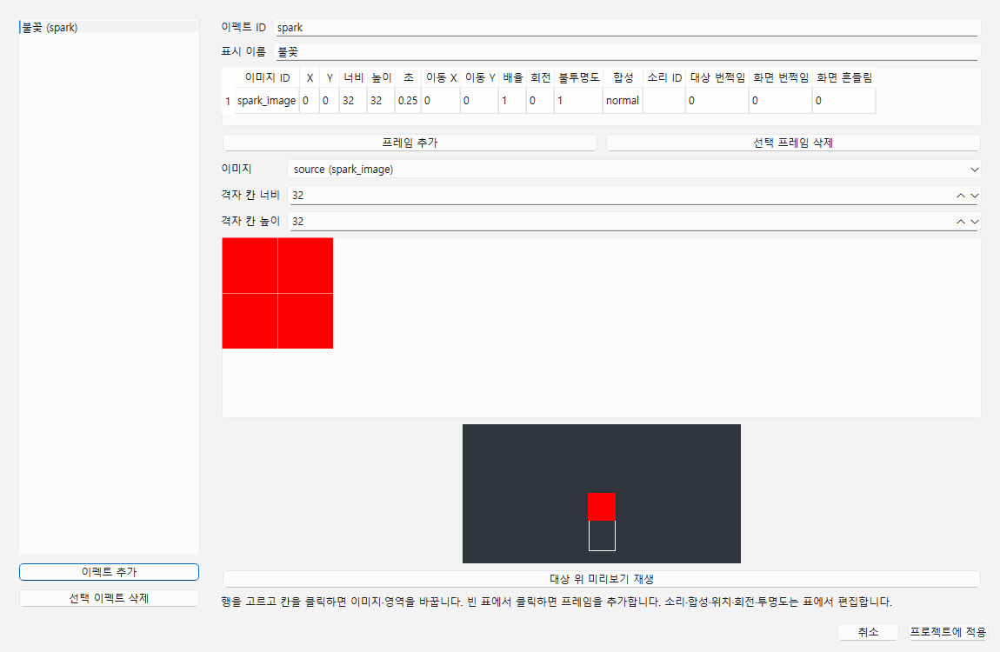
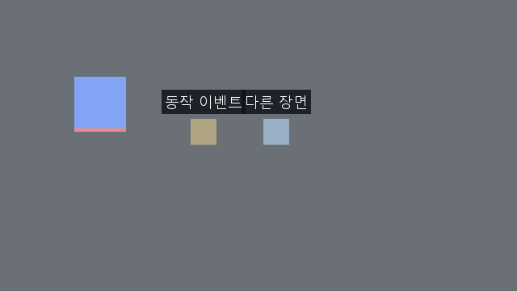

# 이펙트 애니메이션

이펙트는 불꽃·회복빛처럼 게임 화면에 잠시 겹쳐 보여주는 프로젝트 공용 연출입니다. **에셋 → 이펙트 라이브러리...**에서 만들고, 이벤트의 **이펙트 표시** 또는 Python `ctx.effects.play`로 실행합니다. 스킬의 피해·회복·대상 선택 규칙은 아직 구현 전이며 이펙트만으로 게임 값을 바꾸지는 않습니다.



## 만들기와 저장

먼저 **에셋 → 에셋 목록...**에서 PNG/JPG/BMP 이미지와 필요한 WAV/MP3 소리를 등록합니다. **이펙트 라이브러리... → 이펙트 추가**에서 고유 ID와 이름을 입력하고 **프레임 추가**를 누릅니다. 이미지와 격자 칸 너비/높이를 고른 뒤 프레임 행을 선택하고 그림의 칸을 클릭하면 이미지 ID와 X/Y/너비/높이가 들어갑니다. 프레임 표에서 시간과 표시값을 수정하고 **대상 위 미리보기 재생**으로 확인합니다. **프로젝트에 적용**은 한 번의 Undo/Redo 대상으로 기록되고, Ctrl+S로 파일에 저장합니다. 취소하면 프로젝트를 변경하지 않습니다.

이펙트 ID는 만들 때 지정하며 이후에는 고정됩니다. 표시 이름은 수정할 수 있습니다. 이벤트나 DB 속성에서 참조하는 이펙트는 제거할 수 없습니다. Python 코드에 적은 이펙트 ID 문자열은 자동으로 검사하거나 수정하지 않으므로 해당 코드를 함께 관리하세요.

| 프레임 입력 | 기본값·의미 |
|---|---|
| 이미지 ID·X/Y·너비/높이 | 등록된 이미지의 픽셀 영역. ID가 없거나 영역이 이미지 밖이면 적용 거부 |
| 초 | 0.01~60초, 기본 0.1초. 프레임마다 표시 시간 |
| 이동 X/Y·배율·회전 | 대상 중심에서의 픽셀 이동, 양수 배율(기본 1), 회전 각도 |
| 불투명도·합성 | 0~1, 기본 1. 합성은 `normal` 또는 `add` |
| 소리 ID | 해당 프레임에 처음 들어갈 때 한 번 재생할 등록된 소리 ID. 빈칸은 재생 없음 |
| 대상/화면 번쩍임·화면 흔들림 | `1`이면 해당 프레임 동안 적용, `0`이면 끔. 대상 번쩍임은 대상 객체의 충돌 사각형에 흰색을 겹침 |

이펙트는 최대 256개, 이펙트당 프레임은 최대 4096개입니다. ID는 영문·숫자·`_`·`-` 1~64자이며 중복할 수 없습니다. 여러 이펙트를 동시에 재생할 수 있으며 동시 최대 256개입니다. 현재는 반복 재생 옵션이 없습니다. 장면 이동·게임 종료·게임 창 F8에서 재생을 정리합니다.

## 이벤트에서 재생

객체 **이벤트 탭 → 명령 추가 → 이펙트 표시**에서 이펙트 ID, 대상(이 객체·플레이어·장면 객체), **끝날 때까지 기다리기**를 정합니다. 기본값은 이 객체 대상과 완료 대기입니다. 대기를 끄면 다음 명령이 바로 실행됩니다. 대기 중 F8을 누르면 이펙트를 중지하고 이벤트도 멈춥니다. 없는 이펙트/대상은 해당 명령 오류입니다. **F6**은 실제 이펙트·소리 없이 안내 로그를 남기고 다음 명령으로 진행합니다. 같은 명령은 공통 이벤트에서도 사용할 수 있습니다.

예: 표지판 이벤트에 `이펙트 표시: spark → 플레이어, 완료 대기` 다음 `대사 표시`를 두면 게임에서 이펙트가 끝난 뒤 대사가 나옵니다. [이벤트 명령 전체](EVENTS.md).

## Python에서 재생

프로젝트의 `scripts/effect_controls.py`에 아래 코드를 저장하고 **스크립트 → 전역 스크립트...**에 등록합니다. Ctrl+R 실제 게임에서 E를 누르면 대상 위에 재생됩니다.

```python
effect_token = None

def on_game_start(ctx):
    ctx.input.bind("effect_play", ["E"])

def on_update(ctx):
    global effect_token
    if ctx.scene is None:
        return
    if ctx.input.pressed("effect_play"):
        effect_token = ctx.effects.play("spark", "hero")
    if effect_token is not None and not ctx.effects.is_playing(effect_token):
        ctx.log("이펙트 종료")
        effect_token = None
```

`play(effect_id, target="@player", x=0, y=0)`은 양의 재생 번호를 반환합니다. 대상은 객체 ID·`@player`·`@screen`·`@position`이며 `@position`일 때 x/y는 장면 좌표입니다. `is_playing(token)`은 진행 중인지 bool, `stop(token)`은 재생을 중지하고 None을 반환합니다. 없는 이펙트·대상은 ValueError, 동시 재생 한도 초과는 RuntimeError입니다. F5/F6에서는 `ctx.effects`가 None입니다. [공개 API](../SCRIPT_API.md).

## 데이터베이스에서 참조

데이터베이스의 사용자 정의 종류에서 새 속성 형식을 **이펙트**로 고르면 등록한 이펙트 ID를 기본값 또는 항목별 값으로 선택할 수 있습니다. Python의 `ctx.db.get(...)`은 ID 문자열 또는 None을 돌려주며 자동 재생하지 않습니다. 반환한 ID를 `ctx.effects.play(id, target)`에 전달하세요. 참조 중인 이펙트 삭제는 막습니다. **전용 스킬 데이터베이스와 피해·회복 규칙은 순서 16~17에서 분리 구현**합니다.

## 직접 확인

다음에 진행할 사용자 확인 절차는 [E1~E6 수동 테스트 안내](EFFECT_MANUAL_TEST.md)에 준비 명령·클릭 경로·기대 결과별로 정리했습니다. 현재 사용자 확인은 미실시입니다.



`python tools/create_effect_example.py build/manual-effect`로 새 사본을 만든 뒤 제작툴에서 엽니다. 기존 폴더는 덮어쓰지 않습니다. **에셋 → 이펙트 라이브러리...**에서 `spark`의 세 프레임·소리·번쩍임·흔들림을 보고 미리보기, 적용·Undo/Redo·저장·재열기를 확인합니다. Ctrl+R 게임 창에서 E를 누르면 플레이어 위에 빨강→초록→파랑 이펙트가 재생되고 둘째 프레임에서 소리가 나야 합니다. 표지판을 조사하면 이펙트가 끝난 뒤 대사가 나와야 합니다. F6은 그림·소리 없이 진행합니다. 없는 ID, 그림 밖 영역, 없는 소리 ID를 입력한 적용은 거부되어야 합니다.
오른쪽 **다른 장면** 표지판을 조사하면 이펙트 없는 장면으로 이동하며, 그 장면의 **돌아가기**를 조사하면 첫 장면에서 새 이펙트가 시작됩니다. 이전 장면의 재생이 넘어오지 않는지 확인할 수 있습니다.

실제 스피커 출력·UI 조작은 사용자 수동 확인이 필요합니다. 자동 검사는 모델과 실제 player 그림 픽셀/스크립트 호출을 각각 확인합니다. 스킬/몬스터 DB와 전투 연결은 후속 순서 16~17입니다.
