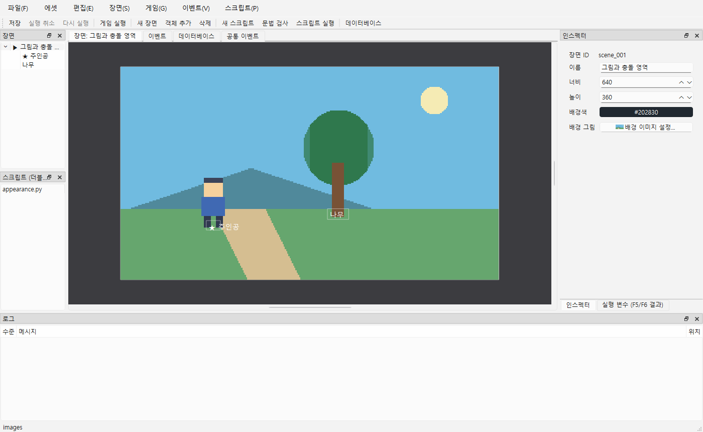
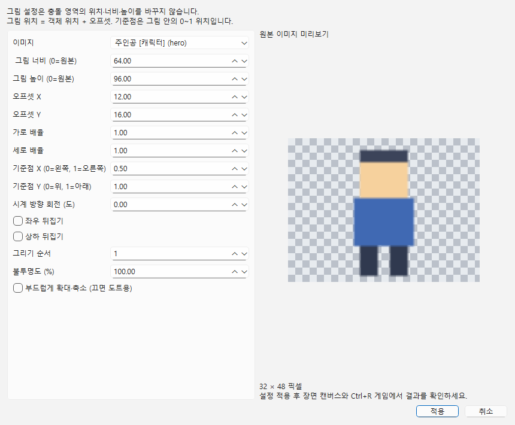
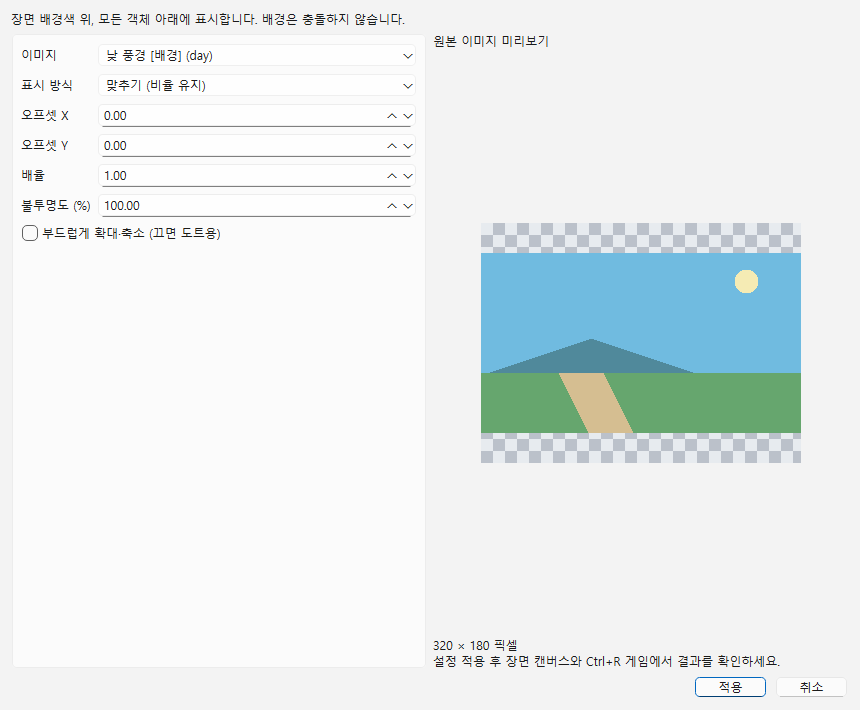
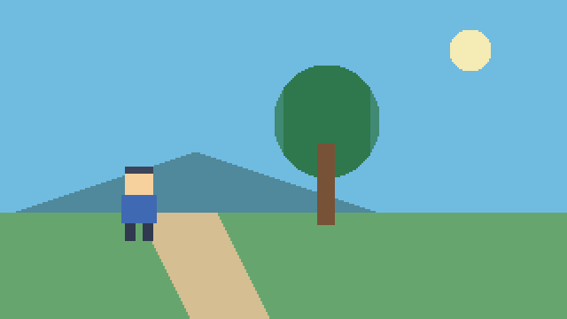

# 객체 이미지·장면 배경

현재 구현: 에셋 이미지(PNG/JPG/JPEG/BMP)를 객체나 장면에 연결하고 제작툴과 실제 게임에서 표시합니다. 그림 크기와 충돌 영역은 별개입니다. 타일맵·카메라·걷기 애니메이션·여러 배경·시차 스크롤은 후속 단계입니다.



## 1. 객체에 그림 붙이기

1. **에셋 → 에셋 목록... → 에셋 추가...**에서 사용할 그림을 추가합니다. PNG 알파는 그대로 보존됩니다.
2. 장면에서 객체를 선택하고 오른쪽 인스펙터의 **객체 그림 → 이미지 설정...**을 누릅니다.
3. 이미지 목록에서 이름·그룹·ID를 확인해 고릅니다. 소리·글꼴은 목록에 나타나지 않습니다. **없음 (이미지 지우기)**으로 해제할 수 있습니다.
4. 원본 미리보기에서 파일을 확인하고 설정한 뒤 **적용**합니다. **취소**는 원본을 바꾸지 않습니다. 적용 후 캔버스에서 배치 결과, **Ctrl+R**로 게임 표시를 확인합니다.
5. 제작툴 **편집 → 실행 취소/다시 실행**, **Ctrl+S**, 프로젝트 재열기를 지원합니다. 이미지 파일 교체도 연결된 그림에 반영됩니다.



| 입력 | 기본값·범위 | 동작 |
|---|---|---|
| 이미지 | 없음 | 에셋 ID 참조. 이름·그룹을 바꿔도 연결 유지 |
| 그림 너비/높이 | 각각 0, 0~100000px | 0인 축은 원본 픽셀 크기. 한 축만 바꿔도 다른 축을 자동 계산하지 않음 |
| 오프셋 X/Y | 0, -100000~100000px | 객체 왼쪽 위 위치에 더한 그림 기준점 위치 |
| 가로/세로 배율 | 각각 1, 0.01~100 | 위 너비·높이에 곱함. 충돌 크기는 유지 |
| 기준점 X/Y | 각각 0, 0~1 | 그림 안의 위치. (0,0)=왼쪽 위, (0.5,1)=아래 중앙 |
| 시계 방향 회전 | 0, -360~360도 | 위 기준점 주위로 회전. 충돌 영역은 회전하지 않음 |
| 불투명도 | 100%, 0~100% | PNG 알파에 추가로 곱함. 0%도 충돌·이벤트는 유지 |
| 좌우/상하 뒤집기 | 끔 | 그림만 뒤집음. 기준점·충돌 위치는 유지 |
| 그리기 순서 | 0, -10000~10000 | 큰 값이 앞. 같으면 장면 객체 목록 순서. 이미지 없는 객체에도 적용 |
| 부드럽게 확대·축소 | 끔 | 끄면 도트용 최근접, 켜면 부드러운 필터. 원본 미리보기는 파일 확인용이며 최종 결과는 캔버스·게임에서 확인 |

좌표 규칙: 최종 그림 너비 = (그림 너비가 0이면 원본 너비) × 가로 배율. 기준점 위치 = 객체 X/Y + 오프셋. 회전 전 그림 왼쪽 위 = 기준점 위치 − 기준점 비율 × 최종 그림 크기입니다.

예제 주인공은 **충돌 24×16**, **그림 64×96**, **오프셋 (12,16)**, **기준점 (0.5,1)**입니다. 발밑 충돌 사각형 아래 중앙에 그림이 맞습니다. 캔버스의 테두리는 충돌·조사 영역이고 그림 전체로도 객체를 선택·드래그할 수 있습니다. 그림을 키워도 통로가 막히는 범위는 커지지 않습니다.

**인스펙터 보이기 OFF**는 그림과 충돌·조사·접촉을 모두 숨깁니다(자동/병렬 이벤트는 유지). 이미지 불투명도 0%는 겉모습만 투명하게 만듭니다. 이미지를 지우면 객체 색 사각형으로 돌아갑니다.

## 2. 장면 배경

장면 트리에서 **장면 이름**을 선택하거나 캔버스 빈 곳을 눌러 객체 선택을 해제합니다. 인스펙터의 **배경 그림 → 배경 이미지 설정...**에서 그림과 표시 방식을 정합니다. **없음**은 배경색만 표시합니다. 적용/취소·Undo·저장/재열기는 객체와 같습니다.



| 표시 방식 | 결과 |
|---|---|
| 맞추기 | 원본 비율을 유지하며 장면 안에 전부 들어오도록 맞춤. 남는 부분은 배경색 |
| 채우기 | 원본 비율을 유지하며 장면을 덮음. 가장자리가 잘릴 수 있음 |
| 늘리기 | 장면 너비·높이에 각각 맞춤. 원본 비율이 달라질 수 있음 |
| 원본 크기 | 원본 픽셀 크기로 왼쪽 위부터 표시 |
| 반복 | 원본 크기의 그림을 가로·세로로 반복 |

기본은 **맞추기 / 오프셋 (0,0) / 배율 1 / 불투명도 100% / 부드러운 필터 끔**입니다. 오프셋은 -100000~100000px, 배율은 0.01~100, 불투명도는 0~100%입니다. 맞추기·채우기·늘리기는 배율을 적용한 뒤 중앙 정렬하고 오프셋을 더합니다. 원본·반복은 왼쪽 위 기준이며 반복의 음수 오프셋도 이어집니다.

표시 순서는 **장면 배경색 → 배경 이미지 → 객체 → 게임 이름표·F9 이름/ID → 게임 대사·선택지 UI**입니다. 배경은 충돌·조사·접촉을 만들지 않습니다. 현재는 장면 좌표 기준이며 창 크기가 바뀌면 장면 비율을 유지합니다. 창 가장자리의 레터박스 여백은 배경 이미지 영역과 별개입니다. 카메라 이동·줌과 화면 고정 배경 선택은 카메라 단계에서 구현합니다.

## 3. 에셋 연결과 오류

- 이미지는 경로 대신 ID로 연결합니다. 에셋 이름/그룹 변경과 프로젝트 폴더 이동 후에도 유지됩니다. 파일 교체는 ID를 유지하므로 객체·배경도 새 그림을 씁니다.
- 추가 팝업에서 ID를 직접 지정할 수 있습니다. 에셋 목록의 **ID 변경...**은 객체·배경 참조도 함께 바꾸고 Undo로 복원합니다. Python 코드에 직접 적은 ID 문자열은 자동 수정하지 않으므로 비교식·대입식도 직접 바꾸고 게임을 다시 실행하세요. [ID 사용법](ASSETS.md#id-직접-지정변경).
- 에셋 상세에 객체/배경 사용처가 표시됩니다. 사용 중인 에셋은 **목록에서 제거**할 수 없습니다. 해당 이미지 설정에서 **없음**을 적용해 연결을 먼저 해제하세요.
- 파일·ID가 누락되거나 손상되면 프로젝트는 열립니다. 객체는 색 사각형, 배경은 배경색으로 대체합니다. 설정 창·캔버스 툴팁에 누락 안내가 있고 실제 게임 로그에도 ID 경고가 한 번 표시됩니다. 에셋의 파일 교체로 복구 후 다시 실행하세요.
- 소리/글꼴 ID를 이미지로 지정하거나 범위를 벗어난 숫자·잘못된 형식을 저장한 프로젝트는 열기/저장에서 거부합니다. 이미지 참조 없는 이전 프로젝트는 기존 색 사각형·배경색 동작을 유지합니다.
- 이미지는 현재 장면에서 필요할 때 읽어 재사용하고 장면 전환·종료 시 캐시를 비웁니다. 제작툴에서 파일을 교체하면 캔버스 캐시를 갱신합니다. 실행 중인 게임에는 자동 재로드하지 않으므로 다시 실행하세요.

현재 지원 빌드인 Windows에서 PNG는 SDL3, JPG/BMP는 Windows 기본 이미지 디코더로 읽습니다. 새 코덱 설치는 필요하지 않습니다. 엔진 데이터·배치 계산은 Qt/SDL과 분리되어 있습니다. Windows 이외 player의 JPG/BMP 디코더는 아직 제공하지 않습니다. 파일당 64 MiB·이미지 32×1024×1024 픽셀 제한을 유지합니다.

## 4. 이벤트·Python 연결

배경 낮/밤/지우기, 객체·플레이어 그림 변경, 변수·입력·다른 기능과의 연결은 [Python 전체 가이드](PYTHON_COOKBOOK.md)에 완성 코드와 함께 정리했습니다. 기존 사용자 `appearance.py`는 자동으로 덮어쓰지 않습니다.

그림 지정은 편집 기능이므로 별도 대기·중지 작업이 없습니다. 현재 전용 ‘객체 이미지 변경/배경 변경’ 이벤트 명령은 없으며 **스크립트 호출**로 연결합니다. BGM·효과음은 [소리 이벤트와 Python API](AUDIO.md)로 재생합니다. 걷기·프레임 애니메이션 API는 아직 없습니다.

예제 `docs/examples/images/scripts/appearance.py`를 프로젝트 `scripts/`에 두고 대상 이미지 ID를 실제 프로젝트에 맞춥니다. 에셋 목록 상세의 ID를 복사해 쓰세요. 전역 등록은 필요하지 않습니다.

```python
def change_appearance(ctx):
    if ctx.scene is None:
        ctx.log("그림 변경은 Ctrl+R 실제 게임에서 확인하세요.")
        return False
    tree = ctx.scene.object("tree")
    if tree is not None:
        tree.image = "tree"       # 등록한 이미지 에셋 ID
    ctx.scene.background_image = "night"
    return True
```

객체 이벤트에 **스크립트 호출 → appearance.py → toggle_background**를 넣으면 예제에서 낮/밤을 번갈아 바꿉니다. 인자는 `ctx` 하나, 반환값은 bool이며 필요하면 이벤트의 반환값 변수로 받습니다. `hide_tree_picture`는 객체 그림 ID를 `""`로 지워 색 사각형으로 바꾸고 `restore_tree_picture`는 그림을 복원합니다.

`obj.image`·`ctx.scene.background_image`는 str 읽기/쓰기입니다. 등록된 이미지 ID 또는 `""`만 허용합니다. 없는 ID·다른 종류는 `ValueError`, 문자열 이외는 `TypeError`이며 기존 값은 유지됩니다. 그 외 그림 설정과 충돌 크기는 유지합니다. 실행 사본에 즉시 반영하고 대기하지 않으므로 F8로 되돌리지 않습니다. 장면 재진입·게임 재시작은 편집 설정으로 초기화합니다. 저장된 프로젝트는 바꾸지 않습니다.

**F5 단독 실행·F6 이벤트 테스트**에서는 `ctx.scene`이 None이므로 예제는 안내 로그만 출력합니다. **Ctrl+R 실제 게임**에서 표시 변경을 확인하세요. 전역 코드에 쓰려면 장면이 준비된 `on_scene_enter(ctx)`나 `on_update(ctx)`에서 호출합니다. `on_game_start`에는 아직 장면이 없습니다. 오류는 Python 파일·행·traceback과 이벤트 호출 위치에 남습니다. API 전체는 [SCRIPT_API](../SCRIPT_API.md)를 보세요.

## 5. 직접 확인

`docs/examples/images` 전체를 `build/manual-images` 같은 새 위치에 복사합니다. `dev check` 후 사본을 열어 확인합니다. 원본 예제와 기존 사용자 사본을 덮어쓰지 않습니다.

| 번호 | 조작 | 예상 결과 |
|---|---|---|
| 1 | 주인공 선택 → 이미지 설정 → 그림 크기·기준점·뒤집기·회전 변경 → 취소/적용 → Undo/Redo | 취소는 변화 없음. 적용은 그림만 바뀌고 충돌 24×16은 유지. Undo/Redo 복원 |
| 2 | Ctrl+R → 주인공을 움직여 나무 주변으로 이동 | 그림이 이동하고 나무 줄기 밑 작은 영역이 막음. 큰 수관 부분 전체가 벽이 되지 않음 |
| 3 | 이미지 불투명도 0%와 인스펙터 보이기 OFF를 각각 적용 후 실행 | 0%는 충돌 유지, 보이기 OFF는 충돌·조사·접촉도 없음 |
| 4 | 장면 배경 설정 → 다섯 표시 방식·오프셋·배율·불투명도 변경 | 캔버스·게임 같은 배치. 배경 뒤에는 배경색. 반복 경계 연결 |
| 5 | 객체 그리기 순서를 바꾸고 겹치게 배치 → 저장·재열기 | 큰 순서가 앞, 같은 순서는 객체 목록 순서. 이미지·설정 유지 |
| 6 | 에셋 이름/그룹 변경·파일 교체 → 목록에서 제거 시도 | 참조 유지·그림 갱신. 사용처 표시와 사용 중 제거 차단 |
| 7 | 게임 종료 → 사본의 hero.png만 임시 이동 → 재열기·실행 → 파일 복구 | 객체 색으로 대체·경고, 프로젝트 열기 가능. 복구/재실행 시 이미지 정상 |
| 8 | Ctrl+R → 나무 바로 아래에서 위를 보고 결정 키 → 대사 넘기기. F6으로도 같은 이벤트 실행 | 실제 게임은 낮/밤 전환. F6은 안내 로그만. 편집 원본 배경은 유지 |

실제 화면·조작의 사용자 확인은 자동 검사와 별도로 기록합니다. 글꼴·음원 수동 확인 결과를 이 확인으로 대신하지 않습니다.

## 그림 다시 찍기

```powershell
$exe = ".\build\windows-msvc\bin\NaruStudio.exe"
& $exe docs/examples/images --smoke-test 1200 --screenshot docs/guide/images/29-image-scene.png
& $exe docs/examples/images --object-image-dialog hero --screenshot docs/guide/images/30-object-image.png
& $exe docs/examples/images --background-image-dialog scene_001 --screenshot docs/guide/images/31-background-image.png
.\build\windows-msvc\bin\NaruPlayer.exe docs/examples/images --frames 2 --screenshot docs/guide/images/32-image-game.png
```



그림 파일은 `tools/generate_image_example.py`로 직접 생성한 검증 자료입니다. 재생성은 새 폴더에 `python tools/generate_image_example.py build/new-image-example`로 실행합니다.
