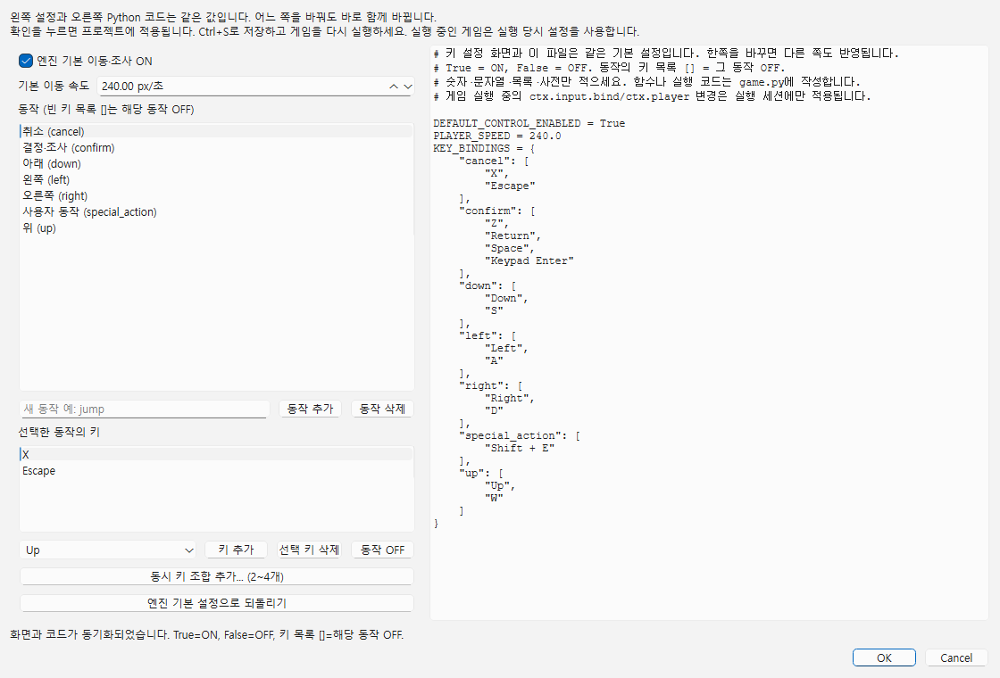
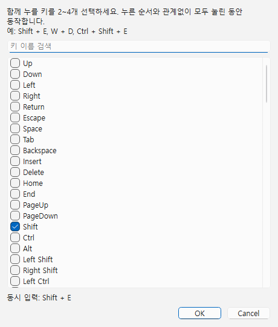

# 키 설정 · Python과 화면 동기화

기준: 2026-11-01. **게임 → 키 설정...**과 전용 Python 파일이 같은 기본값을 편집합니다. 한쪽을 우선하는 두 설정이 아닙니다. 새 프로젝트의 파일은 `scripts/input_settings.py`이며 프로젝트에는 이 파일 이름만 기록합니다.



## 1. 화면에서 바꾸기

1. **게임 → 키 설정...**을 엽니다.
2. **엔진 기본 이동·조사 ON** 체크나 기본 이동 속도를 바꿉니다.
3. 동작을 선택하고 아래 키 목록에서 **키 추가·선택 키 삭제·동작 OFF**를 사용합니다.
4. 오른쪽 Python 값도 바로 바뀝니다. 오른쪽에서 값을 고쳐도 왼쪽이 바로 갱신됩니다.
5. **확인 → Ctrl+S → 게임 재실행**으로 적용합니다. 취소하면 창에서 한 변경을 적용하지 않습니다.

기본 동작은 위/아래/왼쪽/오른쪽/결정·조사/취소입니다. 삭제 대신 빈 키 목록으로 끕니다. 사용자 동작은 소문자로 시작하는 영문 소문자·숫자·`_`, 최대 32자로 추가·삭제합니다. 예: `jump`, `dash`, `open_menu`. 이름만 추가해도 점프나 메뉴가 구현되지는 않으며 이벤트/Python에서 그 입력을 사용해야 합니다.

**엔진 기본 설정으로 되돌리기**는 속도 240, 기본 조작 ON과 기본 동작 6개의 키를 복원하고 사용자 동작을 제거합니다. 적용한 변경은 프로젝트 Ctrl+Z/Ctrl+Y로 취소·복원합니다. 키 하나를 여러 동작에 배치하면 해당 동작들이 함께 눌릴 수 있으므로 의도한 연결인지 확인하세요.

## 2. Python 파일에서 바꾸기

다음은 실제로 읽을 수 있는 설정입니다.

```python
DEFAULT_CONTROL_ENABLED = True
PLAYER_SPEED = 240.0
KEY_BINDINGS = {
    "up": ["Up", "W"],
    "down": ["Down", "S"],
    "left": ["Left", "A"],
    "right": ["Right", "D"],
    "confirm": ["Z", "Return", "Space", "Keypad Enter"],
    "cancel": ["X", "Escape"],
    "dash": ["Shift"]
}
```

| 변수 | 뜻 |
|---|---|
| `DEFAULT_CONTROL_ENABLED` | True=엔진 기본 이동·조사 ON, False=OFF. 대사/선택지 조작과 Python 입력 읽기는 끄지 않음 |
| `PLAYER_SPEED` | 플레이어 기본 이동 속도, 0~100000 px/초. 0이면 기본 이동하지 않음 |
| `KEY_BINDINGS` | 동작 이름→키 문자열 목록. 빈 목록 `[]`는 해당 동작 OFF |

`"right": ["L"]`이면 L로 오른쪽 이동, `"confirm": ["E"]`이면 E로 결정/조사합니다. `Enter`는 `Return`, `Esc`는 `Escape`의 별칭이며 대소문자는 구분하지 않습니다. 화면은 정식 이름으로 표시할 수 있습니다.

이 파일은 **세 변수의 리터럴 대입만 쓰는 전용 설정 파일**입니다. True/False·숫자·문자열·목록·사전·주석과 끝 쉼표를 사용할 수 있습니다. 계산식·다른 변수·import·함수 정의/호출은 넣지 않습니다. 일반 실행 코드는 `game.py` 등 다른 파일에 작성하세요. 엔진은 이 파일을 실행하지 않고 값만 읽습니다.

기본 동작 6개는 파일에 모두 있어야 합니다. 끌 때는 이름을 지우지 말고 `[]`를 씁니다. 동작은 최대 128개, 한 동작의 배치는 최대 64개입니다. 중복 배치·알 수 없는 이름·범위 밖 속도·잘못된 형식을 거부합니다. 선택 가능한 키는 화면의 목록을 기준으로 합니다. Shift/Ctrl/Alt는 각각 왼쪽·오른쪽 수식 키를 모두 허용합니다. 조합은 아래처럼 `+`로 연결합니다.

## 3. 동기화·저장·오류

- 설정 창 안에서는 화면↔코드가 즉시 동기화됩니다. 잘못된 코드는 행과 이유를 표시하며 올바르게 고칠 때까지 화면 적용/확인을 막습니다.
- 제작툴 스크립트 탭에서 전용 파일을 편집하면 올바른 내용이 프로젝트 설정에도 반영됩니다. 미완성/오류 코드는 저장·게임 실행 전에 거부합니다. F7은 설정 검사, F5는 검사·저장 안내이며 일반 `run(ctx)`를 호출하지 않습니다.
- 설정 스크립트 탭을 닫으며 **변경 버리기**를 고르면 연결된 화면 값도 파일에 저장된 값으로 복구합니다.
- 외부 편집기의 저장 내용은 키 설정 창을 열거나 저장/게임 실행할 때 다시 읽습니다. 외부 파일과 미저장 화면 값이 모두 달라졌으면 덮어쓰지 않고 충돌을 알립니다.
- GUI 적용은 파일의 해당 값 영역을 다시 정리합니다. 세 변수 밖의 주석은 보존하며 복잡한 사용자 코드는 별도 파일에 둡니다.
- 이전 프로젝트에 설정 파일이 없으면 엔진 기본값으로 열립니다. 처음 적용할 때 전용 파일을 만들며 같은 이름이 있으면 다른 이름으로 기존 스크립트를 보존합니다. 실제 파일 이름은 `project.json`의 `inputSettingsScript`에 있습니다.

## 4. 기본 설정과 실행 중 변경의 차이

전용 파일과 화면은 **다음 게임 시작에 쓸 같은 기본 설정**입니다. 실행 중인 게임은 시작 당시 사본을 씁니다. 스킬·컷신·전역 스크립트가 `ctx.input.bind(...)`, `ctx.player.speed`, `ctx.player.default_control`을 바꾸는 것은 실행 세션의 변경이며 원본 파일/편집 문서를 자동 저장하지 않습니다.

새 프로젝트 `game.py`의 달리기 예제는 `DASH_ENABLED = False`로 꺼져 있습니다. True로 바꾸면 공유 설정의 `dash` 동작을 읽고 누르는 동안 속도 배율을 적용합니다. 키 자체를 `game.py`에서 중복 정의하지 않습니다.

이전 `game.py`가 매 틱 `WALK_SPEED`나 고정 키를 다시 대입한다면 그 코드는 여전히 게임 동작을 바꿉니다. 기본 키/속도는 전용 설정 파일로 옮기고 달리기 같은 임시 변경만 남기세요. 키 설정 화면이 임의 Python 함수의 실행 결과를 해석하거나 코드를 자동 재작성하는 기능은 아닙니다.

F5/F6에서는 `ctx.input/player`가 None입니다. 설정 파일 편집과 F6에서 실제 키로 이동하는 기능을 혼동하지 마세요. 현재 범위는 키보드·프로젝트 기본 설정이며 이용자 개인 설정 메뉴·패드는 이후 개발 범위입니다.

## 5. 8을 눌러 위로 이동한 뒤 오른쪽 보기

[key_move_face.py](../examples/key_move_face.py)를 게임 프로젝트의 `scripts/`에 복사합니다. 게임 → 키 설정에서 **step_up_face_right** 동작을 추가하고 **8**을 연결합니다. 숫자 키패드도 쓰려면 **Keypad 8**을 별도로 추가합니다. 확인·저장 후 스크립트 → 전역 스크립트에서 **key_move_face.py를 등록**하고 Ctrl+R로 실행합니다. 장면에는 플레이어로 지정된 객체가 있어야 합니다.

`on_update`는 `pressed("step_up_face_right")`를 확인합니다. 참이면 `move(0, -48)`로 위로 이동하고 `facing = "right"`로 방향을 바꿉니다. 새로 누를 때 한 번씩 실행하므로 누르고 있다고 매 틱 이동하지 않습니다. 이동 거리는 파일 위의 `KEY_MOVE_DISTANCE`로 바꿉니다. 이 예제는 즉시 이동이며 벽/장면 끝이면 그 앞에서 멈추고, 움직이지 못해도 오른쪽을 바라봅니다. F5는 안내 로그만 표시하며 실제 키 입력 시험은 전역 등록 후 게임에서 합니다.

부드럽게 이동한 다음 오른쪽을 보려면 공통 이벤트를 만들고 (1) **객체 이동: 플레이어·위·48px·240px/초·완료 대기** (2) **스크립트 호출: key_move_face.py / face_right**를 넣습니다. 이후 `on_update`의 이동/방향 변경 부분을 `ctx.run_event("공통_이벤트의_실제_ID")`로 바꿉니다. 예를 들어 목록 ID가 `common_1`이면 `ctx.run_event("common_1")`입니다. 예약한 이벤트가 플레이어 이동 완료를 기다린 뒤 방향을 바꿉니다. F6는 이동을 로그로만 표시하므로 실제 게임에서도 확인하세요.

참고로 기본 엔진의 **W+D/위+오른쪽 대각선 이동은 이미 지원**합니다. 별도 대각선 동작을 만들 필요가 없습니다. Python에서 두 동작이 함께 눌렸는지는 `ctx.input.held("up") and ctx.input.held("right")`로 확인합니다. 현재 키 목록 `["W", "D"]`는 W 또는 D이며 둘 다 누르라는 뜻은 아닙니다.

## 6. 여러 키를 동시에 눌러 실행하기

1. **게임 → 키 설정...**에서 사용자 동작 `special_action`을 추가하거나 기존 동작을 선택합니다.
2. **동시 키 조합 추가... (2~4개)**를 누르고 Shift와 E를 체크한 뒤 확인합니다.
3. 목록에 **Shift + E**가 생기고 Python도 함께 바뀝니다. 확인·Ctrl+S 후 게임을 다시 실행합니다.



```python
# KEY_BINDINGS 사전의 항목 예시
"special_action": ["Shift + E", "F"],
"step_up_face_right": ["Shift + 8"],
```

목록의 항목끼리는 **또는(OR)**, 한 문자열 안에서 `+`로 연결한 키끼리는 **모두(AND)**입니다. 위 예시는 Shift와 E를 함께 누르거나 F만 누르면 실행합니다. `["W", "D"]`는 W 또는 D, `["W + D"]`는 W와 D를 함께 누르기입니다. 기존 키를 남긴 채 조합을 추가하면 기존 키만으로도 실행하므로 필요 없다면 **선택 키 삭제**로 지우세요.

누른 순서는 상관없습니다. 먼저 Shift를 잡고 E를 눌러도, E를 잡고 Shift를 눌러도 겹쳐 눌린 순간 동작합니다. `pressed()`는 동작 전체가 꺼짐→켜짐일 때 한 번, `held()`는 조합이 유지되는 동안 True입니다. 한 키를 떼면 꺼지고 다시 누르면 재실행합니다. 단, 대체 키 F가 계속 눌려 있다면 동작은 계속 켜진 상태이므로 조합을 다시 눌러도 새로운 `pressed()`는 발생하지 않습니다. 순서대로 누르는 콤보나 일정 시간 안에 누르는 판정은 별도 게임 코드로 작성합니다.

추가 키를 함께 눌러도 허용합니다. 조합의 구성 키를 다른 동작에도 배치했다면 그 동작도 함께 켜지며 입력을 독점하지 않습니다. 예를 들어 W+D 조합과 기본 위/오른쪽 이동이 함께 동작할 수 있습니다. 키보드에 따라 여러 키를 동시에 감지하지 못하는 경우에는 다른 조합을 선택하세요.

조합은 서로 겹치지 않는 키 2~4개입니다. `Shift + Left Shift`, `E + E`처럼 같은 키를 중복 요구하면 거부합니다. `Keypad +`는 숫자 키패드의 더하기 키 하나이며 `Ctrl + Keypad +`도 쓸 수 있습니다. 이름·대소문자·공백과 누른 순서는 정리되어 표시됩니다.

[key_combinations.py](../examples/key_combinations.py)를 프로젝트 `scripts/`에 복사하고 전역 등록하면 `special_action`을 새로 누를 때 로그가 나옵니다. 실제 스킬은 이 위치에서 작성하거나 존재하는 공통 이벤트 ID로 `ctx.run_event(...)`를 호출합니다. 기존 [8 이동 예제](../examples/key_move_face.py)도 코드를 바꾸지 않고 키 설정을 `Shift + 8`로 바꾸면 같은 방식으로 동작합니다.

게임 중 Python으로 임시 배치를 바꿀 때도 같은 문법입니다.

```python
ctx.input.bind("special_action", ["Shift + E", "F"])
if ctx.input.pressed("special_action"):
    ctx.log("이번에 새로 눌림")
```

재촬영:

```powershell
& build/windows-msvc/bin/NaruStudio.exe --input-settings-dialog --screenshot docs/guide/images/24-input-settings.png
& build/windows-msvc/bin/NaruStudio.exe --input-combination-dialog --screenshot docs/guide/images/25-input-combination.png
```
