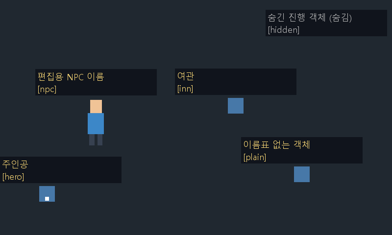
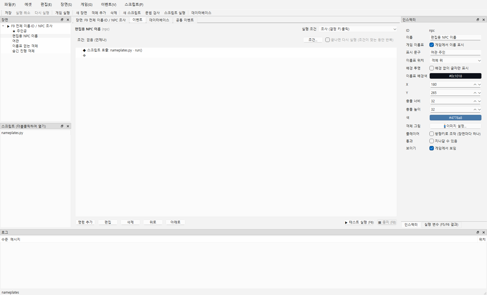
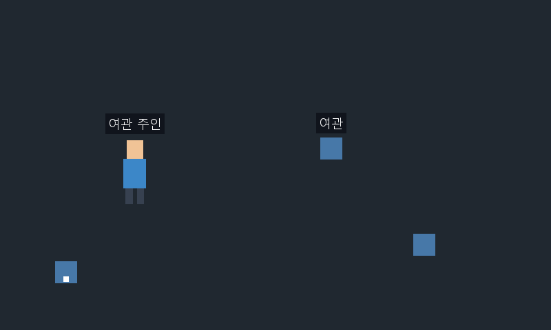
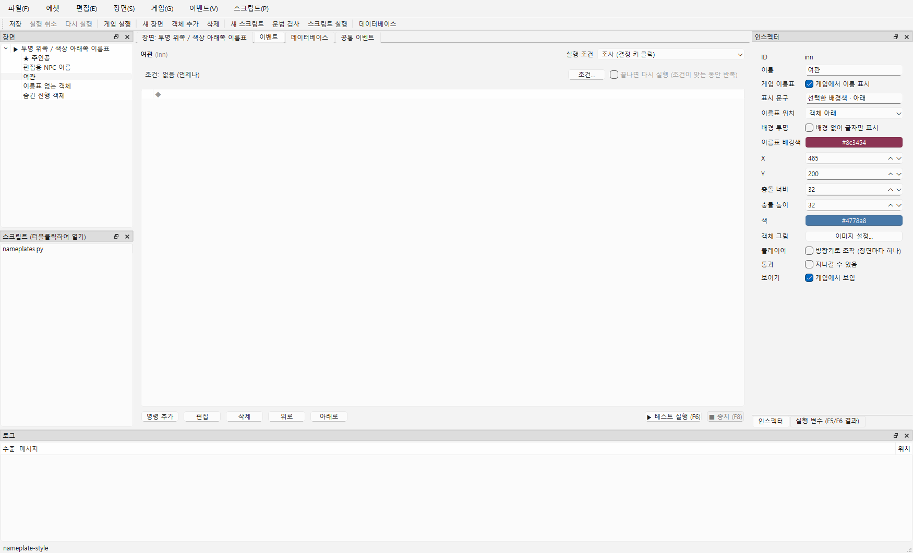
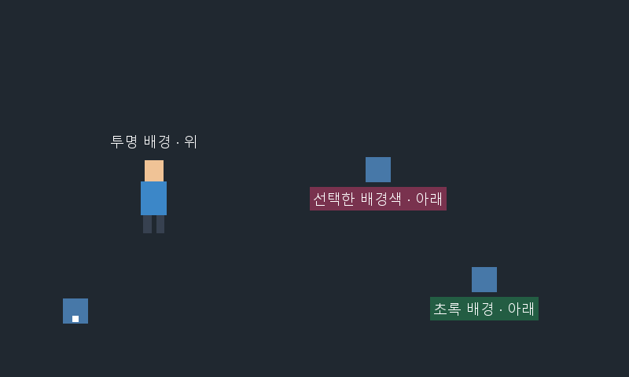

# 객체 이름표와 테스트용 이름·ID

게임을 시험하며 객체를 구별하려면 **F9**, 게임 이용자에게 NPC·시설 이름을 보여주려면 **인스펙터의 게임 이름표**를 사용합니다. 객체의 편집용 이름과 게임에 보일 문구를 다르게 정할 수 있습니다.

| 용도 | 켜는 방법 | 표시 내용 | 저장 |
|---|---|---|---|
| 테스트용 전체 표시 | 게임 창에서 F9 | 현재 장면의 객체 이름 + [객체 ID]. 숨긴 객체도 ‘숨김’ 표시 | 실행 중에만 유지, 프로젝트에 저장하지 않음 |
| 게임용 개별 이름표 | 객체 선택 → 인스펙터 → 게임 이름표 체크 | 해당 객체의 표시 문구. 빈 칸이면 객체 이름 | 장면 파일에 저장, Undo/Redo 지원 |

## 1. 테스트 중 이름·ID 켜고 끄기

1. 제작툴에서 기존 소리 테스트 프로젝트 `build/manual-audio` 또는 자기 프로젝트를 엽니다.
2. Ctrl+R로 게임을 실행하고 **게임 창에 초점을 둡니다**.
3. **F9**를 누르면 현재 장면의 전체 객체 이름과 ID가 머리 위에 나타납니다. 숨긴 객체는 회색 글자와 `(숨김)`으로 구별합니다. 객체를 나타나게 하거나 충돌·조사 설정을 바꾸는 기능은 아닙니다.
4. 다시 F9를 누르면 테스트 표시가 꺼집니다. 게임용 이름표를 켠 객체의 이름표는 계속 남습니다. 한 번 누를 때마다 전환하며 길게 누른다고 매 프레임 깜빡이지 않습니다.

처음부터 표시하려면 제작툴의 **게임 → 게임 시작 시 객체 이름·ID 표시**를 체크한 뒤 Ctrl+R을 누릅니다. 이 메뉴는 **다음 게임 시작 시의 초기값**입니다. 이미 열린 게임은 게임 창의 F9로 바꿉니다. 제작툴 창을 다시 열면 기본은 체크 해제입니다.

게임을 닫고 재실행하면 제작툴 메뉴의 초기값으로 시작합니다. 현재 게임의 F9 상태는 편집 문서에 남지 않습니다. 게임 내 장면 이동에는 현재 F9 상태를 유지합니다.

**창에 따른 F9 차이:** 제작툴의 F9는 기존처럼 데이터베이스 탭을 엽니다. 별도 게임 창의 F9는 이름·ID 표시를 전환합니다. 게임에서는 F9를 이 용도로 예약하므로 Python `ctx.input`의 게임 동작 키로 사용하지 않습니다.



직접 player를 실행할 때도 초기 표시를 지정할 수 있습니다.

```powershell
.\build\windows-msvc\bin\NaruPlayer.exe docs/examples/nameplates --debug-object-names
```

기존 `--debug-state`는 제작툴 변수 패널을 위한 값 전송이며 화면의 이름표를 켜지 않습니다. `--debug-object-names`는 게임 화면 위에 객체를 식별하는 글자를 그립니다. 로그를 추가로 작성할 필요가 없습니다.

## 2. NPC·시설에 게임용 이름표 붙이기

1. 장면의 NPC·시설 객체를 클릭합니다. 오른쪽 인스펙터의 **이름**은 제작자가 식별하는 이름입니다.
2. **게임 이름표 → 게임에서 이름 표시**를 체크합니다. 기본값은 꺼짐입니다.
3. **표시 문구**에 `여관 주인`처럼 게임에 보여줄 글자를 입력하고 Enter를 누르거나 다른 칸을 클릭해 확정합니다. 문구를 비우면 인스펙터의 기존 **이름**을 사용합니다. 체크를 꺼도 입력한 문구는 보존됩니다.
4. Ctrl+S → Ctrl+R. 해당 객체 위에만 이름표가 나타나는지 확인합니다. F9가 꺼져 있어도 개별 이름표는 표시됩니다.
5. 편집 메뉴의 실행 취소/다시 실행(Ctrl+Z/Ctrl+Y)과 저장·재열기로 설정을 복원할 수 있습니다. 텍스트 입력 칸에 초점이 있으면 그 칸의 글자 편집 단축키가 먼저 적용될 수 있으므로 편집 메뉴로 확인하세요.



이름표는 객체 이동을 따라갑니다. 그림이 있으면 그림 크기·오프셋·기준점·회전을 반영한 그림 위 또는 아래에 붙으며, 그림이 없거나 읽지 못하면 충돌 사각형을 기준으로 합니다. 머리 위 그림과 충돌 영역이 다른 NPC에도 사용할 수 있습니다. 화면 위쪽·좌우 가장자리에서는 읽을 수 있도록 화면 안으로 옮겨 표시합니다.

**객체의 보이기를 끄면 게임용 이름표도 숨깁니다.** 테스트 F9는 숨긴 객체를 식별하기 위해 이름·ID만 표시합니다. 그림의 불투명도를 0으로 만드는 것과 객체 보이기를 끄는 것은 다릅니다. 불투명도는 그림에만 적용하므로 이름표는 유지됩니다.

게임용 글자는 흰색이며 배경색 또는 배경 투명을 선택합니다. 테스트 표시는 노란색(숨긴 객체는 회색)과 고정된 어두운 배경을 사용합니다. 게임용은 한 줄, 테스트용은 이름과 ID 두 줄입니다. 표시 폭은 최대 240 장면 픽셀이고 긴 글자는 `...`로 줄입니다. 실제 저장 문구를 자르지는 않습니다. 이름표가 겹치지 않도록 자동으로 재배치하는 기능, 글꼴/글자색/거리/세부 좌표 편집, 클릭 가능한 이름표는 아직 없습니다. 이름표는 객체의 충돌·조사 범위를 넓히지 않습니다.

표시 문구는 빈 문자열 또는 한 줄 글자이며 제어 문자·줄바꿈 없이 UTF-8 기준 최대 512바이트입니다. 길이/형식이 잘못되면 이전 값을 유지하고 오류를 표시합니다. 장면 JSON은 `showName`(기본 false), `nameText`(기본 빈 글자)를 사용합니다. 기존 프로젝트에는 이 필드가 없어도 열리며 이름표는 기본 꺼짐입니다.



제작툴 캔버스와 장면 트리는 계속 객체의 **편집용 이름**을 표시합니다. 실제 게임용 문구와 테스트 ID 표시는 위 두 게임 화면처럼 Ctrl+R로 확인합니다.

### 배경 투명·색과 위/아래 위치

1. 객체를 선택하고 **게임 이름표**를 켭니다. **이름표 위치**에서 **객체 위 / 객체 아래**를 고릅니다. 기본은 객체 위입니다.
2. 배경 없이 글자만 보이게 하려면 **배경 투명 → 배경 없이 글자만 표시**를 켭니다. 글자 자체가 투명해지는 설정은 아닙니다.
3. 색 배경을 원하면 **배경 투명**을 끄고 **이름표 배경색** 버튼을 누릅니다. 색 선택 창에서 색을 고르고 **OK**로 적용합니다. **Cancel**은 이전 색을 유지합니다.
4. Ctrl+S → Ctrl+R로 확인합니다. 게임을 실행한 뒤 에디터 값을 바꿨다면 게임을 종료하고 다시 실행해야 새 편집값을 읽습니다. Python으로 바꾸는 경우에는 현재 게임에 즉시 적용할 수 있습니다.

투명을 켜도 고른 색은 보관되며, 다시 끄면 같은 색이 돌아옵니다. 배경색 버튼은 투명 상태에서는 비활성화됩니다. 배경색은 기존처럼 약간 비치는 배경(알파 210/255)이며, 완전 투명은 투명 체크로 지정합니다. 투명도 수치 슬라이더는 아직 없습니다. 체크·색·위치 모두 객체별 설정이며 실행 취소/다시 실행·저장/재열기를 지원합니다.

위/아래 기준은 회전한 그림의 바깥 경계입니다. 그림을 읽지 못하면 충돌 사각형을 사용합니다. 화면 가장자리에서는 선택한 방향보다 화면 안에서 읽을 수 있도록 보정하는 것을 우선합니다. 디버그 F9 표시는 게임용 배경색/투명/위치와 별개로 기존 위쪽·어두운 배경을 사용합니다. F9를 끄면 개별 설정으로 돌아옵니다.

| 장면 JSON | 기본값 | 값 |
|---|---|---|
| nameBackgroundTransparent | false | true면 배경을 그리지 않음. 보관한 색은 유지 |
| nameBackgroundColor | #0c1018 | #rrggbb 색 문자열. 알파가 붙은 #rrggbbaa는 받지 않음 |
| namePosition | above | above / below |

이 필드가 없는 기존 장면은 어두운 배경·위쪽 표시를 유지합니다. 잘못된 색/위치는 저장/불러오기 오류로 보고하며 정상 저장 파일을 덮어쓰지 않습니다.





## 3. Python으로 문구·표시 바꾸기

프로젝트의 `scripts/nameplates.py`에 아래 코드를 저장합니다. **스크립트 → 새 스크립트...**로 만들거나 [완성 예제 파일](../examples/nameplates/scripts/nameplates.py)을 복사할 수 있습니다. 외부에서 복사했다면 프로젝트를 다시 열어 목록을 갱신합니다.

```python
def run(ctx):
    if ctx.scene is None:
        ctx.log("이름표 변경은 Ctrl+R 게임 실행에서 확인하세요.")
        return
    npc = ctx.scene.object("npc")
    if npc is None:
        ctx.warning("npc 객체가 없습니다.")
        return
    npc.show_name = True
    npc.name_text = "여관 주인"
    npc.name_background_color = "#8c3454"
    npc.name_background_transparent = False
    npc.name_position = "below"


def hide_name(ctx):
    if ctx.scene is not None:
        npc = ctx.scene.object("npc")
        if npc is not None:
            npc.show_name = False


def use_object_name(ctx):
    if ctx.scene is not None:
        npc = ctx.scene.object("npc")
        if npc is not None:
            npc.show_name = True
            npc.name_text = ""
```

| 속성 | 값과 기본값 | 동작 |
|---|---|---|
| `obj.show_name` | bool, 기본 False | 이름표를 표시할지 읽기/쓰기. `obj.visible=False`이면 켜도 게임용 이름표는 숨김 |
| `obj.name_text` | str, 기본 "" | 표시 문구 읽기/쓰기. 빈 문자열이면 obj.name 사용. obj.name 자체는 바뀌지 않음 |
| `obj.name_background_transparent` | bool, 기본 False | True면 배경 없이 글자만. 색 값은 보관 |
| `obj.name_background_color` | str, 기본 #0c1018 | #rrggbb 배경색. 투명이 False일 때 보임 |
| `obj.name_position` | str, 기본 above | above=객체 위, below=객체 아래 |

두 속성은 `ctx.scene.object(ID)`, `find(이름)`, `objects()`로 얻은 SceneObject에서 사용합니다. 플레이어도 `ctx.scene.object(ctx.player.id)`로 얻으면 같은 설정을 사용할 수 있습니다. 별도 Player 속성을 추가한 것은 아닙니다.

객체 이벤트 → **명령 추가 → 스크립트 호출 → 파일 nameplates.py → 함수 run / hide_name / use_object_name → 결과 변수 비움**으로 연결합니다. 함수 칸에는 괄호 없이 이름만 넣습니다. 인자 ctx는 엔진이 넘겨주며 함수는 None을 반환하고 기다리지 않습니다. 이벤트 함수로 쓰면 전역 등록은 필요 없습니다. 제공 예제의 run은 조사할 때마다 `여관 주인`과 `어서 오세요`를 번갈아 표시하고 로그를 남깁니다.

F5/F6에서는 ctx.scene이 None이므로 위 코드는 안내 또는 무변경으로 끝납니다. 실제 게임에서는 장면이 있는 이벤트와 on_scene_enter/on_update/on_scene_exit 훅에서 사용합니다. on_game_start는 첫 장면 진입 전이므로 ctx.scene이 None입니다. 전역 훅으로 쓰려면 정해진 훅 함수를 작성해 **스크립트 → 전역 스크립트...**에 등록합니다.

show_name에 bool 이외, name_text에 문자열 이외를 대입하면 TypeError입니다. 문구 길이/제어 문자가 잘못되면 ValueError이고 이전 값을 유지합니다. 잘못된 객체 ID 조회는 None이며, 다른 장면으로 이동한 뒤 오래된 객체 핸들을 사용하면 KeyError가 날 수 있습니다. 스크립트 파일·행·traceback이 로그에 남습니다. 실행 사본만 바꾸며 장면 재진입/게임 재시작 때는 저장한 편집값으로 돌아갑니다. 테스트 F9는 Python 공개 속성이 아니며 게임용 속성을 바꾸지 않습니다. 배경 투명은 bool, 배경색/위치는 str만 받습니다. 잘못된 타입은 TypeError, #rrggbb가 아닌 색 또는 above/below 이외 위치는 ValueError이며 이전 값이 유지됩니다.

## 4. 예제와 직접 확인

제작툴에서 **docs/examples/nameplates** 폴더를 열고 Ctrl+R을 누릅니다. 아래쪽 왼편은 주인공, 왼편 그림 캐릭터는 NPC, 가운데 위쪽 사각형은 여관, 오른쪽 아래 사각형은 이름표 없는 객체입니다. 오른쪽 위에는 숨긴 진행 객체가 있습니다.

| 번호 | 조작 | 기대 결과 |
|---|---|---|
| 1 | Ctrl+R로 실행 | NPC는 ‘여관 주인’, 여관은 ‘여관’만 표시. 주인공·일반 객체 이름은 안 나옴 |
| 2 | 게임 창에서 F9 → 유지 → 키를 떼고 다시 F9 | 한 번 켜지고, 길게 눌러도 반복 전환 없음. 다시 누르면 게임용 이름표만 남음 |
| 3 | F9를 켜고 오른쪽 위 확인 | 숨긴 진행 객체의 이름·[hidden]·숨김 표시. 객체 그림/충돌은 계속 숨김 |
| 4 | NPC 바로 아래에서 위를 보고 Z/Enter/Space로 조사 | ‘어서 오세요’로 변경, 재조사하면 ‘여관 주인’. F9는 계속 편집용 이름/ID를 보여줌 |
| 5 | 게임 종료 → NPC 인스펙터 표시 문구 비우기 → 저장 → 실행 | ‘편집용 NPC 이름’으로 표시. 다시 실행해도 설정 유지 |
| 6 | 인스펙터 게임 이름표 체크 끄기 → Undo/Redo → 저장/재열기 | 체크·문구가 복원되고 해당 객체에만 적용 |
| 7 | 사본에서 NPC 보이기 끄기 → 실행 → F9 | 일반 이름표 없음. F9를 켜면 숨김 디버그 이름·ID만 표시 |
| 8 | 게임 메뉴 ‘게임 시작 시 객체 이름·ID 표시’ 체크 → 실행 → F9로 끄기 → 종료/재실행 | 시작 때 전체 표시. F9는 현재 실행만 변경. 다음 실행은 메뉴 체크 초기값으로 다시 켜짐 |

기존 소리 예제에서도 **게임 창 F9**로 각 버튼의 이름·ID를 바로 구별할 수 있습니다. 기존 소리 테스트 프로젝트의 데이터를 바꿀 필요가 없습니다.

배경·위치는 별도 [nameplate-style 예제](../examples/nameplate-style/README.md)를 열어 아래를 추가 확인합니다. NPC는 투명/위, 여관과 오른쪽 사각형은 선택한 색/아래로 미리 설정돼 있습니다.

| 번호 | 조작 | 기대 결과 |
|---|---|---|
| 9 | Ctrl+R로 새 스타일 예제 실행 | NPC 글자 뒤 사각 배경 없음. 여관/초록 객체는 아래쪽에 색 배경 이름표 |
| 10 | 게임 종료 → 객체의 배경 투명 켬/끔 → 저장·실행 | 글자는 유지하고 배경만 전환. 다시 끄면 이전 색 복원 |
| 11 | 배경색 선택 → Cancel, 다시 선택 → OK → Undo/Redo | 취소는 변화 없음, 확정은 선택한 색으로 변경, Undo/Redo 복원 |
| 12 | 위치 위/아래 변경 → 저장/재열기·실행 | 해당 객체만 방향 변경. 그림 크기/기준점/회전을 반영하고 이동을 따라감 |
| 13 | 스크립트 호출을 transparent_above / colored_below로 바꿔 조사 → F9 켬/끔 | 게임 중 Python 스타일 즉시 변경. F9는 기존 테스트 스타일, 끄면 현재 게임 스타일 복원 |

스타일 예제의 파일은 scripts/nameplates.py입니다. 함수 transparent_above(ctx)는 투명·위, colored_below(ctx)는 색 배경·아래로 바꾸고 모두 None을 반환합니다. 이벤트의 스크립트 호출에 해당 함수 이름을 지정하며 전역 등록은 필요 없습니다. F5/F6에서는 ctx.scene=None을 보호해 아무것도 바꾸지 않습니다. 새 사본 생성은 `python tools/generate_nameplate_style_example.py build/new-nameplate-style`로 수행합니다.

결과는 `이름표 1~13 통과` 또는 `실패 번호 / 조작 / 실제 표시 / 로그`로 전달합니다. 자동 검사와 직접 화면 확인은 따로 기록합니다. 예제 재생성은 새 폴더에 `python tools/generate_nameplate_example.py build/new-nameplates`로 실행하며 기존 프로젝트는 덮어쓰지 않습니다.

## 그림 다시 찍기

```powershell
.\build\windows-msvc\bin\NaruStudio.exe docs/examples/nameplates --event npc --smoke-test 1200 --screenshot docs/guide/images/35-nameplate-inspector.png
.\build\windows-msvc\bin\NaruPlayer.exe docs/examples/nameplates --frames 2 --screenshot docs/guide/images/36-nameplate-game.png
.\build\windows-msvc\bin\NaruPlayer.exe docs/examples/nameplates --debug-object-names --frames 2 --screenshot docs/guide/images/37-nameplate-debug.png
```


스타일 그림 촬영:

```powershell
.\build\windows-msvc\bin\NaruStudio.exe docs/examples/nameplate-style --event inn --smoke-test 1200 --screenshot docs/guide/images/38-nameplate-style-inspector.png
.\build\windows-msvc\bin\NaruPlayer.exe docs/examples/nameplate-style --frames 2 --screenshot docs/guide/images/39-nameplate-style-game.png
```
