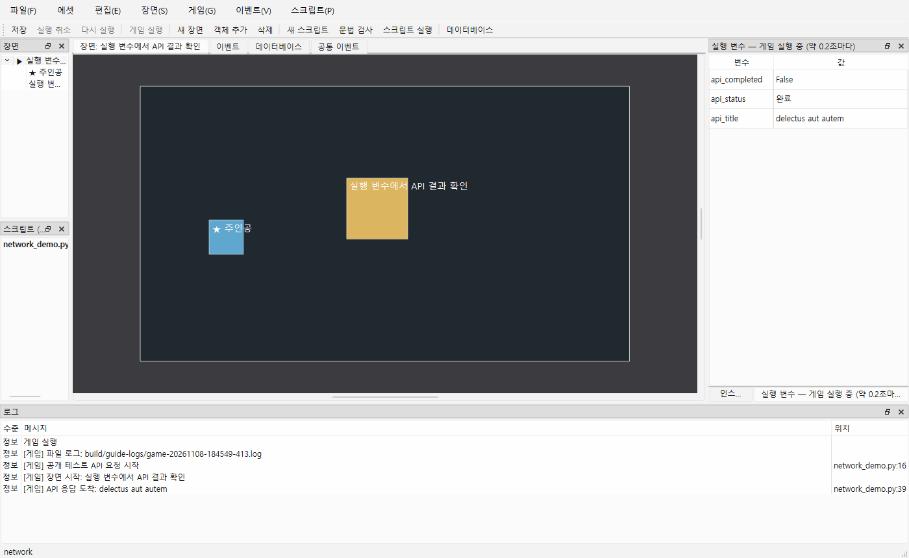

# 공개 API 연결과 응답 읽기

게임의 Python 스크립트에서 HTTP(S) API에 비동기로 요청하고 응답을 읽습니다. **공개 테스트 API를 사용하는 예제**이므로 서버 설치 없이 실제 응답을 확인할 수 있습니다. 외부 서버 연결과 제작툴의 로컬 정의 데이터베이스 `ctx.db`는 별개입니다.



## 1. 준비된 예제 실행

1. 인터넷에 연결하고 Naru Studio에서 준비된 `build/manual-network` 폴더를 엽니다. 다른 PC에서는 [예제 프로젝트](../examples/network/README.md)의 `docs/examples/network` 폴더를 복사해 새 폴더로 만든 뒤 여세요.
2. **Ctrl+R**로 게임을 실행합니다. 게임이 열린 채로 제작툴의 **실행 변수** 패널을 봅니다. 전역 스크립트 `network_demo.py`가 게임 시작 때 자동으로 요청합니다.
3. `api_status`가 `요청 중`에서 `완료`로 바뀌고, `api_title`이 `delectus aut autem`, `api_completed`가 `False`로 표시되는지 확인합니다. 로그에도 `API 응답 도착`과 제목이 표시됩니다. 응답은 [JSONPlaceholder의 공개 테스트 데이터](https://jsonplaceholder.typicode.com/todos/1)이며 서비스 제공자가 내용을 바꿀 수 있습니다.
4. 인터넷 연결·인증서·서버 응답 등에 문제가 생기면 `api_status`가 `실패`가 되고 로그에 오류가 나옵니다. 서버의 주소와 연결 상태를 확인하고 게임을 다시 실행하세요.

**F5/F6에서는 실제 요청을 보내지 않으며 `ctx.network`가 None입니다.** 예제의 `run(ctx)`는 안내 로그만 남깁니다. 전역 훅은 게임 실행에서 자동으로 호출됩니다. `on_game_start(ctx)`와 `on_update(ctx)`는 반환값이 없고 `network_demo.py`는 예제에 전역 스크립트로 이미 등록되어 있습니다.

## 2. 게임에 연결하기

프로젝트의 `scripts/`에 [network_demo.py](../examples/network/scripts/network_demo.py)를 복사하고 **스크립트 → 전역 스크립트...**에서 등록합니다. URL과 실행 변수를 게임에 맞게 바꿉니다. 전역 스크립트의 `on_game_start(ctx)`에서 요청하고 매 틱 `on_update(ctx)`에서 결과를 확인하므로 게임 화면이 요청 중 멈추지 않습니다. 응답이 왔을 때만 변수에 값을 기록합니다.

```python
request_id = None

def on_game_start(ctx):
    global request_id
    request_id = ctx.network.request(
        "https://jsonplaceholder.typicode.com/todos/1", timeout=10.0
    )

def on_update(ctx):
    global request_id
    if request_id is None:
        return
    result = ctx.network.result(request_id)
    if result is None:
        return
    request_id = None
    if not result["ok"]:
        ctx.log("요청 실패: " + result["error"])
        return
    data = result["json"]
    if isinstance(data, dict) and isinstance(data.get("title"), str):
        ctx.variables.set("api_title", data["title"])
```

예제는 응답의 `title`이 문자열인지 검사하고 게임 변수 `api_title`에 명시적으로 넣습니다. 외부 데이터를 로컬 DB에 자동 저장하거나 DB 정의를 덮어쓰지 않습니다. 변수 정의가 필요한 경우 **게임 → 변수·스위치**에서 같은 이름의 문자열 변수를 추가합니다. 자세한 시그니처·상태·오류는 [Python API](../SCRIPT_API.md)를 참고하세요.

POST 요청을 시작하는 예는 아래와 같습니다. 반환된 ID를 위 `on_update`처럼 보관하고 결과를 확인해야 합니다. `json`에 전달한 사전은 요청 본문으로 직렬화됩니다.

```python
def start_post(ctx):
    if ctx.network is None:
        ctx.log("게임 실행에서 확인하세요.")
        return None
    return ctx.network.request(
        "https://jsonplaceholder.typicode.com/posts",
        method="POST",
        json={"title": "Naru test", "body": "Hello", "userId": 1},
        timeout=10.0,
    )
```

테스트 사이트의 POST 응답에는 입력 값과 ID가 포함되지만, 실제 게시글을 저장하지는 않습니다. 게임에서 이 함수를 쓰려면 `scripts/`에 저장해 호출하고 반환된 요청 ID를 결과 확인 코드에 연결하세요. F5/F6에서는 None을 반환합니다.

## 3. 직접 만든 서버로 변경

Spring을 사용하는 경우에도 핵심은 같습니다. API 서버를 실행하고 예제 `URL`을 해당 서버의 HTTPS 주소와 경로로 바꾼 뒤, 반환 JSON의 실제 필드명에 맞게 `data["..."]`를 수정하세요. 이 기능이 Spring 서버 또는 외부 데이터베이스를 자동으로 만들거나 호스팅하지는 않습니다. `http://`는 로컬 테스트용 루프백 주소에 한해 사용합니다.

인터넷 없이 확인하려면 별도 터미널에서 다음 명령을 실행한 채 예제 URL을 `http://127.0.0.1:8765/hello`로 바꿉니다. 터미널에서 Ctrl+C를 누르면 서버가 종료됩니다.

```powershell
python docs/examples/network/server.py
```

로컬 `/hello`는 `message`와 `score`를 반환하므로 스크립트도 해당 키에 맞게 수정하세요. `/slow`는 지연 응답, 없는 경로는 404입니다. 로컬 POST는 받은 JSON을 `received`에 담아 돌려줍니다. 공개 JSONPlaceholder의 POST 등 쓰기 응답은 테스트용으로 실제 저장되지 않습니다.

## 4. 제한과 취소

- Windows의 WinHTTP를 사용합니다. HTTPS 인증서 검증은 기본으로 유지하고, 자동 리디렉션·프록시를 사용하지 않습니다. Windows 외 플랫폼에서는 미지원 오류를 돌려줍니다.
- 타임아웃과 응답 크기 제한을 적용합니다. 서버가 반환한 HTTP 오류와 JSON 형식 오류는 결과의 오류를 확인합니다.
- 취소는 게임에서 해당 요청의 결과를 무시합니다. 이미 서버에 도착한 요청이나 그 처리·저장을 되돌리는 기능은 아닙니다. 장면 전환·게임 종료 시 미완료 결과를 폐기합니다. 이미 진행 중인 OS 네트워크 호출은 즉시 강제 중단하지 않으며, 호출 완료나 시간 제한 후 작업자가 정리됩니다. 이벤트 F8만으로 별도 취소하지 않으므로 필요하면 Python에서 `cancel`을 호출합니다.
- API 주소, 토큰, 서버가 반환한 값을 Python 코드·프로젝트·로그에 기록할 때는 배포 대상도 볼 수 있습니다. 서버 전용 비밀번호나 비밀 키는 게임 프로젝트나 배포본에 넣지 마세요.
- 외부 DB 직접 연결, 응답을 이벤트 명령으로 지정하는 UI, 자동 동기화, 재시도, 멀티플레이는 아직 구현하지 않았습니다.

## 5. 직접 확인

1. 예제에서 Ctrl+R을 누르고 위 1장의 변수와 로그가 나오는지 확인합니다. 게임 실행 중 방향키가 계속 작동해야 합니다.
2. 네트워크가 끊겼거나 잘못된 주소라면 실패 상태와 오류 로그가 표시되어야 합니다. 연결 문제는 공개 사이트와 로컬 서버 양쪽에서 구분해 확인합니다.
3. 스크립트를 F5로 실행하면 안내 로그만 남고 요청이 발생하지 않아야 합니다.
4. 결과를 게임 변수에 반영해도 프로젝트의 원래 변수 기본값이나 로컬 DB 정의는 바뀌지 않아야 합니다.

공개 서비스의 정상 응답을 직접 받아 확인한 결과와 자동 테스트 결과를 구분해 기록합니다. 자동 테스트는 외부 인터넷에 의존하지 않는 로컬 서버를 사용합니다.

사용자가 공개 API 응답 수신을 확인했습니다. 위의 오류·취소·F5 등의 개별 수동 결과까지 완료한 것으로 간주하지 않습니다.

스크린샷 재촬영:

```powershell
& .\build\windows-msvc\bin\NaruStudio.exe docs/examples/network --run-game --game-log-directory build/guide-logs --smoke-test 7000 --screenshot docs/guide/images/43-network.png
```
