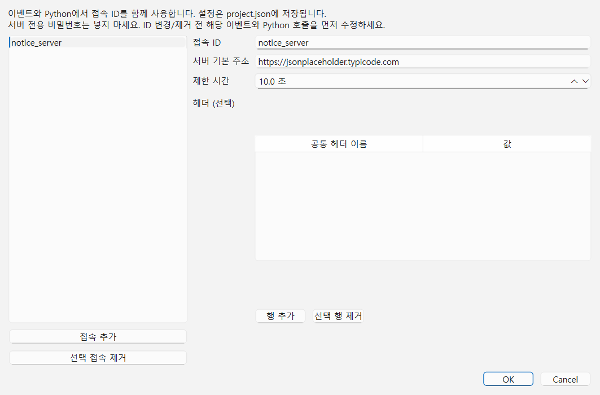
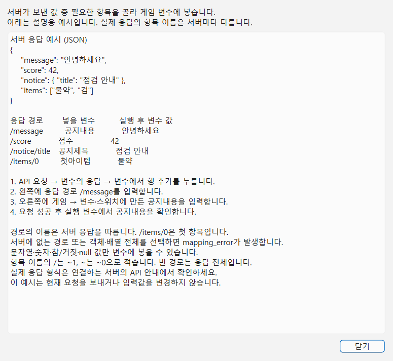
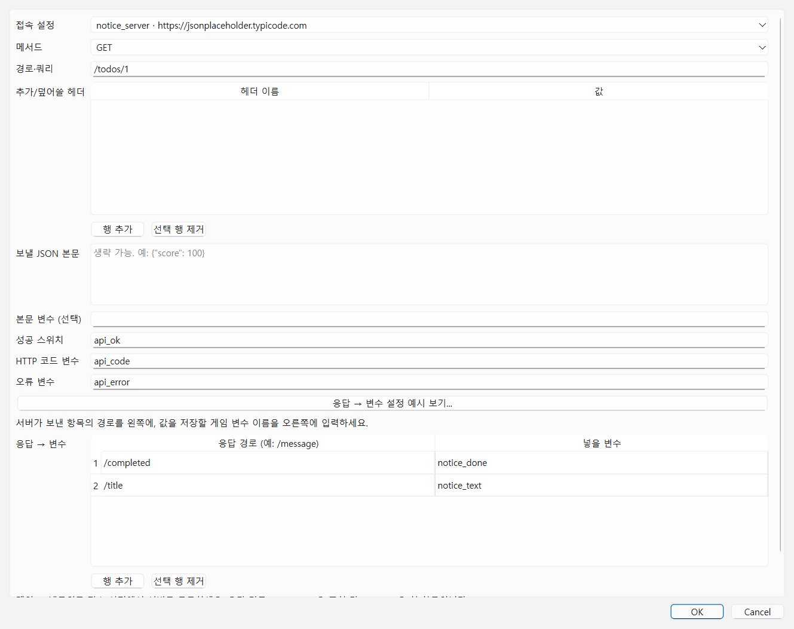

# 네트워크 접속 설정과 API 이벤트

Windows 게임 실행에서 HTTP(S) JSON API를 이벤트로 호출합니다. Python 없이 요청·응답 변수 연결·성공/실패 분기를 구성할 수 있습니다. 외부 DB 직접 연결·자동 동기화·로그인 서버 제공은 포함하지 않습니다.

## 1. 서버 등록

**게임 → 네트워크 접속 설정... → 접속 추가**를 누릅니다.

| 입력 | 기본값·규칙 |
|---|---|
| 접속 ID | 영문·숫자·`_`·`-` 1~64자, 중복 불가. 이벤트와 Python이 이 ID를 사용 |
| 서버 기본 주소 | 예: `https://api.example.com`. 경로 접두사도 가능. 쿼리·fragment·URL 인증 정보는 제외 |
| 제한 시간 | 기본 10초, 0.1~60초 |
| 공통 헤더 | 선택 사항. 헤더 이름/값을 표에 추가. 서버 전용 비밀번호는 저장하지 않음 |

확인을 누르면 프로젝트 편집 상태에 적용됩니다. Ctrl+Z/Ctrl+Y로 되돌리거나 다시 적용하고 Ctrl+S로 저장합니다. 설정은 `project.json`의 `networkConnections`에 저장됩니다. 닫기/취소는 적용하지 않습니다. 이벤트에서 사용하는 접속 ID는 먼저 이벤트를 수정해야 변경/제거할 수 있습니다. Python 문자열 참조는 직접 수정합니다.

외부 서버는 HTTPS를 사용합니다. 로컬 테스트 서버만 `http://127.0.0.1:8765` 같은 HTTP를 허용합니다. 개발/배포 설정 자동 전환·인증 토큰 저장 UI는 아직 없습니다. 주소와 헤더는 프로젝트/배포본에 들어가므로 서버 전용 비밀을 넣지 않습니다.



## 2. 이벤트에서 요청

객체를 선택하고 **이벤트 탭 → 명령 추가 목록 → API 요청 → 변수**를 선택합니다. 공통 이벤트에도 같은 명령을 넣을 수 있습니다. 저장 이름은 `network_request`입니다.

| 입력 | 기본값·동작 |
|---|---|
| 접속 설정 | 등록한 접속 ID 선택 |
| 메서드 | 기본 GET. POST/PUT/PATCH/DELETE도 지원 |
| 경로·쿼리 | 기본 `/`. 예: `/notice?page=1`. 기본 주소 뒤에 연결하며 주소의 경로 접두사도 유지. `/`로 시작, `//`·fragment 불가. 쿼리는 URL 인코딩하여 입력 |
| 추가/덮어쓸 헤더 | 같은 이름의 공통 헤더를 대소문자 구분 없이 덮어씀 |
| 보낼 JSON 본문 | 기본 빈칸(본문 없음). 예: `{"score": 100}`. 본문이 있으면 Content-Type 기본값은 `application/json; charset=utf-8` |
| 본문 변수 | 기본 빈칸. 지정하면 해당 게임 변수의 **JSON 문자열**을 본문으로 사용. 위의 고정 본문보다 우선. 자동 문자열 치환은 없음 |
| 성공 스위치 | 기본 `api_ok`. 성공이면 True, 실패/취소면 False |
| HTTP 코드 변수 | 기본 `api_code`. HTTP 상태 코드 정수. 응답 전·요청 생성 실패는 0 |
| 오류 변수 | 기본 `api_error`. 성공이면 빈 문자열. 실패면 아래 오류 코드 |
| 응답 → 변수 | JSON Pointer 경로와 게임 변수 이름을 행별로 연결. 예: `/message` → `공지내용`, `/user/name` → `이름`, `/items/0` → `첫항목`. 빈 경로는 응답 전체 |

응답에서 null·참거짓·정수·소수·문자열을 읽습니다. 객체/배열 전체를 변수에 넣지 않습니다. JSON Pointer에서 이름에 `/`가 들어가면 `~1`, `~`는 `~0`으로 씁니다. 결과 변수 이름은 각각 다르게 지정하고 본문 변수와 겹치지 않게 합니다. 미정의 변수도 실행 중 생성할 수 있습니다.

**응답 → 변수 설정 예시 보기...**를 누르면 응답 JSON과 `/message` → `공지내용` 같은 연결 결과를 한 화면에서 볼 수 있습니다. 예시는 설명용이며 현재 요청을 보내거나 입력한 값을 수정하지 않습니다. 실제 경로 이름은 연결할 서버의 응답과 API 안내를 확인하세요. 예를 들어 응답이 `{"message": "안녕하세요", "score": 42}`라면 **행 추가** 후 왼쪽에 `/message`, 오른쪽에 게임 → 변수·스위치에서 정한 `공지내용`을 입력합니다. 성공하면 실행 변수의 `공지내용`이 `안녕하세요`가 됩니다. `/notice/title`은 중첩된 `notice` 안의 `title`, `/items/0`은 배열의 첫 항목입니다.



요청 시작 시 성공=False·코드=0·오류=빈 문자열·연결한 응답 변수=None으로 초기화합니다. 모든 응답 필드를 확인한 뒤 한 번에 반영합니다. 필드 누락/배열·객체/정수 범위 초과는 `mapping_error`이며 응답 변수는 모두 None으로 유지합니다. 따라서 지난 성공 값이 다음 실패에서 재사용되지 않습니다. 편집 원본의 변수 초기값과 로컬 DB 정의는 바꾸지 않습니다.



화면이 작으면 명령 창 안을 아래로 스크롤하여 예시 버튼과 응답 → 변수 표를 찾을 수 있습니다.

## 3. 대기·분기·중지

이 명령은 **해당 이벤트에서 응답이 끝날 때까지 기다린 뒤** 다음 명령으로 넘어갑니다. 통신은 백그라운드에서 진행되어 게임 틱과 다른 병렬 이벤트는 계속 동작합니다. 일반 조사/자동 실행 이벤트의 기존 조작 차단 규칙은 유지됩니다. 요청 중 플레이어 이동을 원하면 병렬 이벤트를 사용하세요. 이벤트에서 요청만 시작하고 바로 다음 명령으로 진행하는 옵션은 이번 버전에 없습니다. Python은 요청 ID를 받은 뒤 다른 작업을 계속할 수 있습니다.

바로 다음에 **조건 분기 (변수): `api_ok == True`**를 넣습니다. 그렇다면 공지 표시/다음 동작, 아니라면 실패 안내/재시도 선택지를 넣을 수 있습니다. 실패도 다음 명령으로 진행하며 이벤트 전체를 오류로 중지하지 않습니다. 대사에서 변수 표시가 필요하면 기존 [변수·대사 작성 규칙](EVENTS.md)을 따르거나 Python/실행 변수 패널로 결과를 확인합니다.

| 상황 | 동작 |
|---|---|
| 정상 2xx JSON | 성공=True, 연결한 응답 변수 반영 |
| 204/빈 응답 | 연결할 필드가 없으면 성공. 필요한 필드가 있으면 mapping_error |
| HTTP 실패 | `http_error`, HTTP 코드 보존 |
| 잘못된 JSON | `invalid_json` |
| 필드 누락·비기본값 | `mapping_error` |
| 시간 초과·끊김 | `timeout`·`transport_error` |
| 없는 접속 ID·본문 변수 형식 오류·요청 한도 등 시작 실패 | `request_error`, 코드 0 |
| F6 테스트 | 실제 통신·응답 변수 변경 없이 안내 로그만 남김. 뒤의 분기는 테스트 초기값으로 실행되므로 통신 성공 검증이 아님 |
| F8 게임 이벤트 중지 | 진행 중인 이벤트 요청을 취소·결과 제거. 성공=False, 오류=cancelled. 나머지 명령 실행 안 함 |
| 장면 이동·게임 종료 | 진행 중 요청 취소. 늦게 도착한 결과를 다음 장면에 반영하지 않음. 장면 이동을 끝낸 뒤 시작한 새 이벤트는 별개 |

취소는 서버에 이미 도착한 쓰기를 되돌리지 않습니다. 자동 재시도는 없으며 필요하면 이벤트 선택지/조건으로 새 요청을 명시적으로 보냅니다. 리디렉션·인증 자동 처리·프록시는 사용하지 않습니다. 요청/응답 크기와 작업자 한도 등은 [기존 네트워크 제한](NETWORK.md#4-제한과-취소)을 따릅니다.

게임 창에서 F8을 누르면 실행 중 이벤트·대사·이동 경로를 중지합니다. 반복 이벤트는 조건이 맞으면 다음 틱에 재시작할 수 있습니다. 제작툴의 F8은 F6 미리보기 중지입니다. Python이 직접 시작한 요청은 기존처럼 F8로 자동 취소되지 않습니다. 게임 창을 닫으면 게임 전체 요청이 정리됩니다.

## 4. Python에서 같은 설정 사용

프로젝트의 `scripts/shared_network.py`에 아래 코드를 저장하고 전역 스크립트에 등록합니다. 먼저 접속 ID `local`을 등록하세요. `on_update(ctx)`가 결과를 확인하므로 이벤트 명령과 달리 Python 함수 안에서 기다리지 않습니다.

```python
request_id = None

def on_game_start(ctx):
    global request_id
    request_id = ctx.network.request_connection("local", "/hello")

def on_update(ctx):
    global request_id
    if request_id is None:
        return
    response = ctx.network.result(request_id)
    if response is None:
        return
    request_id = None
    ctx.variables.set("python_api_ok", response["ok"])
    if response["ok"]:
        ctx.variables.set("python_message", response["json"]["message"])

def on_scene_exit(ctx):
    global request_id
    if request_id is not None:
        ctx.network.cancel(request_id)
        ctx.network.result(request_id)  # 취소 결과를 소비
        request_id = None
```

`request_connection(connection, path="/", method="GET", headers=None, json=None)`은 공통 주소·헤더·제한 시간을 사용하고 요청 ID 정수를 반환합니다. 요청별 헤더와 JSON 본문을 추가할 수 있습니다. 공통 제한 시간의 개별 덮어쓰기는 없습니다. 없는 접속·잘못된 입력은 ValueError/TypeError, 작업자/요청 한도는 RuntimeError입니다. `status/result/cancel`과 결과 사전은 [SCRIPT_API](../SCRIPT_API.md)의 기존 요청과 같습니다. F5/F6에서는 `ctx.network`가 None이므로 직접 실행하는 `run(ctx)`에서는 먼저 확인하세요. 이 예제의 훅은 Ctrl+R에서 실행됩니다.

## 5. 직접 확인

기존 사용자 예제는 사본으로 테스트합니다. [네트워크 이벤트 예제](../examples/network-events/README.md)를 따라 로컬 서버를 시작하고 예제를 새 폴더에 복사합니다.

1. 예제 열기 → 게임 → 네트워크 접속 설정에서 `local` 주소와 10초 제한 확인. 수정 후 확인 → Ctrl+Z/Ctrl+Y → Ctrl+S → 닫고 다시 열어 설정 유지 확인.
2. Ctrl+R → 제작툴 실행 변수에서 `api_ok=True`, `공지내용=안녕하세요`, `점수=42` 확인. 병렬 요청 중 플레이어 이동 가능 확인.
3. 이벤트 경로를 `/missing`으로 변경 → 다시 게임 실행 → `api_ok=False`, `api_code=404`, `api_error=http_error`, 응답 변수=None 확인.
4. `/slow`로 변경 → 게임 실행 직후 **게임 창에서 F8** → 성공=False·cancelled와 다음 명령 미실행 확인. 응답이 늦게 와도 값이 바뀌지 않아야 함. 제한 시간을 0.1초로 설정하면 timeout 확인.
5. 응답 경로 `/없는필드`를 추가 → `/hello` 실행 → mapping_error와 모든 응답 변수=None 확인. `/hello`에는 message·score만 있음.
6. F6 → 통신 안내 로그만 남고 응답 변수는 생성/변경되지 않는지 확인. 프로젝트 재열기 후 변수 초기값과 DB가 그대로인지 확인.

위 절차는 사용자 수동 확인용입니다. 자동 테스트 통과를 사용자 확인 완료로 표시하지 않습니다.

재촬영:

```powershell
& .\build\windows-msvc\bin\NaruStudio.exe --network-settings-dialog --screenshot docs/guide/images/46-network-settings.png
& .\build\windows-msvc\bin\NaruStudio.exe --command-dialog network_request --screenshot docs/guide/images/47-network-command.png
& .\build\windows-msvc\bin\NaruStudio.exe --network-mapping-help-dialog --screenshot docs/guide/images/48-network-mapping-help.png
```
