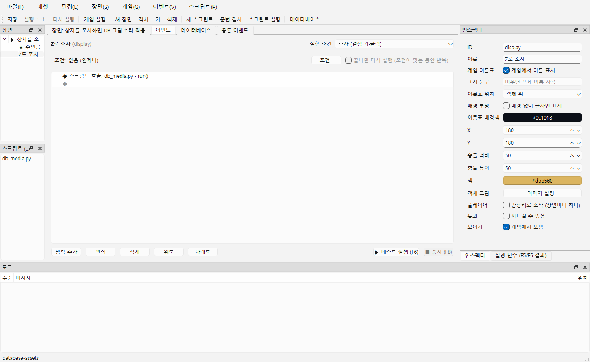

# 객체 ID 변경

객체 ID는 장면 객체를 식별하기 위한 이름입니다. 객체 표시 이름 및 이미지·소리 에셋 ID와는 별개입니다. 객체를 추가하면 자동으로 ID가 생기며, 인스펙터에서 원하는 ID로 바꿀 수 있습니다.

예를 들어 상자의 **표시 이름**을 `보물 상자`, 객체 ID를 `treasure_box`로 지정할 수 있습니다. Python에서는 `ctx.scene.object("treasure_box")`로 그 상자를 찾습니다. 상자에 표시할 그림 `chest_image`는 따로 등록한 **에셋 ID**입니다.



1. 장면 트리 또는 캔버스에서 객체를 선택합니다.
2. 오른쪽 인스펙터의 **ID**를 원하는 값으로 수정하고 **Enter**를 누르거나 다른 칸을 선택합니다.
3. 프로젝트 전체에서 고유한 영문·숫자·`_`·`-`를 1~64자로 입력합니다. 빈 값, 공백, 다른 객체와 중복된 ID는 거부합니다. `@self`, `@player`는 이벤트의 특수 대상이므로 ID로 사용할 수 없습니다. 잘못된 값은 적용되지 않고 기존 ID가 유지됩니다.
4. 변경은 **Ctrl+Z / Ctrl+Y**로 되돌리거나 다시 적용할 수 있습니다. **Ctrl+S**로 저장하고 다시 열면 새 ID가 유지됩니다.

## 연결된 곳은 어떻게 되나요?

장면의 플레이어 지정과 이벤트 명령 **객체 이동**, **보이기/숨기기**의 대상 ID를 함께 바꿉니다. 모든 장면과 공통 이벤트의 중첩 조건·선택지에 들어 있는 대상도 포함하며, 한 번의 실행 취소로 함께 되돌아갑니다.

Python 코드에 직접 적은 문자열이나 일반 텍스트·로그는 자동으로 고치지 않습니다. 예를 들어 객체 ID를 `display`에서 `shop_sign`으로 변경했다면 `scripts/db_media.py`의 `ctx.scene.object("display")`도 `ctx.scene.object("shop_sign")`으로 직접 바꾸고 저장하세요. Python의 `obj.id`는 게임 실행 중 읽기 전용입니다. 이미 실행 중인 게임은 이전 실행 사본을 사용하므로 저장 후 게임을 다시 시작합니다.

### 내 게임의 Python에서 객체 찾기

아래 코드를 프로젝트의 `scripts/open_chest.py`에 저장하고, 실행할 객체의 이벤트에서 **스크립트 호출 → open_chest.py → run**으로 연결합니다. 전역 스크립트 등록은 필요하지 않습니다. `run`은 엔진이 전달하는 `ctx`를 받고 반환값은 없습니다.

```python
def run(ctx):
    if ctx.scene is None:
        ctx.log("게임 실행(Ctrl+R)에서 확인하세요.")
        return

    chest = ctx.scene.object("treasure_box")
    if chest is None:
        ctx.log("현재 장면에서 treasure_box 객체를 찾지 못했습니다.")
        return

    chest.visible = False
    ctx.log("보물 상자를 숨겼습니다.")
```

1. 대상 객체를 선택하고 ID를 `treasure_box`로 설정합니다. 이 코드로 숨길 상자와 스크립트를 호출할 객체가 같아도 됩니다.
2. 이벤트를 만들고 위 파일과 `run` 함수를 연결한 뒤 저장합니다. **Ctrl+R**로 실행해 해당 이벤트를 실행하면 상자가 숨겨집니다.
3. 객체를 찾지 못하면 로그를 확인하고 **현재 장면**에 해당 ID가 있는지, 대소문자와 철자가 맞는지 확인합니다. `ctx.scene.object()`는 못 찾으면 `None`을 반환합니다.
4. 제작툴의 F5/F6에서는 `ctx.scene`이 `None`이므로 예제는 안내 로그를 남기고 끝납니다. 객체 변경은 게임 실행에서 확인합니다.

이 코드는 실행 중 객체만 변경합니다. 게임을 종료하거나 장면에 다시 들어가면 편집 데이터에 설정한 보이기 상태로 시작합니다. ID를 `treasure_box`에서 `treasure_chest`로 변경했다면 위 코드의 문자열도 `"treasure_chest"`로 직접 바꿔야 합니다.

## 직접 확인

테스트용 사본을 새로 만들려면 저장소 폴더에서 아래 명령을 실행합니다. 기존 폴더는 덮어쓰지 않습니다.

```powershell
python tools/generate_database_asset_example.py build/manual-object-id
```

현재 PC에는 `build/manual-object-id` 사본이 이미 준비되어 있습니다. 제작툴의 **프로젝트 열기**에서 이 폴더를 선택하면 됩니다. 다른 PC에서는 위 명령으로 사본을 만듭니다.

1. `build/manual-object-id` 프로젝트를 열고 장면 트리에서 **Z로 조사** 객체를 선택합니다. 인스펙터의 ID가 `display`인지 확인합니다.
2. ID를 `shop_sign`으로 바꾸고 Enter를 누릅니다. 다시 선택해도 `shop_sign`이 표시되어야 합니다. Ctrl+Z를 누르면 `display`, Ctrl+Y를 누르면 `shop_sign`으로 돌아와야 합니다.
3. ID에 `hero`, 공백이 든 이름, 빈 값, `@self`를 각각 입력해 봅니다. 적용이 거부되고 기존 `shop_sign`이 남아야 합니다. `hero`는 이미 주인공이 사용하는 ID입니다.
4. Ctrl+S로 저장하고 프로젝트를 다시 엽니다. 객체의 ID가 `shop_sign`으로 유지되는지 확인합니다. 이후 스크립트 탭에서 `db_media.py`의 `ctx.scene.object("display")`를 `ctx.scene.object("shop_sign")`으로 직접 고치고 저장합니다. Ctrl+R로 게임을 실행해 상자 왼쪽에서 오른쪽을 바라보고 Z를 누르면 DB의 그림과 소리가 적용되어야 합니다.
5. 주인공의 ID도 원하는 고유 ID로 변경한 뒤 저장하고 Ctrl+R을 실행합니다. 방향키로 주인공을 계속 움직일 수 있어야 합니다. Ctrl+Z로 되돌린 뒤에도 주인공 지정이 유지되어야 합니다.
6. 이벤트의 **객체 이동** 또는 **보이기/숨기기** 명령에서 대상을 선택하고 대상 객체의 ID를 변경합니다. 명령을 다시 열어 변경된 ID가 선택되어 있고, Ctrl+Z/ Ctrl+Y 후에도 대상이 이어지는지 확인합니다. 조건 분기·선택지 안의 명령과 공통 이벤트에서도 같은 방식으로 확인할 수 있습니다.

스크린샷 재촬영:

```powershell
& .\build\windows-msvc\bin\NaruStudio.exe docs/examples/database-assets --event display --smoke-test 1200 --screenshot docs/guide/images/42-object-id.png
```
