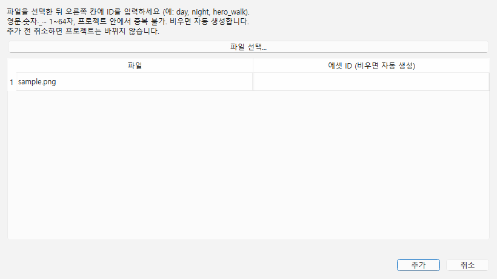
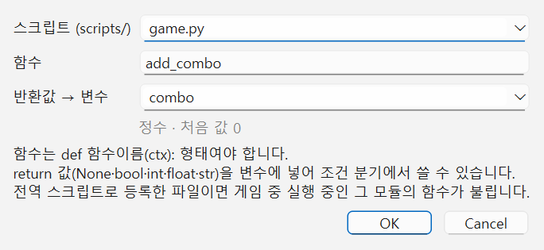

# 현재 기능을 Python으로 연결하는 전체 가이드

DB의 이미지·소리 에셋 속성은 `ctx.db.get`에서 ID 문자열 또는 None으로 읽습니다. [완성 코드·연결 순서·F5/F6 보호·오류](DB_ASSETS.md), [실행 프로젝트](../examples/database-assets/README.md)를 함께 제공합니다.

기준: 2026-11-08. **현재 구현된 공개 API**만 사용합니다. 엔진은 C++, 제작 UI는 Qt이고 아래 Python은 게임 프로젝트 안의 동작을 작성하는 코드입니다. 상세 형식·범위·실행 순서는 [SCRIPT_API](../SCRIPT_API.md), 화면 설명은 [이미지](IMAGES.md)·[입력 설정](INPUT_SETTINGS.md)·[이벤트](EVENTS.md)에 있습니다.

복사할 완성 코드:

- [python_guide.py](../examples/python_guide.py): 이벤트에서 골라 부르는 함수 전체. 전역 등록 불필요.
- [guide_global.py](../examples/guide_global.py): 위 파일을 import해서 키 입력·전역 훅으로 연결. 두 파일을 같은 `scripts/`에 복사하고 **python_guide.py → guide_global.py 순서로 둘 다 전역 등록**합니다. 이벤트 함수만 쓸 때는 전역 등록이 필요 없습니다.

기존 사용자 프로젝트와 테스트 예제를 자동으로 덮어쓰지 않습니다. 코드를 복사하고 자기 프로젝트의 ID로 바꾼 뒤 필요한 함수만 연결하세요. 의도적인 오류 함수와 조작 OFF 함수도 있으므로 모든 함수를 한꺼번에 실행하지 않습니다.

## 1. 준비: 파일명·표시 이름·ID를 구분하기

| 무엇 | 확인하는 곳 | 코드에서 쓰는 예 |
|---|---|---|
| 이미지 에셋 ID | 에셋 → 에셋 목록 → 상세 ID. 추가 시 직접 지정 가능 | `"day"`, `"night"`, `"hero"` |
| 객체 ID | 장면 객체 선택 → 인스펙터 ID | `"tree"`, 새 프로젝트의 `"obj_002"` |
| 장면 ID | 장면 이름 선택 → 인스펙터 장면 ID | `"scene_002"` |
| 공통 이벤트 ID | 공통 이벤트 탭 | `"recover"` |
| DB 종류 키·항목 ID·속성 키 | 데이터베이스 종류/항목/속성 편집 | `"item"`, `"potion"`, `"price"` |
| 입력 동작 이름 | 게임 → 키 설정 | `"guide_toggle_background"` |
| Python 파일·함수 | 프로젝트 scripts 폴더·코드 | `python_guide.py` / `set_night` |

같은 `"tree"`를 써도 **객체 ID**와 **이미지 에셋 ID**는 별개입니다. 파일명이 `night.png`여도 에셋 ID가 다르면 `"night"`로 찾을 수 없습니다. ID는 대소문자를 구분합니다. 파일 경로를 `obj.image`에 넣지 마세요.

1. `docs/examples/images`를 새 작업 폴더로 복사하거나 자신의 프로젝트를 엽니다.
2. 에셋 추가에서 낮·밤 그림의 ID를 `day`·`night`로 지정합니다. 기존 에셋은 **ID 변경...**으로 고칩니다. 소리·글꼴은 이미지로 쓸 수 없습니다.
3. 객체 인스펙터에서 대상 객체 ID를 확인합니다. 예제는 객체 `tree`, 플레이어 `hero`를 사용합니다. 일반 프로젝트는 `python_guide.py` 맨 위 `GUIDE_OBJECT_ID` 등을 실제 값으로 바꾸세요.
4. 두 `.py` 파일을 프로젝트 `scripts/`에 복사합니다. `input_settings.py`는 전용 설정 파일이므로 게임 함수를 그 안에 넣지 않습니다.
5. 제작툴에서 파일을 열어 **F7 문법 검사** 후 저장합니다. 공백 4칸씩 들여쓰기하고 탭과 섞지 않습니다.



`python_guide.py`의 설정값은 이미지 `day/night/tree/hero`, 대상 객체 `tree`·표시 이름 `나무`, 다음 장면 `scene_002`, 공통 이벤트 `recover`, DB `item/potion`입니다. 프로젝트에 없는 값은 먼저 만들거나 바꿉니다. 이미지 예제에는 추가 장면·recover·item/potion이 없으므로 해당 예제를 사용할 때 따로 준비하세요.

## 2. 이벤트에서 함수 연결하기

1. 장면 객체를 더블클릭하여 **이벤트** 탭을 엽니다.
2. **명령 추가 → 스크립트 호출**을 고릅니다.
3. 파일은 `python_guide.py`, 함수는 예를 들어 **set_night**로 입력합니다. 함수 이름에 괄호나 ctx를 쓰지 않습니다.
4. 실행 조건을 **조사**로 두고 저장합니다. 필요하면 **반환값 → 변수**에 `changed`를 지정한 뒤 조건 분기 `changed == 참`을 연결합니다.
5. **Ctrl+R** → 객체 앞에서 결정 키(기본 Z/Enter/Space)로 조사합니다.

엔진이 `set_night(ctx)`를 호출합니다. 파일 이름과 함수 이름은 임의로 정할 수 있지만 함수 이름을 바꿨으면 이벤트 연결도 고칩니다. 이 방식은 **전역 등록이 필요 없습니다**. 공통 이벤트 안의 스크립트 호출도 같은 방법입니다.



위 그림은 입력 칸 위치 예시입니다. 이번 가이드에서는 **파일 python_guide.py / 함수 set_night / 반환값 변수 changed(선택)**로 입력합니다.

| 실행 방법 | 실행되는 것 | 장면·플레이어·입력 |
|---|---|---|
| F7 | 문법 검사만 | 게임을 실행하지 않음 |
| F5 | 파일의 `run(ctx)` | `ctx.scene`, `ctx.player`, `ctx.input`은 None |
| F6 | 선택한 객체/공통 이벤트를 첫 명령부터 테스트 | 위 셋은 None. 변수·DB·로그와 공통 이벤트 예약은 가능 |
| Ctrl+R | 시작 장면부터 실제 게임 | scene/input 있음, 플레이어 지정 장면이면 player도 있음 |
| Ctrl+Shift+R | 현재 장면부터 실제 게임 | 위와 같음 |

F5가 `set_night`를 임의로 고르는 기능은 아닙니다. 완성 코드의 `run`은 사용 안내만 출력합니다. 그림·이동·입력은 실제 게임에서 확인하세요. 장면이 있어도 플레이어가 없는 컷신에서는 `ctx.player`가 None입니다. None 확인 코드는 예제에 포함되어 있습니다.

## 3. 배경 이미지 읽기·낮/밤 전환·지우기

```python
def set_night(ctx):
    if ctx.scene is None:
        ctx.log("배경 변경은 Ctrl+R 실제 게임에서 확인하세요.")
        return False
    ctx.scene.background_image = "night"
    return True


def toggle_background(ctx):
    if ctx.scene is None:
        return False
    if ctx.scene.background_image == "day":
        ctx.scene.background_image = "night"
    else:
        ctx.scene.background_image = "day"
    return True


def clear_background(ctx):
    if ctx.scene is None:
        return False
    ctx.scene.background_image = ""
    return True
```

`=`는 대입, `==`는 같은지 비교합니다. 위 if/else는 현재 낮이면 밤, 그 외에는 낮을 고릅니다. Python은 `{}` 대신 콜론과 들여쓰기로 실행 범위를 표시합니다. `return True`는 호출한 이벤트에 성공 값을 돌려주는 것이며 함수 실행을 끝냅니다.

완성 코드의 `set_day`는 낮으로, `set_night`는 밤으로, `clear_background`는 이미지 없이 장면 배경색으로 바꿉니다. 반환은 모두 bool입니다. 배경 맞춤 방식·오프셋·배율·불투명도는 **장면 인스펙터 설정을 유지**합니다. Python으로 해당 수치까지 바꾸는 API는 아직 없습니다.

## 4. 객체·플레이어 이미지 바꾸기

```python
def change_object_image(ctx):
    if ctx.scene is None:
        return False
    obj = ctx.scene.object("tree")       # 대상 객체 ID
    if obj is None:
        ctx.warning("대상 객체가 없습니다.")
        return False
    obj.image = "tree"                  # 등록된 이미지 에셋 ID
    return True


def change_player_image(ctx):
    if ctx.scene is None or ctx.player is None:
        return False
    obj = ctx.scene.object(ctx.player.id)
    if obj is None:
        return False
    obj.image = "hero"
    return True
```

플레이어의 그림도 **SceneObject**로 얻어서 바꿉니다. `ctx.player.image`는 현재 API가 아닙니다. `obj.image = ""`는 이미지를 지우고 객체 색 사각형으로 돌아갑니다. 완성 코드 함수는 `change_object_image`, `clear_object_image`, `change_player_image`이며 모두 bool을 반환합니다.

이미지 변경은 그림 크기·기준점·회전·뒤집기·불투명도·순서·필터·충돌 영역을 유지합니다. 이 그림 수치는 객체 인스펙터에서 설정합니다. 다른 비율의 그림으로 바꿀 때 원본 크기(그림 너비/높이 0)를 쓸지, 고정 표시 크기를 쓸지 정하세요.

이미지는 등록된 image 에셋 ID 또는 빈 문자열만 받습니다. 잘못된 ID·소리/글꼴 ID는 **ValueError**, 문자열 이외는 **TypeError**입니다. 실패하면 그 속성의 이전 값은 유지됩니다. ID가 있어도 파일이 누락되면 색으로 대체하고 경고합니다. 오류 처리 예:

```python
def safe_night(ctx):
    if ctx.scene is None:
        return False
    try:
        ctx.scene.background_image = "night"
    except (ValueError, TypeError) as error:
        ctx.warning(str(error))
        return False
    return True
```

에셋 **ID 변경...**은 편집 객체·배경 참조를 함께 바꾸지만 Python 문자열을 고치지는 않습니다. `GUIDE_DAY_IMAGE`, `GUIDE_NIGHT_IMAGE` 같은 파일 맨 위 상수를 실제 ID로 맞추면 예제 함수가 공통으로 사용합니다. 직접 작성한 비교식·대입식도 점검하고 게임을 다시 실행하세요.

## 5. 숨기기·통과·색·객체 이동

| 완성 코드 함수 | 동작 | 반환 |
|---|---|---|
| `hide_object(ctx)` | 대상 `visible = False` | bool |
| `show_object(ctx)` | 대상 `visible = True` | bool |
| `toggle_passable(ctx)` | `passable` 참/거짓 전환 | 변경 후 bool (False가 실패만을 뜻하지 않음) |
| `change_object_color(ctx)` | `color = "#ff8800"` | bool |
| `move_object(ctx)` | `move(48, 0)` 충돌 검사 이동 | 실제 이동 여부 bool |
| `teleport_object(ctx)` | `x = 128`, `y = 128` 직접 대입 | bool |

```python
def hide_object(ctx):
    if ctx.scene is None:
        return False
    obj = ctx.scene.object("tree")
    if obj is None:
        return False
    obj.visible = False
    return True
```

숨기면 그림·충돌·조사·접촉이 없어지지만 자동 실행/병렬 이벤트는 그대로입니다. 그림 불투명도 0%와 다릅니다. 통과 가능 객체는 다른 객체를 막지도 막히지도 않으며, 플레이어도 같은 규칙입니다. `color`는 `#rrggbb`만 허용하고 정상 이미지에 색을 곱하지 않습니다. 색을 확인하려면 이미지를 지우세요.

`move(dx, dy)`는 지나는 경로와 장면 경계의 충돌을 검사합니다. 일부만 움직여도 True일 수 있습니다. 현재는 한 번에 즉시 움직이는 함수이며, 속도를 주고 끝날 때까지 기다리는 동작은 이벤트의 **객체 이동** 명령을 사용합니다. `x/y` 직접 대입은 벽을 건너뛸 수 있습니다. 객체 `width/height`는 읽기 전용입니다.

## 6. 객체·장면·플레이어 값 읽기

`inspect_scene(ctx)`는 `ctx.scene.id/name/width/height`, `ids()`(전체 장면 ID), `find(이름)`, `objects()`를 로그에 출력합니다. 각 객체의 `id/name/x/y/width/height/is_player/passable/visible/color/image`도 읽습니다. `object(ID)`·`find(이름)`는 못 찾으면 None이고 이름이 같은 객체가 여럿이면 첫 객체를 반환합니다. 오래 쓰는 연결은 ID를 권장합니다.

`inspect_player(ctx)`는 `ctx.player.id/name/x/y/width/height/speed/facing/default_control`을 출력합니다. 위치 단위는 픽셀, 속도는 픽셀/초입니다. 장면을 바꾼 뒤 이전 객체 참조를 계속 쓰지 말고 현재 `ctx.scene.object(ID)`로 다시 얻으세요.

## 7. 플레이어 이동·방향·속도·기본 조작

| 완성 코드 함수 | 코드·의미 | 반환 |
|---|---|---|
| `move_player(ctx)` | `ctx.player.move(48, 0)` — 충돌 검사 | 이동 여부 bool |
| `teleport_player(ctx)` | `ctx.player.x = 64`, `y = 64` — 충돌 없는 순간 이동 | bool |
| `face_right(ctx)` | `facing = "right"` — up/down/left/right | bool |
| `set_player_speed(ctx)` | `speed = 360.0` | bool |
| `disable_default_control(ctx)` | `default_control = False` — 기본 이동/조사 OFF | bool |
| `enable_default_control(ctx)` | `default_control = True` — 기본 이동/조사 ON | bool |
| `interact(ctx)` | `ctx.player.interact()` — 바라보는 앞 조사 | 이벤트 시작 여부 bool |

플레이어가 없으면 False를 반환하고 안내합니다. 기본 조작 OFF라도 대사·선택지 입력, Python 입력 읽기는 유지됩니다. 직접 `move`는 대사/이벤트 중에도 호출할 수 있으므로 사용자 이동 훅에서는 `ctx.busy`를 확인하세요. `interact`는 막는 이벤트·대사 중이면 False입니다. `interact`를 현재 조사 이벤트 안에서 재호출해 다른 조사 이벤트를 곧바로 시작하는 용도로 쓰지 마세요.

지속 기본 속도·기본 조작·키는 **게임 → 키 설정**과 같은 원본 `input_settings.py`로 관리합니다. 위 함수는 실행 중 임시 변경이며 파일을 자동 저장하지 않습니다.

## 8. 변수·스위치·반환값

`variables_demo(ctx)`는 `ctx.variables.get/set`으로 정수 카운트·실수·문자열·None을 기록하고 bool 스위치를 전환합니다. 반환은 새 카운트 정수입니다.

```python
def variables_demo(ctx):
    count = ctx.variables.get("guide_count", 0)
    ctx.variables.set("guide_count", count + 1)
    if ctx.variables.get("guide_switch", False):
        ctx.variables.set("guide_switch", False)
    else:
        ctx.variables.set("guide_switch", True)
    return count + 1
```

이벤트의 **반환값 → 변수**를 `result_count`로 지정하면 뒤의 조건 분기에서 비교할 수 있습니다. 게임 → 변수·스위치에서 처음 값·설명을 정의할 수 있고, 미정의 이름도 허용합니다. `get`의 기본값을 생략하면 없는 이름은 None입니다. `set`은 None/bool/int/float/str만 지원하며 list/dict는 TypeError입니다. DB에서 받은 dict 전체 대신 필요한 단일 속성을 변수에 넣으세요.

Python의 지역 변수 `count`와 게임 변수 `guide_count`는 별개입니다. 게임 변수는 장면 이동을 넘어 유지되지만 게임 재시작 시 처음 값으로 돌아옵니다. F5·F6·실제 게임은 각각 별도 세션입니다. 저장/로드 API는 아직 없습니다.

## 9. DB 읽기·게임 변수에 연결

`inspect_database(ctx)`는 `ctx.db.types()` → `ids(종류키)` → `get(종류키, 항목ID)` 순서로 전부 로그에 출력합니다. `read_item_price(ctx)`는 기본 `item/potion`의 `name`·`price`를 읽어 게임 변수 `guide_item_name`·`guide_item_price`로 기록하고 가격을 반환합니다.

```python
def read_item_price(ctx):
    if "item" not in ctx.db.types():
        ctx.warning("item 종류를 먼저 만드세요.")
        return 0
    item = ctx.db.get("item", "potion")
    if item is None:
        ctx.warning("potion 항목을 먼저 만드세요.")
        return 0
    price = item.get("price", 0)
    ctx.variables.set("guide_item_price", price)
    return price
```

사전 `item.get`은 Python dict 함수이고 `ctx.db.get`과 다릅니다. DB 종류 없음은 KeyError, 항목 없음은 None입니다. 반환 dict의 `id/name`과 속성 키로 읽으며 반환 dict를 바꿔도 DB를 수정하지 않습니다. 현재 `ctx.db`는 프로젝트의 읽기 전용 정의 DB이며 외부 서버·DB/API 연결이나 소지품/아이템 사용 시스템이 아닙니다. F5/F6에서도 사용할 수 있습니다.

## 10. 장면 이동

`change_scene(ctx)`는 기본 `scene_002`가 `ctx.scene.ids()`에 있는지 확인하고 아래처럼 예약합니다. 반환은 예약 성공 bool입니다.

```python
def change_scene(ctx):
    if ctx.scene is None:
        return False
    ctx.scene.change("scene_002", 64, 96, "up")
    return True
```

도착 x/y는 플레이어 왼쪽 위 좌표이고 둘 다 주거나 둘 다 생략합니다. `change("scene_002")`만 쓰면 편집한 위치·아래 방향을 사용합니다. 없는 장면 ID는 KeyError, x/y 중 하나만 지정하거나 잘못된 방향을 쓰면 ValueError, 좌표에 숫자로 변환할 수 없는 형식을 쓰면 TypeError입니다. 이동은 **이번 틱 끝**에 일어나므로 다음 줄에서 이미 새 장면이라고 가정하지 마세요. 그 이벤트의 뒤 명령은 이어 실행하지 않습니다.

새 장면의 위치·보이기·그림은 편집 상태로 초기화합니다. 게임 변수는 유지됩니다. 플레이어 speed/default_control은 유지되지만 새 장면의 위치·방향은 도착 설정을 따릅니다.

## 11. 공통 이벤트 예약

공통 이벤트 탭에서 `recover`를 만들고 원하는 변수·대사·대기·선택지 명령을 넣습니다. `queue_common_event(ctx)`는 `ctx.run_event("recover")`를 예약하며 성공 bool을 반환합니다. ID가 없거나 F5라면 잡아서 경고하고 False를 반환합니다.

```python
def queue_common_event(ctx):
    ctx.run_event("recover")
    ctx.log("지금은 예약만 했고, 이 함수 반환 뒤 실행됩니다.")
    return True
```

`ctx.run_event` 자체 반환은 None입니다. 이벤트에서 예약하면 공통 이벤트가 끝난 뒤 **스크립트 호출 다음 명령**으로 돌아갑니다. 같은 Python 함수 안의 다음 줄에서 공통 이벤트 결과가 이미 바뀌었다고 생각하지 마세요. F6에서도 가능하고 F8로 안쪽 호출까지 중지합니다. F5는 RuntimeError, 없는 ID는 KeyError, 순환/최대 32단계·한 함수 128개 예약 제한이 있습니다.

대사·선택지·대기·조건 분기는 공통 이벤트 명령으로 만들고 Python에서 예약하는 방식으로 연결할 수 있습니다. `ctx.say`, `ctx.wait`, `await` 같은 직접 호출 API는 아직 없습니다. 전역 `on_update`에서 매 틱 예약하지 말고 `pressed`나 스위치로 중복을 막으세요.

## 12. 전역 훅·키 입력·다른 파일 호출

`python_guide.py`, `guide_global.py`를 같은 scripts에 복사하고 **스크립트 → 전역 스크립트...**에서 **python_guide.py 먼저, guide_global.py 다음**으로 둘 다 등록합니다. 현재는 먼저 로드된 전역 모듈을 import하는 방식입니다. 단순히 같은 폴더에 일반 Python 파일을 두는 것만으로 임의 import가 지원된다고 가정하지 마세요. python_guide.py에는 자동 훅이 없으므로 등록해도 임의로 모든 함수를 실행하지 않습니다. 게임 → 키 설정에 다음 동작을 추가하고 저장합니다.

| 동작 이름 | 키 예 | 동작 |
|---|---|---|
| `guide_toggle_background` | G | 새로 누르면 낮/밤 전환 |
| `guide_move_up` | 8 | 새로 누르면 위로 48px 충돌 검사 이동 후 오른쪽 보기 |
| `guide_dash` | Shift | 선택 기능. guide_global.py의 GUIDE_GLOBAL_ENABLE_DASH를 True로 바꾸면 누르는 동안 속도 1.75배 |

| 엔진이 자동 호출하는 함수 | 시점·예제 |
|---|---|
| `on_game_start(ctx)` | 모듈을 읽은 뒤 1회. 입력은 있지만 장면/플레이어는 아직 None. 카운트 초기화 |
| `on_scene_enter(ctx)` | 장면에 들어온 뒤. 입장 수 기록·원래 속도 보관. 배경 초기화를 원하면 이곳에서 set_night 호출 |
| `on_update(ctx)` | 고정 1/60초마다. 입력 확인·카운트 갱신. ctx.busy면 사용자 동작 건너뜀 |
| `on_scene_exit(ctx)` | 이전 장면을 떠나기 직전. 예제는 선택 달리기 속도 복원·로그. 이 훅의 공통 이벤트 예약은 취소됨 |

핵심 코드는 다음과 같습니다. 아래 조각만 복사하면 위 기능 중 배경 전환만 동작합니다. 전체 연결은 완성 파일을 사용하세요.

```python
import python_guide as _guide


def on_update(ctx):
    if ctx.scene is None or ctx.input is None or ctx.busy:
        return
    if ctx.input.pressed("guide_toggle_background"):
        _guide.toggle_background(ctx)
```

`import`는 다른 파일의 함수를 사용할 수 있게 합니다. 함수 이름을 적기만 하면 실행되는 것이 아니라 `_guide.toggle_background(ctx)`처럼 호출해야 합니다. 엔진이 자동으로 부르는 이름은 위 네 훅뿐입니다. 전역 등록된 모듈은 게임 실행 동안 유지되며 같은 모듈 함수를 이벤트에서 부르면 상태를 공유합니다. 등록하지 않은 일반 이벤트 파일은 실행마다 다시 읽습니다.

전역 변수·import 이름은 등록 파일 간 중복 검사를 받습니다. 완성 파일은 GUIDE_ 접두사와 `_` 내부 이름을 사용합니다. `json.py`, `random.py` 같은 Python 표준 모듈 이름은 파일명으로 피합니다. 전역 최상위 코드에서 ctx를 쓰지 말고 훅 인자로 받으세요. `time.sleep`·끝없는 while은 게임을 멈추므로 사용하지 않습니다.

## 13. 입력 읽기·실행 중 키 바꾸기

| 완성 코드 함수 | 내용·반환 |
|---|---|
| `inspect_input(ctx)` | `ctx.input.actions/keys/held/pressed`, `ctx.busy` 출력. bool |
| `bind_runtime_keys(ctx)` | `guide_special`을 Shift+E 또는 F로 교체. bool |
| `disable_runtime_action(ctx)` | `guide_special`을 빈 키 목록으로 OFF. bool |

```python
def bind_runtime_keys(ctx):
    if ctx.input is None:
        return False
    ctx.input.bind("guide_special", ["Shift + E", "F"])
    ctx.log(str(ctx.input.keys("guide_special")))
    return True
```

`pressed`는 새 누름 첫 틱, `held`는 누르는 동안입니다. 키 이름 대신 **동작 이름**을 묻습니다. `bind`는 기존 키 목록 전체를 교체하며 문자열 한 개도 받습니다. 목록은 OR, 한 문자열의 +는 동시 입력 AND입니다. 잘못된 조합은 ValueError이며 이전 배치를 보존합니다. 없는 동작을 물으면 False/빈 목록입니다.

실행 중 키 변경은 프로젝트 기본 설정을 저장하지 않습니다. 영구 기본값은 게임 → 키 설정과 양방향인 `input_settings.py`에서 바꿉니다. 대사/선택지에 사용된 pressed 입력은 스크립트에서 소비되어 보이지 않을 수 있습니다. [동시 입력 규칙](INPUT_SETTINGS.md#6-여러-키를-동시에-눌러-실행하기)을 참고하세요.

## 14. 로그·오류 위치·재실행

`log_examples(ctx)`는 `ctx.log`·`ctx.warning`·`print`·`sys.stderr`를 보여 줍니다. stderr 예제는 오류 수준 로그를 출력하지만 예외를 발생시키지는 않습니다. `error_example(ctx)`는 **의도적으로 ValueError**를 발생시키므로 오류 위치를 시험할 때만 골라 호출하세요.

```python
def error_example(ctx):
    raise ValueError("오류 위치를 확인하는 테스트입니다.")
```

파일·행·traceback과 이벤트 호출 위치가 로그에 남습니다. 오류 로그 더블클릭으로 코드로, 뒤따르는 명령 실패 로그로 호출 이벤트로 이동합니다. 게임 → 게임 로그 폴더 열기에서 파일 기록도 확인합니다. 전역 훅 오류는 해당 스크립트 훅을 중지하므로 수정·저장 후 게임을 다시 실행하세요.

명령 실패가 앞선 모든 상태 변경을 롤백하지는 않습니다. 이미 바꾼 변수·그림·위치는 남을 수 있습니다. 이벤트 F8 중지도 이전 값으로 되돌리는 기능이 아닙니다. 장면 재진입·게임 재시작·명시적인 복원 함수의 차이를 구분하세요.

## 15. 현재 Python 연결 범위 한눈에 보기

| 공개 기능 | 완성 코드·연결 |
|---|---|
| `ctx.variables`, `get`, `set` | variables_demo, 이벤트 변수/조건 분기/반환값 연결 |
| `ctx.db`, `types`, `ids`, `get` | inspect_database, read_item_price |
| `ctx.scene`, `id`, `name`, `width`, `height`, `ids` | inspect_scene |
| `object`, `find`, `objects`, `is_player` | inspect_scene, change_player_image |
| `image`, `background_image` | set_day/set_night/toggle/clear, 객체·플레이어 이미지 함수 |
| 객체 `x`, `y`, `move`, `passable`, `visible`, `color` | move_object/teleport_object/toggle_passable/hide/show/change_object_color |
| `ctx.player`, `speed`, `facing`, `default_control`, `interact` | 플레이어 검사·이동·순간이동·속도·방향·조작 ON/OFF·조사 |
| `ctx.input`, `held`, `pressed`, `bind`, `keys`, `actions` | inspect_input, bind_runtime_keys, disable_runtime_action, guide_global |
| `ctx.busy` | guide_global에서 대사/막는 이벤트 중 동작 제한 |
| `ctx.run_event` | queue_common_event, 이벤트/전역 훅/F6 연결 |
| `ctx.log`, `ctx.warning`, `print`, stderr | log_examples, error_example |
| `on_game_start`, `on_scene_enter`, `on_scene_exit`, `on_update` | guide_global 네 훅·모듈 상태·import 연결 |

**현재 직접 Python API가 없는 기능:** 에셋 추가/ID·그룹 편집/내보내기, DB 정의 수정, 객체 이름·충돌 크기 변경/생성·삭제, 그림 배치 수치·애니메이션, 배경 맞춤 수치, 대사·선택지·대기 직접 호출, 타일맵·카메라, 저장/로드·배포·외부 DB/API. 이 중 편집 기능은 제작툴에서 사용하고 대사/선택지/대기는 공통 이벤트로 연결합니다. 계획 API를 현재 기능처럼 복사하지 마세요.

이벤트 명령 14종의 Python 대응도 다음처럼 구분합니다.

| 이벤트 명령 | Python 연결 |
|---|---|
| 대사·선택지·대기 | 공통 이벤트에 해당 명령 작성 → ctx.run_event로 예약. 직접 대기/대사 API 없음 |
| 변수 조작·조건 분기 | ctx.variables.get/set, Python if/else |
| 데이터 → 변수 | ctx.db.get으로 단일 속성 읽기 → ctx.variables.set |
| 객체 이동 | obj.move / ctx.player.move는 즉시 충돌 이동. 속도·완료 대기는 이벤트 명령 |
| 보이기/숨기기 | obj.visible |
| 장면 이동 | ctx.scene.change |
| 스크립트 호출 | 이벤트 파일·함수 연결, 같은 파일 함수 호출, 등록된 모듈 import |
| 공통 이벤트 호출 | ctx.run_event |
| 소리 재생/정지 | ctx.audio.play_bgm / stop_bgm / play_se / stop_se. F5/F6은 ctx.audio=None |
| 로그·주석 | ctx.log/ctx.warning/print, Python # 주석 |

## 16. 직접 따라 하는 확인 순서

1. 사본에 두 코드를 복사하고 GUIDE_* ID를 맞춥니다. F7 통과·F5 안내 로그를 확인합니다.
2. 객체 이벤트를 set_night → set_day → clear_background → toggle_background로 하나씩 바꿔 Ctrl+R에서 조사합니다.
3. change_object_image/clear_object_image/change_player_image를 연결합니다. 그림만 바뀌고 충돌/그림 크기 설정은 유지되는지 확인합니다.
4. hide/show/passable/color와 move/teleport를 시험합니다. 숨긴 조사 객체는 다시 조사할 수 없으므로 다른 컨트롤 객체나 공통 이벤트에서 show_object를 부르세요.
5. variables_demo의 반환값 변수를 result_count로 연결하고 실행 변수 패널에서 카운트·스위치를 봅니다. DB item/potion과 price 속성을 준비해 read_item_price도 실행합니다.
6. scene_002와 recover를 준비해 장면 이동·공통 이벤트 반환 순서를 확인합니다. F6의 이미지 함수는 안내/False, 공통 이벤트는 실제 예약되는 차이를 확인합니다.
7. python_guide → guide_global 순서로 전역 등록하고 동작 G/8을 배치합니다. G 새 누름마다 배경 전환, 유지 시 반복 없음, 8 이동·오른쪽 보기, 대사 중 사용자 동작 건너뛰기를 봅니다.
8. 선택한 경우에만 조작 OFF/ON·runtime 키 교체·달리기·error_example을 시험합니다. 정상화한 뒤 저장·게임 재시작으로 편집 기본값 복원을 확인합니다.

자동 검증은 실제 C++/Python 실행에서 함수·반환·상태·오류를 확인합니다. 사용자 화면·클릭·키보드 확인은 별도 결과로 기록합니다.


## 17. BGM·효과음 연결

`ctx.audio`는 게임에서만 사용할 수 있고 F5/F6에서는 None입니다. [소리 안내](AUDIO.md)와 [완성 코드](../examples/audio/scripts/audio_demo.py)를 사용하세요. 프로젝트 scripts/audio_demo.py에 복사하고 이벤트의 스크립트 호출에 파일 audio_demo.py / 함수 run을 지정합니다. 전역 등록 없이 동작하며 반환값은 None입니다. fade는 2초 페이드 정지, stop_effects는 효과음 모두 정지 함수입니다.

```python
def run(ctx):
    if ctx.audio is None:
        ctx.log("게임 실행에서 소리를 확인하세요.")
        return
    ctx.audio.play_bgm("test_bgm", volume=35, loop=True)
    ctx.audio.play_se("test_se", volume=70)


def stop(ctx):
    if ctx.audio is not None:
        ctx.audio.stop_bgm(fade_seconds=2)
        ctx.audio.stop_se()
```

play_bgm(asset_id, volume=100, loop=True), play_se(asset_id, volume=100), stop_bgm(fade_seconds=0), stop_se()는 모두 즉시 None을 반환합니다. 음량은 0~100, 페이드는 0~60초이며 유한한 숫자만 허용합니다. loop는 bool입니다. 잘못된 ID/종류·범위는 ValueError, 타입은 TypeError, 파일·장치·동시 재생 한도 실패는 RuntimeError이며 파일·행·traceback을 보존합니다. ID는 경로가 아닌 에셋 목록의 소리 ID입니다. 같은 BGM 재생은 처음부터 시작하므로 on_update에서 매 틱 호출하지 않습니다. on_game_start 또는 장면의 자동 실행(반복 끔)에서 한 번 시작하세요. 장면 이동에도 유지하며 게임 종료 시 해제합니다. 자세한 한도·실행/대기·수동 확인은 소리 안내를 따릅니다.


## 18. NPC·시설 이름표 연결

객체 인스펙터의 게임 이름표로 표시 여부/문구를 저장하고, 실제 게임에서는 `obj.show_name`과 `obj.name_text`로 바꿉니다. F9는 별도의 전체 이름·ID 테스트 표시입니다. [입력 항목·그림·수동 확인](NAMEPLATES.md), [완성 파일](../examples/nameplates/scripts/nameplates.py)을 보세요.

```python
def run(ctx):
    if ctx.scene is None:
        ctx.log("이름표는 게임 실행에서 확인하세요.")
        return
    npc = ctx.scene.object("npc")
    if npc is not None:
        npc.show_name = True
        npc.name_text = "여관 주인"
```

파일은 프로젝트 scripts/nameplates.py, 이벤트 스크립트 호출은 파일 nameplates.py / 함수 run / 결과 변수 빈 칸입니다. 인자 ctx는 엔진이 전달하고 반환 None·대기 없음·전역 등록 불필요입니다. 예제 run은 조사 때 문구를 번갈아 바꾸며 hide_name은 표시를 끄고 use_object_name은 빈 문구로 객체 이름을 사용합니다. show_name은 bool, name_text는 문자열이며 잘못된 타입은 TypeError, 제어 문자/512바이트 초과는 ValueError입니다. 실패하면 이전 값을 유지하고 오류 파일·행·traceback을 보존합니다. F5/F6은 ctx.scene=None 보호로 안내만 내며 게임의 장면 이벤트/훅에서 바꾼 값은 장면 재진입/재시작 때 편집값으로 돌아갑니다. obj.name과 ID 자체는 바꾸지 않습니다.


## 19. 이름표 배경과 위·아래 위치

`name_background_transparent`(bool, 기본 False), `name_background_color`(str, 기본 #0c1018), `name_position`(str, 기본 above)을 객체별로 읽고 바꿉니다. [설정·그림·직접 확인 9~13](NAMEPLATES.md), [완성 코드](../examples/nameplate-style/scripts/nameplates.py)를 보세요.

```python
def run(ctx):
    if ctx.scene is None:
        return
    npc = ctx.scene.object("npc")
    if npc is not None:
        npc.show_name = True
        npc.name_background_color = "#8c3454"
        npc.name_background_transparent = False
        npc.name_position = "below"
```

파일 scripts/nameplates.py, 이벤트 스크립트 호출 함수 run, 결과 변수 빈 칸입니다. ctx 인자·None 반환·대기 없음·전역 등록 불필요입니다. 완성 코드에서는 transparent_above가 투명/위, colored_below가 색/아래를 설정합니다. 색은 #rrggbb, 위치는 above/below이고 타입 오류 TypeError·값 오류 ValueError·실패 시 이전 값 유지입니다. 색만 바꿔도 투명 체크는 자동 해제되지 않습니다. 실행 사본만 변경하며 장면 재진입/재시작은 편집값으로 돌아갑니다. F5/F6은 ctx.scene=None 보호가 필요합니다.
