# Naru Studio 사용 설명서

> 기능을 추가하거나 바꿀 때마다 이 문서와 그림을 함께 갱신합니다. 그림은 툴이 직접 촬영합니다 ([그림 다시 찍기](#부록-그림-다시-찍기)).
>
> 기준 버전: 2026-10-27 — 프로젝트 · 장면 편집 · 이벤트 편집 · 데이터베이스 · Python 스크립트(전역 스크립트 포함) · 게임 실행 화면

## 목차

1. [기본 개념](#1-기본-개념)
2. [프로젝트 만들기와 열기](#2-프로젝트-만들기와-열기)
3. [장면 편집](#3-장면-편집)
4. [이벤트 편집](#4-이벤트-편집)
5. [데이터베이스](#5-데이터베이스)
6. [Python 스크립트](#6-python-스크립트)
7. [게임 실행](#7-게임-실행)
8. [단축키 모음](#8-단축키-모음)
9. [아직 안 되는 것](#9-아직-안-되는-것)

---

## 1. 기본 개념

| 용어 | 뜻 | 예 |
|---|---|---|
| **프로젝트** | 게임 하나. 폴더 하나에 모든 데이터가 들어 있다 | `내 RPG/` |
| **장면** | 게임 화면 하나 (RPG Maker의 맵, Unity·Godot의 Scene) | 마을, 던전 1층, 전투 화면 |
| **객체** | 장면에 놓인 것 | 주인공, NPC, 상자, 문 |
| **이벤트** | 객체에서 일어나는 일을 명령 목록으로 만든 것 | 상자를 조사하면 → 대사 → 아이템 |
| **스크립트** | 이벤트 명령으로 어려운 기능을 Python으로 직접 작성 | 복잡한 계산, 특수 규칙 |
| **데이터베이스** | 캐릭터·아이템·몬스터처럼 게임 전체에서 쓰는 정보. 어떤 속성을 둘지 직접 정한다 | 몬스터 "슬라임": 체력 30, 속성 물 |

대사는 장면이 아니라 **이벤트의 "대사 표시" 명령**으로 넣습니다.

```
장면: 마을
 ├ 객체: 촌장 ── 이벤트: 대사 "어서 오게" → 변수 visits += 1 → 조건 분기 …
 ├ 객체: 상자 ── 이벤트: 대사 → 스크립트 reward.py 호출
 └ 객체: 출구 ── 이벤트: (장면 이동 — 아직 없음)
```

프로젝트 폴더 구조:

```
내 RPG/
  project.json          프로젝트 이름·시작 장면·장면 순서·전역 스크립트 목록
  scenes/scene_001.json 장면, 배치된 객체, 객체의 이벤트
  data/monster.json     데이터베이스: 데이터 종류 하나의 속성 정의와 항목
  scripts/main.py       Python 게임 스크립트 (이벤트에서 호출)
  scripts/game.py       전역 스크립트 예제 (게임 전체에서 실행)
  assets/               이미지·음원 (가져오기 기능은 아직 없음)
```

---

## 2. 프로젝트 만들기와 열기

`NaruStudio.exe`를 실행하면 시작 화면이 나옵니다.

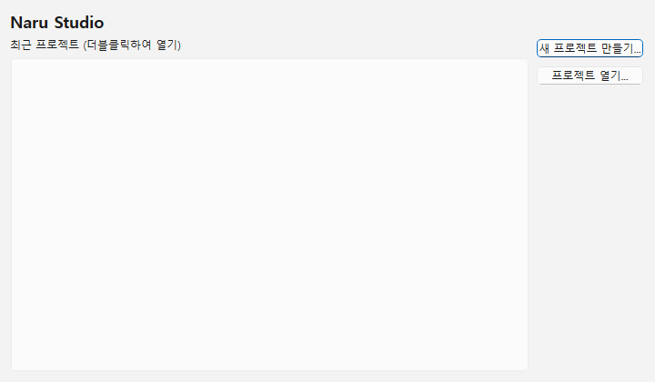

- **새 프로젝트 만들기…** — 프로젝트 이름과 저장 위치를 입력하면 `저장 위치/프로젝트 이름` 폴더가 만들어집니다. 시작 장면 하나와 예제 객체(주인공, 상자), 예제 데이터(아이템 2개, 몬스터 1개), 예제 스크립트 `main.py`가 들어 있습니다.
- **프로젝트 열기…** — `project.json`이 들어 있는 폴더를 고릅니다.
- **최근 프로젝트** — 더블클릭해서 엽니다. 회색 항목은 폴더를 찾을 수 없는 프로젝트입니다.

작업 중 **파일 → 프로젝트 닫기**를 누르면 이 화면으로 돌아옵니다.

> 프로젝트 파일이 손상됐거나 더 새로운 버전의 형식이면, 어느 파일의 무엇이 문제인지 알려 주고 열지 않습니다.
> 예: `scenes/scene_001.json: 형식 오류: 'x'은(는) 숫자이어야 합니다`

---

## 3. 장면 편집

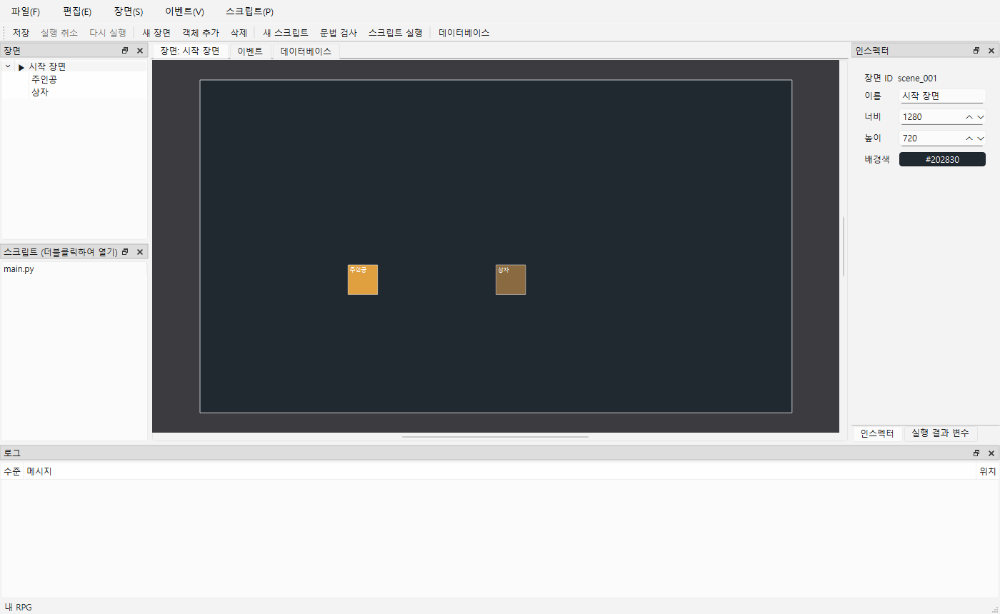

| 위치 | 이름 | 하는 일 |
|---|---|---|
| 왼쪽 위 | **장면** 트리 | 장면 목록(▶가 시작 장면)과 장면 안의 객체(★가 플레이어). 클릭하면 선택, 객체를 더블클릭하면 이벤트 탭이 열림 |
| 왼쪽 아래 | **스크립트** | `scripts/` 폴더의 `.py` 파일. 더블클릭하면 편집 탭이 열림 |
| 가운데 | **장면 캔버스** | 객체를 마우스로 끌어서 배치. 휠로 확대/축소 |
| 오른쪽 | **인스펙터** | 선택한 객체의 이름·X·Y·너비·높이·색·**플레이어**·**통과**. 아무것도 선택하지 않으면 장면의 이름·크기·배경색 |
| 아래 | **로그** | 실행 기록과 오류. 오류 줄을 더블클릭하면 해당 스크립트 행으로 이동 |

**자주 하는 작업**

- 객체 추가: 툴바 **객체 추가** (Ctrl+N) — 화면 가운데에 생깁니다.
- 객체 삭제: 캔버스나 트리에서 선택 후 **Delete**.
- 장면 추가: 툴바 **새 장면**. 시작 장면 바꾸기: **장면 → 시작 장면으로 지정**.
- 되돌리기/다시 하기: **Ctrl+Z / Ctrl+Y** — 배치, 속성, 이벤트 편집 모두 해당됩니다.
- 저장: **Ctrl+S** — 프로젝트와 열린 스크립트를 모두 저장합니다. 저장하지 않은 변경이 있으면 창 제목에 `*`가 붙습니다.
- **플레이어 정하기**: 객체를 선택하고 인스펙터의 **플레이어 — 방향키로 조작**을 켭니다. 장면마다 하나이며, 다른 객체를 켜면 그쪽으로 바뀝니다. 새 프로젝트에서는 "주인공"이 플레이어입니다 (트리·캔버스에 ★ 표시).
- **지나갈 수 있는 객체**: 인스펙터의 **통과 — 지나갈 수 있음**을 켜면 게임에서 플레이어가 그 위를 지나갈 수 있습니다 (바닥 표시·함정·출입구 등). 끄면 벽처럼 막습니다. 캔버스에서는 점선 테두리로 보입니다.

---

## 4. 이벤트 편집

캔버스나 트리에서 객체를 **더블클릭**(또는 선택 후 **Enter**)하면 **이벤트** 탭이 열립니다. 새 프로젝트의 "상자"에는 예제 이벤트가 들어 있습니다.

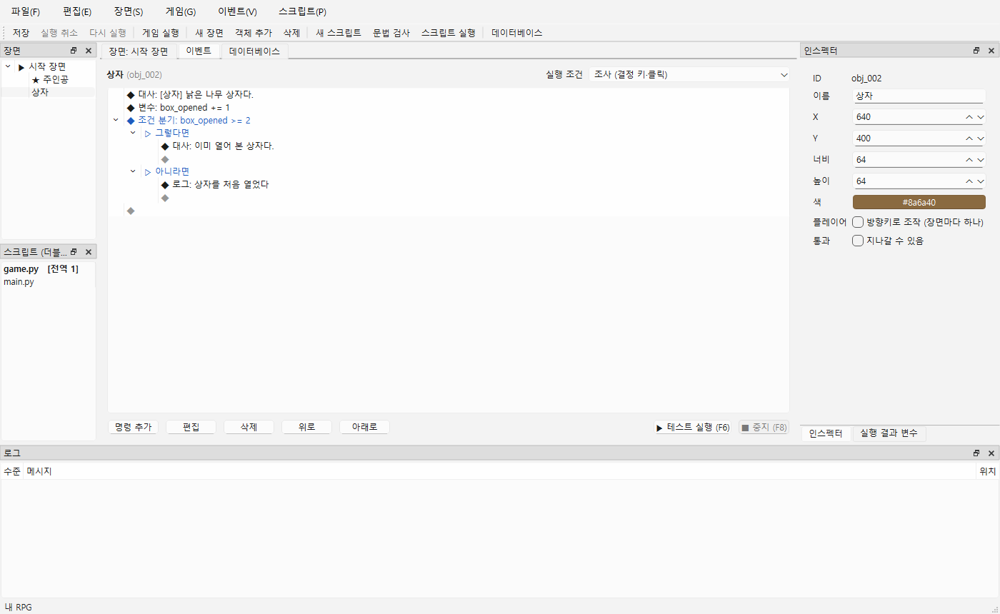

### 화면 읽는 법

- `◆ 대사: …` 처럼 한 줄이 명령 하나이며 위에서 아래로 실행됩니다.
- **조건 분기**는 아래에 **▷ 그렇다면 / ▷ 아니라면** 두 갈래가 있고, 각 갈래 안에 명령을 넣습니다. 분기 안에 분기를 또 넣을 수 있습니다.
- 각 목록 끝의 빈 **◆** 줄은 "여기에 추가" 자리입니다.
- 오른쪽 위 **실행 조건** (RPG Maker의 시동 트리거와 같습니다). [게임 실행](#7-게임-실행) 화면에서 아래처럼 동작합니다.

  | 실행 조건 | 언제 실행되나 (지금 동작) |
  |---|---|
  | 조사 (결정 키·클릭) | 플레이어가 이 객체를 바라보고 바로 앞(16px 안)에서 결정 키를 누를 때. 통과 가능한 객체는 위에 서서 눌러도 됨. *클릭은 아직 없음* |
  | 플레이어 접촉 | 플레이어가 이 객체에 부딪힐 때(막는 객체) 또는 위로 들어설 때(통과 가능한 객체). 계속 밀거나 서 있는 동안은 다시 실행하지 않음 |
  | 자동 실행 (장면 시작) | 장면이 시작되면 조작을 막고 객체 순서대로 하나씩 실행 (컷신) |
  | 이벤트 접촉 | 플레이어 접촉의 경우 + **이 객체가 움직여 플레이어에게 닿을 때** (예: 다가오는 몬스터). 객체를 움직이는 것은 지금은 스크립트(`move`) — 이벤트 명령은 다음 단계 |
  | 병렬 처리 | 장면이 시작되면 다른 행동을 막지 않고 함께 실행 |

  조사·접촉·자동 실행 이벤트가 실행되는 동안에는 플레이어가 움직이지 않습니다. 반복 조건(스위치)이 아직 없어 자동 실행·병렬 처리는 장면에 들어올 때 한 번 실행됩니다.

### 명령 추가·편집

1. 빈 **◆** 줄을 더블클릭합니다. 또는 명령을 선택하고 **명령 추가**를 누르면 선택한 명령 **위에** 들어갑니다.
2. 메뉴에서 명령 종류를 고릅니다.
3. 입력 창에 내용을 넣고 OK를 누릅니다.

| 대사 표시 | 조건 분기 | 스크립트 호출 |
|---|---|---|
| 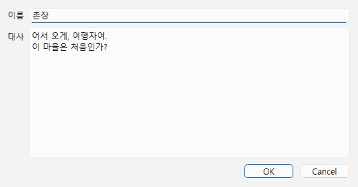 | 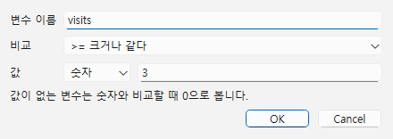 | 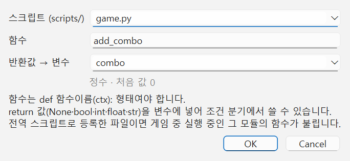 |

명령을 **더블클릭**하면 다시 편집합니다. **삭제 / 위로 / 아래로** 버튼으로 정리하고, 실수하면 Ctrl+Z를 누릅니다.

### 명령 종류

| 명령 | 하는 일 | 참고 |
|---|---|---|
| **대사 표시** | 이름과 대사를 보여 주고, 플레이어가 넘길 때까지 기다림 | 여러 줄 가능 |
| **대기** | 지정한 초만큼 기다림 | |
| **변수 조작** | `=` 대입, `+=` 더하기, `-=` 빼기 | 값: 숫자·문자열·참/거짓·없음. 없는 변수에 더하면 0부터 시작 |
| **조건 분기 (변수)** | 변수를 값과 비교해서 그렇다면/아니라면 중 하나 실행 | `== != < <= > >=`. 없는 변수는 숫자와 비교할 때 0 |
| **데이터 → 변수** | 데이터베이스 항목의 속성 값을 변수에 넣음 | 예: 몬스터 slime의 hp → `enemy_hp`. 그 뒤 조건 분기로 비교 |
| **스크립트 호출** | `scripts/`의 Python 파일에서 함수 실행 | 함수 형태: `def 함수이름(ctx):`. **반환값 → 변수**를 정하면 `return` 값이 그 변수에 들어감 ([6장](#이벤트와-스크립트가-값을-주고받는-법)) |
| **로그 남기기** | 로그 창에 메시지 기록 | 확인·디버깅용 |
| **주석** | 메모. 실행하지 않음 | 초록색으로 표시 |

### 테스트 실행

**▶ 테스트 실행 (F6)** 을 누르면 이벤트가 바로 실행됩니다.

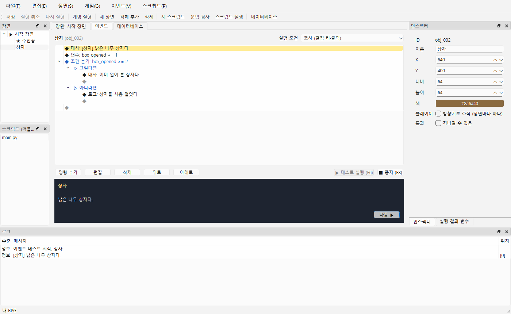

- 지금 실행 중인 명령이 **노란색**으로 표시됩니다.
- 대사는 아래 미리보기 창에 나오며 **다음 ▶**(또는 Enter)으로 넘깁니다.
- **■ 중지 (F8)** 로 언제든 멈출 수 있습니다.
- 끝나면 오른쪽 **실행 결과 변수** 탭에서 변수 값을 확인할 수 있습니다.
- 오류가 나면 해당 명령이 **빨간색**으로 선택되고 로그에 이유가 나옵니다. 예: `변수 'name': 문자열에 정수을(를) 뺄 수 없습니다`
- 테스트 실행은 매번 **변수가 비어 있는 상태**로 시작합니다. 그래서 예제 상자는 항상 "처음 열었다" 쪽으로 갑니다.

---

## 5. 데이터베이스

**데이터베이스** 탭(F9, 툴바 "데이터베이스")에서 게임에 쓰는 정보를 관리합니다. RPG Maker와 달리 캐릭터·아이템·몬스터의 구조가 정해져 있지 않습니다. **어떤 정보를 어떤 속성으로 둘지 직접 정합니다.** "스킬", "퀘스트", "카드", "날씨"처럼 무엇이든 만들 수 있습니다.

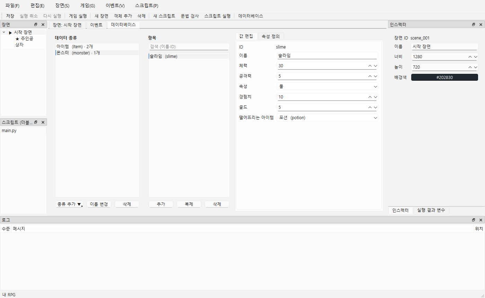

화면은 왼쪽부터 3단입니다.

| 단 | 이름 | 하는 일 |
|---|---|---|
| 1 | **데이터 종류** | 몬스터, 아이템 같은 묶음. `이름 (키) · 항목 수` |
| 2 | **항목** | 그 종류에 속한 것들 (슬라임, 고블린…). 위의 검색 칸으로 이름·ID 검색 |
| 3 | **값 편집 / 속성 정의** | 선택한 항목의 값 입력 / 이 종류가 가질 속성 목록 |

### 데이터 종류 만들기

**종류 추가 ▼**를 누르고 고릅니다.

- **빈 데이터 종류** — 속성 없이 시작해서 직접 만듭니다.
- **템플릿: 캐릭터 / 아이템 / 몬스터** — 자주 쓰는 속성이 미리 들어 있습니다. *템플릿은 출발점일 뿐이라 속성을 마음대로 추가·삭제·변경할 수 있습니다.*

이름(예: 몬스터)과 **키**(영문, 예: `monster`)를 입력합니다. 키는 이벤트·스크립트가 데이터를 찾을 때 쓰므로 **만든 뒤에는 바꿀 수 없습니다**. 이름은 언제든 바꿀 수 있습니다.

### 속성 정의하기

**속성 정의** 탭에서 이 종류의 모든 항목이 가질 속성을 정합니다. 더블클릭하거나 **편집**을 누르면 고칠 수 있습니다.

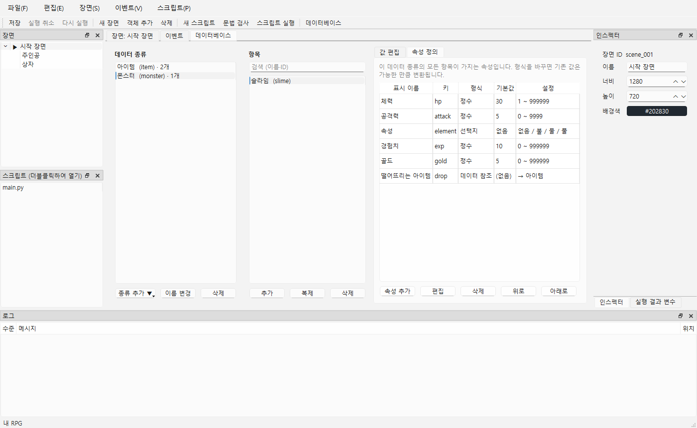

| 속성 형식 | 쓰는 곳 | 추가 설정 |
|---|---|---|
| **정수** | 체력, 레벨, 가격 | 최소·최대 |
| **실수** | 이동 속도 1.5, 확률 0.25 | 최소·최대 |
| **문자열** | 설명, 그림 파일 이름 | |
| **참/거짓** | 사용하면 사라짐, 보스 여부 | |
| **선택지** | 속성(불/물/풀), 분류 | 선택지 목록 (한 줄에 하나) |
| **데이터 참조** | 몬스터가 떨어뜨리는 아이템, 캐릭터의 기본 무기 | 참조할 데이터 종류 |

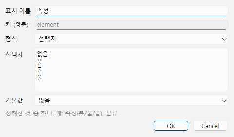

- **키**(영문)는 스크립트에서 `slime["hp"]`처럼 쓰는 이름입니다. 만든 뒤에는 바꿀 수 없습니다.
- **기본값**: 항목에 값을 따로 입력하지 않으면 이 값을 씁니다.
- 속성의 **형식을 바꾸면** 기존 값을 가능한 만큼 변환합니다 (예: 정수 250 → 문자열 "250"). 바꿀 수 없는 값이 있으면 몇 개인지 알려 주고, 계속하면 그 값은 기본값으로 돌아갑니다.
- 다른 데이터가 참조하고 있는 종류는 삭제할 수 없습니다. 먼저 참조하는 속성을 정리하세요.

### 항목 입력하기

가운데 **추가**를 누르고 이름(예: 슬라임)과 ID(영문, 예: `slime`)를 입력합니다. **복제**는 선택한 항목을 복사합니다. 오른쪽 **값 편집**에서 속성 값을 입력하면 바로 반영되며 Ctrl+Z로 되돌릴 수 있습니다.

- 데이터 참조 속성은 목록에서 대상 항목을 고릅니다.
- 범위를 벗어난 값, 없어진 항목을 가리키는 참조 등은 화면 아래에 **⚠ 확인이 필요한 곳 N건**으로 표시됩니다. 마우스를 올리면 전체 목록이 보입니다. 저장은 막지 않습니다.

### 이벤트·스크립트에서 쓰기

- **이벤트**: **데이터 → 변수** 명령으로 값을 변수에 넣은 뒤 조건 분기 등에서 씁니다.

  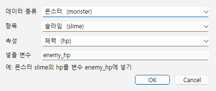

- **스크립트**:

  ```python
  def run(ctx):
      slime = ctx.db.get("monster", "slime")      # 없으면 None
      ctx.log(f'{slime["name"]} 체력 {slime["hp"]}')
      drop = ctx.db.get("item", slime["drop"])    # 참조는 항목 ID 문자열
      for item_id in ctx.db.ids("item"):          # 항목 ID 목록
          ctx.log(ctx.db.get("item", item_id)["price"])
  ```

  `ctx.db.get(...)`이 돌려주는 사전에는 `"id"`, `"name"`과 모든 속성이 들어 있습니다. 값을 입력하지 않은 속성은 기본값입니다. 데이터베이스는 실행 중에 읽기만 합니다.

---

## 6. Python 스크립트

### 기본

스크립트 목록에서 파일을 더블클릭하면 편집 탭이 열립니다. **새 스크립트…** 로 파일을 만들 수 있습니다.

```python
def run(ctx):
    count = ctx.variables.get("visits", 0) + 1   # 게임 변수 읽기 (없으면 0)
    ctx.variables.set("visits", count)           # 게임 변수 쓰기
    ctx.log(f"방문 횟수: {count}")                # 로그
    print("print도 로그 창에 나옵니다")
```

- **F5** — 스크립트 탭에서는 그 파일을, 장면 탭에서는 `scripts/main.py`를 실행합니다.
- **F7** — 실행하지 않고 문법만 검사합니다. 전역 스크립트면 다른 전역 스크립트와 변수 이름이 겹치는지도 봅니다.
- 오류가 나면 해당 **행이 선택**되고 로그에 `파일:행`이 표시됩니다. 로그 줄에 마우스를 올리면 전체 traceback이 보입니다.
- `scripts/` 폴더는 **프로젝트 전체 공용**입니다. 어느 장면의 이벤트에서든 같은 스크립트를 부를 수 있습니다.

### 이벤트와 스크립트가 값을 주고받는 법

| 방법 | 어떻게 | 언제 쓰나 |
|---|---|---|
| **게임 변수** | 스크립트: `ctx.variables.set("bought", True)` → 이벤트: 조건 분기 `bought == true` | 기본. 이벤트·이벤트 스크립트·전역 스크립트가 **모두 같은 게임 변수**를 씀 |
| **반환값 → 변수** | 스크립트 호출 명령의 **반환값 → 변수** 칸에 `result` → 함수에서 `return 3` | 계산 결과 하나를 바로 받을 때 |
| **전역 스크립트의 함수 호출** | 스크립트 호출에서 전역 스크립트 파일(예: `game.py`)과 함수를 고름 | 전역 스크립트가 가진 **파이썬 전역 변수**(예: `combo`)를 바꿀 때 |
| **import** | 아무 스크립트에서 `import game` → `game.combo += 1` | 다른 스크립트에서 전역 스크립트의 값·함수를 쓸 때 |

> **게임 변수와 파이썬 변수는 다릅니다.** 이벤트(조건 분기·변수 조작)에서 이름으로 쓸 수 있는 것은 `ctx.variables`에 넣은 **게임 변수**뿐입니다. 스크립트 안의 `count = 3` 같은 파이썬 변수는 이벤트에서 보이지 않습니다. 여러 곳이 함께 쓰고 나중에 저장(세이브)되어야 하는 값은 게임 변수에 두세요.

- 변수·반환값에 넣을 수 있는 값: `None`, `True/False`, 정수, 실수, 문자열.
- 데이터베이스 읽기: `ctx.db.get(종류키, 항목ID)`, `ctx.db.ids(종류키)`, `ctx.db.types()` — [5장](#이벤트스크립트에서-쓰기) 참고.

### 전역 스크립트

**전역 스크립트**는 장면·이벤트와 상관없이 **게임 전체에서 실행**되는 스크립트입니다. RPG Maker의 플러그인처럼 여러 개를 등록하고 순서를 정할 수 있습니다. 새 프로젝트에는 예제 `game.py`가 등록되어 있습니다 (Shift를 누르면 빨리 달리기).

**등록하기**: 메뉴 **스크립트 → 전역 스크립트…** 에서 체크하고 **위로/아래로**로 순서를 정합니다. 또는 스크립트 목록에서 **오른쪽 클릭 → 전역 스크립트로 사용**. 등록된 파일은 목록에 **굵게 `[전역 1]`** 로 표시됩니다. 등록 변경도 Ctrl+Z로 되돌릴 수 있습니다.

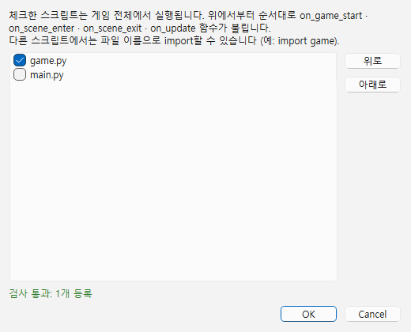

**훅 함수**: 아래 이름의 함수가 있으면 게임이 부릅니다. 필요한 것만 만들면 됩니다. 여러 전역 스크립트에 같은 훅이 있으면 등록 순서대로 모두 불립니다. **자동으로 불리는 것은 이 4개 이름뿐**입니다. 이름이 조금이라도 다르면(`onUpdate` 등) 불리지 않고, 그 밖의 함수(`add_combo` 등)는 이벤트의 "스크립트 호출"이나 다른 코드가 불러야 실행됩니다. 함수 밖에 쓴 코드는 게임 시작 때 한 번 실행됩니다.

| 함수 | 언제 |
|---|---|
| `on_game_start(ctx)` | 게임을 시작할 때 한 번 (첫 장면에 들어가기 전, `ctx.scene`·`ctx.player`는 None) |
| `on_scene_enter(ctx)` | 장면에 들어온 직후 (그 장면의 자동 실행 이벤트보다 먼저) |
| `on_scene_exit(ctx)` | 다른 장면으로 가기 직전 |
| `on_update(ctx)` | 매 프레임 (1/60초마다), 엔진 기본 조작보다 먼저 |

```python
# scripts/game.py — 전역 스크립트
WALK_SPEED = 240
DASH_SPEED = 420
combo = 0                                   # 게임 실행 중 유지되는 파이썬 전역 변수

def on_game_start(ctx):
    ctx.input.bind("dash", ["Shift"])       # 새 동작 "dash"를 Shift에 연결

def on_update(ctx):
    # 기본 조작(이동·조사)은 엔진이 하고, Shift를 누르는 동안만 빨라지게 덧붙인다
    if ctx.player:
        ctx.player.speed = DASH_SPEED if ctx.input.held("dash") else WALK_SPEED

def add_combo(ctx):                         # 이벤트의 "스크립트 호출: game.py · add_combo()"
    global combo
    combo += 1
    return combo                            # 반환값 → 변수로 받으면 조건 분기에 쓸 수 있다
```

**다른 객체 움직이기**: 인스펙터 맨 위의 **ID**(예: `obj_002`)로 객체를 가져와 움직입니다. 충돌 규칙은 플레이어와 같고, 움직이다 플레이어에게 닿으면 그 객체의 **이벤트 접촉** 이벤트가 실행됩니다.

```python
def on_update(ctx):
    slime = ctx.scene.object("obj_002")      # ID로 객체 가져오기 (없으면 None)
    if slime and ctx.player:
        # 플레이어가 오른쪽에 있으면 +1, 왼쪽에 있으면 -1 픽셀씩 매 프레임 다가간다
        slime.move(1 if ctx.player.x > slime.x else -1, 0)
```

더 많은 예제(순찰·밀기·문 열기)는 [docs/examples](../examples/README.md)에 있습니다.

**기본 조작을 끄고 직접 만들기**: `ctx.player.default_control = False`로 끄면 엔진이 방향키 이동·결정 키 조사를 하지 않습니다. 그 대신 `on_update`에서 `ctx.player.move(dx, dy)`(충돌·접촉 이벤트 포함), `ctx.player.interact()`(앞의 객체 조사)로 직접 처리합니다.

**검사 규칙** (어기면 오류로 알림 — 게임 시작 시 로그, F7, 등록 창):

- 등록된 전역 스크립트끼리 **파일 최상위 변수 이름이 같으면 안 됩니다** (예: 두 파일 모두 `combo = 0`). 오류에 두 위치가 함께 나옵니다. 훅 함수, `import`한 이름, `_`로 시작하는 이름은 겹쳐도 됩니다.
- 파일 이름이 Python 표준 모듈과 같으면 안 됩니다 (예: `random.py`) — `import`가 꼬입니다.
- 오류가 난 훅은 로그에 한 번 보고하고, 그 실행 동안 그 스크립트의 그 훅은 다시 부르지 않습니다 (`on_update` 오류가 매 프레임 쌓이지 않게).

> 파이썬 전역 변수는 **게임 실행 동안만** 유지되고, 게임을 다시 실행하면 파일을 새로 읽습니다. 에디터의 이벤트 테스트(F6)는 게임 밖이라 전역 스크립트 함수도 매번 새로 읽어 실행하며, `ctx.player`·`ctx.input`·`ctx.scene`은 None입니다.

### ctx로 쓸 수 있는 것

> 기본값·범위·실행 순서까지 포함한 전체 목록은 **[스크립트 API 레퍼런스(docs/SCRIPT_API.md)](../SCRIPT_API.md)** 에 있습니다. 아래는 요약입니다.

| 이름 | 내용 | 게임 밖(F5·F6) |
|---|---|---|
| `ctx.variables.get(이름, 기본값)` / `.set(이름, 값)` | 게임 변수 | 사용 가능 |
| `ctx.db.get / ids / types` | 데이터베이스 (읽기 전용) | 사용 가능 |
| `ctx.log(메시지)`, `ctx.warning(메시지)`, `print()` | 로그 | 사용 가능 |
| `ctx.input.held(동작)` / `.pressed(동작)` | 누르고 있는가 / 이번 프레임에 새로 눌렀는가 | None |
| `ctx.input.bind(동작, [키...])`, `.keys(동작)`, `.actions()` | 키 배치 바꾸기, 새 동작 만들기 | None |
| `ctx.player.x / y / speed / facing / default_control` | 플레이어 위치·속도(픽셀/초)·방향(`"down"` 등)·기본 조작 (바꿀 수 있음) | None |
| `ctx.player.move(dx, dy)`, `.interact()`, `.id`, `.name` | 충돌을 따지는 이동, 조사 | None |
| `ctx.scene.id / name / width / height`, `.change(장면ID)`, `.ids()` | 현재 장면, 장면 이동 (이번 프레임이 끝난 뒤) | None |
| `ctx.scene.object(ID)`, `.find(이름)`, `.objects()` | 장면의 객체 가져오기 (없으면 None) | None |
| 객체`.x / y / passable / color`, `.move(dx, dy)`, `.id / name / width / height / is_player` | 다른 객체(NPC·상자 등) 위치·통과·색 바꾸기, 충돌을 따지는 이동 | None |
| `ctx.busy` | 대사나 조작을 막는 이벤트가 진행 중인가 | False |

**동작 이름**: 기본은 `up` `down` `left` `right` `confirm` `cancel`. `bind`로 새 이름(영문 소문자·숫자·_)을 만들 수 있습니다.
**키 이름**: `A`~`Z`, `0`~`9`, `Up` `Down` `Left` `Right`, `Space`, `Return`(=`Enter`), `Escape`(=`Esc`), `Tab`, `Backspace`, `F1`~`F12`, `Left Shift`/`Right Shift`(둘 다 `Shift`), `Left Ctrl`/`Right Ctrl`(`Ctrl`), `Left Alt`/`Right Alt`(`Alt`). 대소문자는 가리지 않습니다.

> 아직 `async def`(대사나 이동을 기다리는 스크립트)는 지원하지 않습니다. 대기가 필요한 연출은 이벤트 명령을 쓰세요.

---

## 7. 게임 실행

**Ctrl+R** (또는 툴바 **게임 실행**, 메뉴 게임 → 게임 실행)을 누르면 프로젝트를 저장한 뒤 **지금 보고 있는 장면부터** 게임 창(NaruPlayer)이 뜹니다. 편집 화면은 그대로 두고 따로 실행되므로, 게임 창을 닫으면 바로 편집을 이어 갈 수 있습니다.

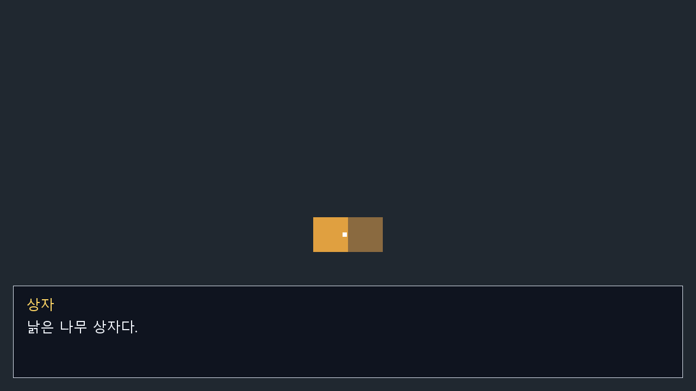

**조작 (코딩 없이 바로 동작하는 기본 조작)**

| 키 | 하는 일 |
|---|---|
| 방향키 또는 W A S D | 플레이어 이동 (대각선 가능). 막는 객체와 장면 가장자리에서 멈춤 |
| Z / Enter / Space | 바라보는 앞의 객체 **조사**, 대사 넘기기 |
| 창 닫기 | 게임 종료 (제작툴의 게임 → 게임 중지도 같음) |

- 플레이어(★)는 바라보는 쪽 가장자리에 흰 점이 표시됩니다. 이미지·걷기 애니메이션은 이미지 기능(P3)과 함께 추가합니다.
- 실행 조건별 동작은 [4장의 표](#화면-읽는-법)를 보세요. 예: 새 프로젝트에서 주인공을 오른쪽으로 움직여 상자에 붙은 뒤 Z를 누르면 상자 이벤트가 실행됩니다.
- 이벤트의 로그·오류는 제작툴 아래 **로그** 패널에 `[게임]`을 붙여 표시됩니다. 스크립트 오류 줄을 더블클릭하면 해당 파일·행으로 이동합니다.
- 실행 중에 바뀐 위치·변수는 편집 데이터에 남지 않습니다.

- 이동 속도(기본 초당 240px)·키 배치·기본 조작 켜기/끄기는 [전역 스크립트](#전역-스크립트)에서 바꿉니다. 전역 스크립트의 로그·오류도 로그 패널에 나옵니다.

> 대사 글꼴은 Windows의 맑은 고딕을 사용합니다. 키 배치를 바꾸는 설정 화면(코딩 없이)은 아직 없습니다.

---

## 8. 단축키 모음

| 키 | 기능 |
|---|---|
| Ctrl+R | 게임 실행 (현재 장면부터) |
| Ctrl+S | 저장 (프로젝트 + 스크립트) |
| Ctrl+Z / Ctrl+Y | 실행 취소 / 다시 실행 |
| Ctrl+N | 객체 추가 |
| Delete | 선택한 객체 삭제 (캔버스·트리에서) |
| Enter | 선택한 객체의 이벤트 편집 (캔버스에서) |
| F5 | 스크립트 실행 |
| F6 / F8 | 이벤트 테스트 실행 / 중지 |
| F7 | 스크립트 문법 검사 |
| F9 | 데이터베이스 탭 |
| 마우스 휠 | 캔버스 확대/축소 |
| Ctrl+Q | 종료 |

전체 목록(마우스 조작 포함): [단축키 모음](../SHORTCUTS.md)

---

## 9. 아직 안 되는 것

- 객체 이미지·음원 가져오기 (지금은 색 사각형). 데이터베이스의 이미지 속성도 이것과 함께 추가 예정
- 게임 화면: 클릭으로 조사, 객체 이동(이벤트 접촉의 "객체가 닿을 때"), 이벤트 반복 조건(스위치), 키 설정 화면(지금은 전역 스크립트의 `ctx.input.bind`로)
- 공통 이벤트(어디서나 부르는 이벤트)
- 객체 이동·숨기기를 이벤트 명령으로 (지금은 스크립트로만 이동), 스크립트에서 대사 띄우고 기다리기(`async`)
- 선택지, 장면 이동, 이미지·소리·이동 연출 명령
- 데이터베이스: 목록/묶음 속성, 표(스프레드시트) 보기, 실행 중 값 변경, 항목 ID 바꾸기
- 프로젝트 공용 변수 정의 (테스트 실행은 매번 빈 변수로 시작)
- 게임 내보내기(배포)

---

## 부록: 그림 다시 찍기

설명서 그림은 툴의 촬영 옵션으로 만듭니다. 화면이 바뀌면 빌드 후 아래 명령으로 다시 찍습니다 (PowerShell, 저장소 폴더에서). 촬영 모드에서는 최근 프로젝트 목록과 개인 폴더 경로가 찍히지 않습니다.

```powershell
$exe = "build\windows-msvc\bin\NaruStudio.exe"
$img = (Resolve-Path docs\guide\images).Path
$p = "build\windows-msvc\test_projects\guide\내 RPG"   # 비어 있는 새 위치여야 함
& $exe --start-screen --screenshot "$img\01-start.png"
& $exe --new-project $p --smoke-test 1500 --screenshot "$img\02-scene.png"
& $exe $p --event obj_002 --smoke-test 1500 --screenshot "$img\03-event.png"
& $exe $p --event obj_002 --run-event --smoke-test 1500 --screenshot "$img\04-event-run.png"
& $exe --command-dialog say --screenshot "$img\05-command-say.png"
& $exe --command-dialog if_variable --screenshot "$img\06-command-if.png"
& $exe --command-dialog call_script --screenshot "$img\07-command-script.png"
& $exe $p --database monster/slime --smoke-test 1500 --screenshot "$img\08-database.png"
& $exe $p --database monster --fields-tab --smoke-test 1500 --screenshot "$img\09-database-fields.png"
& $exe --field-dialog --screenshot "$img\10-field-dialog.png"
& $exe $p --global-scripts-dialog --screenshot "$img\13-global-scripts.png"
& $exe --command-dialog get_data --screenshot "$img\11-command-getdata.png"
# 게임 화면: 주인공을 80프레임 동안 오른쪽으로 움직여 상자 앞에서 결정 키
& build\windows-msvc\bin\NaruPlayer.exe $p --frames 100 --hold right:0-80 --hold confirm:85-85 --screenshot "$img\12-game.png"
```
