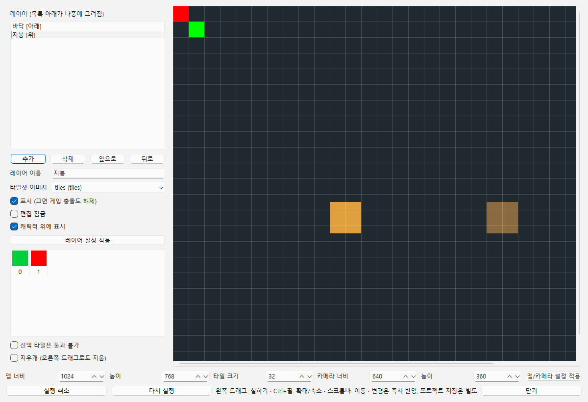
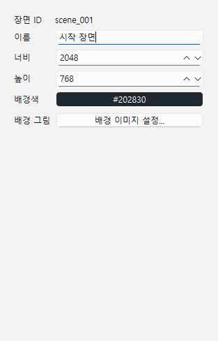
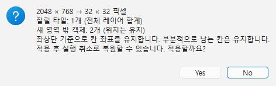

# 레이어 타일맵과 카메라

**장면 선택 → 장면 → 타일맵·레이어 편집...**에서 바닥·장식·지붕을 칠합니다. 기존 객체·플레이어·이벤트는 장면 캔버스에서 배치하며 타일맵과 함께 사용합니다.

## 맵을 만드는 순서

1. 에셋 목록에 타일셋 PNG/JPG/BMP를 추가합니다. 같은 크기의 칸으로 배열한 이미지입니다. 가장자리의 불완전한 칸은 사용하지 않습니다.
2. 장면을 선택하고 **타일맵·레이어 편집...**을 엽니다. 먼저 맵 너비·높이(픽셀), 타일 크기(8~256px), 카메라 너비·높이(64~4096px)를 입력하고 **맵/카메라 설정 적용**을 누릅니다. 맵 크기는 32~32768px입니다.
3. **추가**로 레이어를 만들고 이름·타일셋 이미지를 지정한 뒤 **레이어 설정 적용**을 누릅니다. 레이어는 최대 32개이며 기본 이름은 레이어 1, 레이어 2 순서입니다.
4. 팔레트에서 타일을 선택하고 오른쪽 맵에서 왼쪽 드래그로 칠합니다. 오른쪽 드래그 또는 지우개를 켜고 왼쪽 드래그하면 지웁니다. 한 번의 드래그가 하나의 Undo입니다.
5. 레이어를 선택하고 **앞으로/뒤로**로 목록 순서를 바꿉니다. 목록 아래가 나중에 그려집니다. 이름과 위/아래 그룹이 함께 표시됩니다.
6. 타일을 선택하고 **선택 타일은 통과 불가**를 켜면 해당 레이어에서 그 타일을 칠한 모든 칸이 이동을 막습니다. 이미지 자체를 바꾸지는 않습니다.
7. 창 아래 **실행 취소/다시 실행**을 사용합니다. 닫기는 변경을 취소하지 않습니다. 변경은 문서에 즉시 반영되며 프로젝트 저장은 Ctrl+S로 별도 수행합니다.

Ctrl+휠로 확대/축소하고 스크롤바로 넓은 맵을 이동합니다. 편집 창의 객체는 위치 확인용 색 사각형으로 표시됩니다. 장면 캔버스와 실제 게임에서는 기존 객체 이미지가 표시됩니다.

## 레이어 규칙

| 설정 | 동작 |
|---|---|
| 표시 | 끄면 편집·게임에서 그리지 않고 해당 레이어의 타일 충돌도 해제 |
| 편집 잠금 | 타일 칠하기·지우기 차단. 게임 표시·충돌은 유지. 설정 변경·삭제는 가능 |
| 캐릭터 위에 표시 | 켜면 모든 장면 객체 위, 끄면 모든 객체 아래. 같은 그룹 안에서는 목록 순서를 따름 |
| 삭제 | 확인 창 후 레이어 전체 제거. Undo 가능 |
| 타일셋 | 레이어마다 이미지 1개. 팔레트는 최대 4096칸, 각 레이어는 최대 262144개의 칠한 셀 |

레이어 설정은 적용 버튼을 누를 때 반영됩니다. 타일셋을 교체하면 칸 번호와 충돌 지정은 유지되므로 같은 배열의 이미지를 사용하고 결과를 확인하세요. 파일을 읽지 못하거나 칸 번호가 이미지 범위를 벗어나면 그림은 생략하며 지정된 충돌은 유지합니다. 사용 중인 에셋 제거는 막고 에셋 ID 변경은 레이어 참조와 Undo까지 반영합니다. Python 문자열은 직접 수정합니다.

타일을 칠한 뒤에도 **맵/카메라 설정 적용** 또는 **장면 선택 → 오른쪽 인스펙터의 너비·높이**로 맵 크기를 변경할 수 있습니다. 인스펙터에서도 입력은 잠기지 않으며 숫자를 입력하고 Enter를 누르거나 다른 칸으로 이동하면 확인 창이 나옵니다. 기존 타일은 좌상단 기준의 칸 좌표를 유지하고 확장 영역은 빈 칸입니다. 축소할 때 새 맵 밖의 타일은 제거하며 확인 창에서 전체 레이어의 잘릴 타일 수와 새 영역 밖에 남는 객체 수를 표시합니다. 일부라도 맵 안에 남는 마지막 칸은 유지합니다. 객체를 자동 이동·삭제하지 않습니다. 취소하면 문서와 인스펙터 값이 원래대로 돌아오고, 승인 후 한 번 Undo로 크기와 잘린 타일을 함께 복원합니다. 전용 창에서 카메라까지 함께 바꾼 경우 카메라도 함께 복원합니다.

인스펙터 그림 재촬영은 `NARU_MAP_INSPECTOR_SCREENSHOT`에 그림의 절대 경로를 지정하고 편집기 검사 실행 파일을 실행합니다.

칠한 맵의 **타일 크기** 변경은 계속 제한합니다. 타일셋 자르기 기준도 바뀌므로 빈 맵에서 먼저 정하세요. 자동 타일 연결·다중 칸 붓·채우기·타일별 방향 통과·높이 정렬·시차 배경·애니메이션 타일은 후속입니다.

## 게임 실행과 카메라

Ctrl+R은 시작 장면, Ctrl+Shift+R은 현재 장면부터 실행합니다. 카메라는 플레이어 중심을 따라가고 맵 경계에서 멈춥니다. 맵이 카메라보다 작으면 좌상단에 고정되고 남는 화면은 장면 배경색입니다. 배경 이미지는 맵 좌표에 놓여 카메라와 함께 움직입니다. 대사·선택지는 화면에 고정됩니다. 플레이어 없는 장면은 좌상단을 표시합니다. 이전 프로젝트의 카메라 0/0은 장면 전체 표시를 유지합니다.

타일 충돌은 엔진의 기존 이동 규칙을 사용합니다. 보이는 통과 불가 타일은 플레이어·이벤트·Python 객체 이동을 막습니다. 통과 가능 또는 숨김 객체는 막히지 않습니다. 큰 이동도 벽을 건너뛰지 않으며 처음부터 겹친 벽에서는 빠져나올 수 있습니다. 타일은 조사·접촉 이벤트의 대상이 아니므로 문·NPC 등은 기존 장면 객체로 배치합니다.

새 Python/이벤트 명령은 추가하지 않습니다. [기존 객체 이동·게임 실행 예제](PYTHON_COOKBOOK.md)와 [이벤트 명령](EVENTS.md)을 그대로 사용합니다. F5/F6는 게임 이동·카메라 검증 수단이 아니며 실제 게임에서 확인합니다. 실행 중 변경은 편집 문서에 반영되지 않습니다.

## 예제와 직접 확인

`docs/examples/tilemap`은 자체 생성한 타일 이미지로 구성한 2048×1024 맵, 640×360 카메라, 바닥·벽·지붕 3개 레이어 예제입니다. 사본에서 시험하세요. 새 사본은 저장소 루트에서 `python tools/create_tilemap_example.py build/manual-tilemap`으로 만들 수 있습니다. 기존 폴더는 덮어쓰지 않습니다.

1. 예제를 열고 레이어 편집 창에서 바닥·벽·지붕을 선택합니다. 타일을 칠하고 지운 뒤 한 번 Undo/Redo로 드래그 전체가 취소·복원되는지 확인합니다.
2. 레이어 추가·이름 변경·순서 변경·삭제와 Undo를 확인합니다. 잠금을 켜면 칠하기/지우기가 막히고 게임 표시는 유지되어야 합니다.
3. 지붕의 위 표시를 끄고 켜서 객체를 가리는 순서가 바뀌는지 확인합니다. 표시를 끄면 해당 레이어 그림·충돌이 모두 해제되어야 합니다.
4. 게임에서 방향키로 이동해 x=384의 벽 타일에 막히는지 확인합니다. 벽 타일의 통과 불가를 끄고 다시 실행하면 통과해야 합니다.
5. 큰 맵의 끝으로 이동해 카메라 추적·경계 정지, 이름표·배경·대사의 좌표를 확인합니다. 작은 맵에서도 좌상단과 여백을 확인합니다.
6. Ctrl+S → 닫기 → 다시 열기 후 레이어·타일·충돌·카메라 설정이 유지되는지 확인합니다. 기존 이벤트와 객체 이미지를 함께 시험합니다.

수동 확인은 자동 검사와 별도로 기록합니다. [보류 중인 수동 테스트 모음](MANUAL_TESTS.md)에 크기 변경 확인·취소·복원 절차도 있습니다. 그림 재촬영은 `NARU_TILEMAP_SCREENSHOT`을 편집기 그림의 절대 경로로, `NARU_TILEMAP_RESIZE_SCREENSHOT`을 크기 변경 확인 그림의 절대 경로로 지정하고 `build/windows-msvc/bin/naru_asset_editor_tests.exe`를 실행합니다. 게임 그림은 `NaruPlayer.exe docs/examples/tilemap --frames 2 --screenshot docs/guide/images/51-tilemap-game.png`로 촬영합니다.
